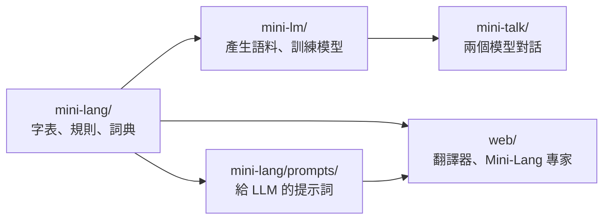

# mini-lm

**Mini-Lang**：只用 297 個漢字、說法自然的受限中文；以及用它來訓練、研究小型語言模型的 **mini-lm**。

```zh
我家有一個 dog（會看家、會叫的小東西）。今天天氣很好，我們和 dog 去河邊看樹和鳥。
```

這句話的每一個漢字都在 Mini-Lang 的 297 字裡；字表外的東西用英文外來語，第一次出現時附上說明。

* 線上版（翻譯器與 Mini-Lang 專家）：<https://mini-lang-expert.ccckmit.workers.dev/>
* 目前的字集：[doc/charset.md](doc/charset.md)

## 這個專案有什麼

| 資料夾 | 內容 |
|---|---|
| [mini-lang/](mini-lang/) | Mini-Lang 語言本身：字表與語法規格、通用版（翻譯任何中文）、詞典、讀音、給 LLM 的提示詞、檢查與翻譯工具 |
| [mini-lm/](mini-lm/) | 字元級 Transformer：語料產生、預訓練、問答微調、實驗程式 |
| [mini-talk/](mini-talk/) | 兩個 Mini-Lang 模型互相問答，並從對話中學習 |
| [web/](web/) | 網頁：規則翻譯器（純前端），以及用 GLM 5.3 Flash 的 Mini-Lang 專家 |
| [doc/](doc/) | 說明文件、實驗紀錄與論文 |



## 目前的字集：297 字（第 3 版）

| 類別 | 字數 | 類別 | 字數 | 類別 | 字數 |
|---|---:|---|---:|---|---:|
| 代詞・指示 | 15 | 時間 | 17 | 性質 | 32 |
| 語法 | 38 | 方位 | 17 | 事物 | 102 |
| 數量 | 16 | 動作 | 57 | 社交 | 3 |

* **選字原則：** 收「用其他字描述不出來、加入後又能組出很多詞」的字（例如綠、藍、聲、海、樹、鳥、動、物、法、力）；能用其他字輕易說出來的不收（容易 → 不難、但是 → 可是）。
* **數字**用阿拉伯數字 0–9；**第三人稱**只用「他」；**被、把、雖然**這類結構字不收，用固定的替代說法。
* **版本：** 第 1 版 256 字 → 第 2 版 247 字（數字改用阿拉伯數字）→ 第 3 版 297 字（加 60 字、刪 10 字）。

每個字的拼音與意思、版本差異、常用字的替代說法與檢查方法，見 [doc/charset.md](doc/charset.md)。字表本身定義在 [mini-lang.md 的附錄](mini-lang/mini-lang.md#附錄完整字表)，其他地方都從那裡讀取或檢查。

## 快速開始

需要 Python 3（訓練模型另外需要 PyTorch；網頁測試需要 Node.js）。

**檢查一段文字是否只用 Mini-Lang 的字：**

```bash
python mini-lang/check.py "我家有一個 dog。"
```

**規則翻譯器（中文 ⇄ Mini-Lang，可標注拼音）：** 直接用瀏覽器打開 [web/index.html](web/index.html)。

**Mini-Lang 專家（用 LLM 回答問題、翻譯、寫文章）：** 需要 NVIDIA 的 API 金鑰。

```bash
export NVIDIA_API_KEY=...
python web/expert_server.py
```

再打開 <http://localhost:8766/mini-lang-expert.html>。說明見 [web/README.md](web/README.md)。

**訓練 Mini-Lang 小模型：**

```bash
cd mini-lm
python gen_minilang.py          # 產生語料到 corpus/minilang/
./run.sh corpus/minilang        # 預訓練 + 問答微調
python chat.py --ckpt runs/minilang/finetune.pt
```

更多參數見 [mini-lm/run.md](mini-lm/run.md)。

## Mini-Lang 的文件

| 文件 | 內容 |
|---|---|
| [doc/charset.md](doc/charset.md) | **目前的字集**：297 字一覽、版本歷史、選字原則、常用字怎麼說、怎麼檢查 |
| [mini-lang/mini-lang.md](mini-lang/mini-lang.md) | 基礎版規格：字表、構詞法、17 條句型規則、範例對話 |
| [mini-lang/universal.md](mini-lang/universal.md) | 通用版：翻譯任何中文文章的方法（描述、外來語、語法替代表、數字、專有名詞） |
| [mini-lang/examples.md](mini-lang/examples.md) | 翻譯範例：中文 → Mini-Lang 6 段、Mini-Lang → 中文 2 段 |
| [mini-lang/lexicon/](mini-lang/lexicon/) | 詞典：約 1,250 條一般中文詞的 Mini-Lang 說法 |
| [mini-lang/prompts/](mini-lang/prompts/) | 給 LLM 的系統提示詞與任務模板，以及實測結果 |
| [doc/charset-expansion.md](doc/charset-expansion.md) | 第 3 版字集是怎麼選出來的：分析方法與數據 |

## 研究紀錄

用 Mini-Lang 訓練小型語言模型的實驗與討論。**除了 glm-corpus.md 用第 3 版（297 字），其他實驗用的是第 1 版（256 字）的字表。**

| 文件 | 問題 |
|---|---|
| [doc/paper.md](doc/paper.md)（[PDF](doc/paper.pdf)） | 論文：以受限中文研究小型語言模型的泛化 |
| [doc/data-and-model-size.md](doc/data-and-model-size.md) | 資料要多大？把模型縮小，泛化會更好嗎？（縮放實驗） |
| [doc/best-model.md](doc/best-model.md) | 怎麼設計泛化最好的 Mini-Lang 模型？ |
| [doc/glm-corpus.md](doc/glm-corpus.md) | 請 GLM 5.3 Flash 大量寫 Mini-Lang 語料來訓練，模型會變好嗎？（第 3 版字表、英文人名、世界知識測試） |
| [doc/reversal.md](doc/reversal.md) | 學過「小明的老師是小花」，答得出「小花是誰的老師？」嗎？（反轉詛咒） |
| [doc/emergence.md](doc/emergence.md) | 字少，為什麼小模型還是得不到大模型那樣的泛化？ |
| [doc/generalization.md](doc/generalization.md) | 小模型為什麼泛化能力不足？ |
| [doc/small-models.md](doc/small-models.md) | 小模型為什麼沒有「智慧湧現」？ |
| [doc/understanding.md](doc/understanding.md) | 怎麼確定兩個語言模型理解了對方的話？ |
| [doc/slot-filling.md](doc/slot-filling.md) | 用 slot filling 判斷模型是否理解句子 |
| [doc/roadmap.md](doc/roadmap.md) | 改進路線圖 |
| [doc/applications.md](doc/applications.md) | Mini-Lang 小語言模型的發展與應用 |
| [mini-talk/talk.md](mini-talk/talk.md) | 兩個模型對話，能從對方學到知識嗎？ |

## 授權

[MIT License](LICENSE)
