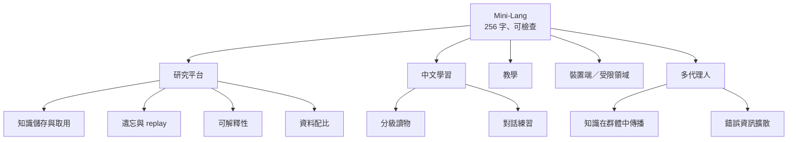

# Mini-Lang 小語言模型的發展與應用

> 問題：對於這個小語言模型，有什麼發展或應用的可能？
>
> 相關文件：[paper.md](paper.md)、[best-model.md](best-model.md)、[understanding.md](understanding.md)、[roadmap.md](roadmap.md)

## 結論

這個專案真正的價值，不在於模型本身能做什麼，而在於兩件事：

1. **一個「方向數得完」的語言。** 256 字、17 條規則、每句話都能用程式檢查。
2. **一個在筆電 CPU 上一小時就能跑完的完整實驗流程。** 包含產生語料、預訓練、微調、評估，以及兩個模型對話。

所以我最看好的兩個方向是：

| 優先 | 方向 | 理由 |
|---|---|---|
| 1 | **研究大型語言模型現象的「模式生物」** | 便宜、可控、有標準答案，大模型上的很多現象在這裡都能重現並逐一拆解 |
| 2 | **中文學習工具** | 這是 Mini-Lang 設計的初衷；但實際的對話者應該是「被 Mini-Lang 約束的大模型」，小模型負責檢查與分級 |

另外還有教學、裝置端應用、多代理人研究三個方向，價值也很高。

## 一、研究平台：大型語言模型的「模式生物」

生物學用果蠅、線蟲研究遺傳，因為牠們便宜、繁殖快、基因數得完。Mini-Lang 在語言模型研究上可以扮演同樣的角色：

* 每個事實、每種問法都由程式產生，**每個問題都有標準答案**；
* 詞表只有約 270 個符號，**模型內部容易分析**；
* 640 萬參數的模型在 CPU 上約一小時訓練完，**可以跑很多次**。

已經在本專案觀察到、可以繼續深入的現象：

| 現象 | 本專案的觀察 | 下一步 |
|---|---|---|
| 知識儲存與取用（Allen-Zhu & Li） | 同一事實有多種說法，換句話問才答得出來（68% → 86%） | 系統性地改變說法數、小傳數，畫出曲線 |
| 反轉詛咒（reversal curse） | 還沒測 | 只訓練「小明的朋友是小花」，問「小花是誰的朋友？」 |
| 災難性遺忘 | 微調太久會沖掉部分事實；mini-talk 混入原本問答可防止大部分遺忘 | 比較 replay 比例、LoRA、凍結層 |
| 資料配比 | 方向語句只佔 10%，卻讓所有方向的 loss 減半 | 找最佳配比，再檢驗它能不能轉移到更大的語言（類似 DoReMi） |
| Grokking | 還沒測 | 小資料、長時間訓練，看驗證集會不會突然上升 |
| 理解的行為測試 | 不通順的問題照樣作答 | 實作 [understanding.md](understanding.md) 與 [slot-filling.md](slot-filling.md) 的測試 |

**可解釋性特別適合。** 事實是誰的、在哪一層、由哪些神經元儲存，都可以用探針（probe）或因果介入（activation patching）去找。例如：把「小明」的某一層表示換成「小花」的，看答案會不會跟著換。大模型上很難做乾淨的實驗，在這裡答案是已知的。

## 二、中文學習工具

Mini-Lang 原本就是為了「用 256 字跟學中文的人溝通」而設計的。不過要老實說：**640 萬參數的模型沒有能力當真正的對話老師**。比較可行的分工是：

| 角色 | 由誰負責 |
|---|---|
| 產生內容、和學習者對話 | 大型語言模型，**解碼時把字表外的字的機率設為 0**（constrained decoding），保證輸出只用 256 字 |
| 檢查是否只用字表、是否符合 17 條語法 | `check.py` 加上小模型（小模型可以給出「這句話在 Mini-Lang 中有多自然」的分數） |
| 依程度分級 | 字表可以再切成 64、128、256 字三級，每級都是下一級的子集 |

可以做的產品：

* **分級讀物產生器**：依學習者目前會的字，產生「幾乎全懂、只有少數新字」的短故事（Krashen 的 i+1）。方向語料中的短篇故事就是原型。
* **對話練習**：買東西、問路、看醫生等情境，正好對應 13 個方向。
* **改寫器**：把一般中文改寫成 Mini-Lang，讓初學者讀得懂新聞或說明。
* **反過來的用途**：給中文母語者寫「對外國人友善的中文」，例如公告、醫療說明，類似英文的 Plain English。

## 三、教學

整個流程只有幾百行 Python，從 tokenizer、Transformer、預訓練、微調、評估到兩個模型對話都有，而且：

* 一台筆電就能訓練，學生可以自己改參數重跑；
* 每個實驗都有明確的對照組，例如縮放實驗、四種資料設定；
* 實驗結果會推翻直覺，例如「縮小模型能逼它學規則」是錯的，很適合課堂討論。

可以做成一學期的課：每週一個實驗，最後學生各自設計一種新的方向語料，看能讓模型進步多少。

## 四、裝置端與受限領域

* **體積小。** 每個字元都是 1 個位元組的符號；640 萬參數的模型用 8 位元量化約 6 MB，可以放進手機、甚至較強的微控制器。
* **輸出可驗證。** 受限語言的每一句話都能用程式檢查，不會冒出字表外的詞。這和航空用語、Simplified Technical English 的精神相同：犧牲表達力，換取不會誤解。
* 適合的場景：家電、玩具、導覽機、緊急廣播等**詞彙有限、但要求可靠**的對話。

限制是領域外的問題會答錯，所以一定要搭配「我不知道」的訓練。mini-talk 已經示範模型能學會這件事。

## 五、多代理人研究

mini-talk 目前只有兩個模型，可以擴充成一個群體：

| 實驗 | 要回答的問題 |
|---|---|
| N 個模型、各知道一部分人，隨機兩兩交談 | 知識要經過幾輪才傳遍整個群體？和傳染病模型一樣嗎？ |
| 讓其中一個模型帶有錯誤事實 | 錯誤資訊會擴散多遠？其他模型能不能靠「多數決」修正？ |
| 模型只用彼此的輸出繼續訓練很多代 | 語言會不會退化（model collapse）？會不會偏離 256 字？ |
| 移除字表限制，獎勵溝通成功 | 會不會發展出自己的「新語言」？（湧現式溝通） |

本專案的對話中已經有 3% 的答案是錯的，而學習時模型會把聽到的答案照單全收，沒有任何查證。所以「錯誤資訊在模型群體中擴散」這個實驗馬上就能做，而且和現在大量模型用彼此輸出訓練的現實問題直接相關。

## 六、建議的順序

| 階段 | 工作 | 成本 |
|---|---|---|
| 1 | 反轉詛咒與遺忘實驗、多個亂數種子 | 現有程式加幾個參數，數小時 |
| 2 | 多代理人知識傳播與錯誤擴散 | 擴充 mini-talk，一兩天 |
| 3 | 可解釋性：找出事實存在哪裡 | 需要寫探針工具 |
| 4 | 中文學習：大模型 + 字表約束解碼 + 分級讀物 | 需要使用者測試，是另一個專案 |

前三項都能直接延伸成新的論文章節。第四項最有實用價值，但需要真正的學習者參與評估。

## 參考文獻

* Allen-Zhu & Li (2023). *Physics of Language Models: Part 3.1, Knowledge Storage and Extraction.*
* Berglund et al. (2023). *The Reversal Curse: LLMs trained on "A is B" fail to learn "B is A".*
* Power et al. (2022). *Grokking: Generalization Beyond Overfitting on Small Algorithmic Datasets.*
* Xie et al. (2023). *DoReMi: Optimizing Data Mixtures Speeds Up Language Model Pretraining.*
* Shumailov et al. (2024). *AI models collapse when trained on recursively generated data.* Nature.
* Krashen (1985). *The Input Hypothesis: Issues and Implications.*
* Meng et al. (2022). *Locating and Editing Factual Associations in GPT.*
