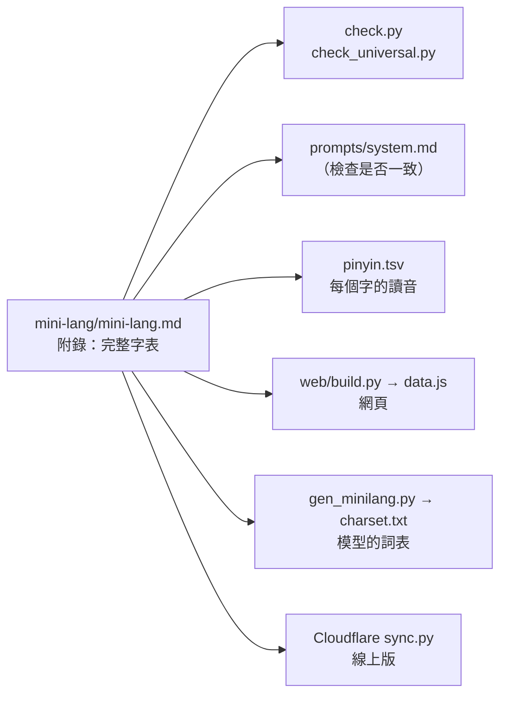

# Mini-Lang 字集（第 3 版，297 字）

> Mini-Lang 目前的字集：哪 297 個字、為什麼是這些字、字集以外還能用什麼、常用但不在字集裡的字怎麼說，以及怎麼檢查。
>
> 字集只在一個地方定義：[mini-lang.md 的附錄](../mini-lang/mini-lang.md#附錄完整字表)。其他所有地方（檢查工具、網頁、提示詞、語料）都從那裡讀取或檢查。

## 結論

* **297 個漢字**，分成 9 類。數字用阿拉伯數字 0–9，不算在字集裡。
* **選字原則：** 收「用其他字描述不出來、加入後又能組出很多詞」的字；能用其他字輕易說出來的字不收。
* **第三人稱只用「他」**（不分他、她、它）；被、把、雖然這類結構字不收，用固定的替代說法。
* **字集以外的東西用英文外來語：** 描述不出「是哪一個」的東西（例如 dog、coffee、Beijing），第一次出現時加上只用 297 字的說明。
* **三個版本：** 第 1 版 256 字 → 第 2 版 247 字（數字改用阿拉伯數字）→ 第 3 版 297 字（加 60 字、刪 10 字）。

## 一、字集一覽

| 類別 | 字數 | 用途 | 字 |
|---|---:|---|---|
| 代詞・指示 | 15 | 我、你、他、這、那、什麼、怎麼樣 | 我你他們這那誰什麼哪怎樣自己每 |
| 語法 | 38 | 的、了、嗎、不、因為所以、可以 | 的了過嗎呢吧不沒是有在和也都很太最更還就再會能要可以得給對從到為因所果只起比 |
| 數量 | 16 | 一、兩、百千萬、量詞、數、量 | 一百千萬兩幾半第個些次點塊歲數量 |
| 時間 | 17 | 年月日、今明昨、早晚、分鐘、週 | 年月日天時候今明昨早晚午現分鐘週先 |
| 方位 | 17 | 上下左右前後裡外、東南西北 | 上下左右前後裡外中間東西南北邊方地 |
| 動作 | 57 | 來去、吃喝、說聽看寫、笑哭、死活 | 來去走坐站住回進出開關拿放用做作說話聽看見寫學教問叫想知道懂記覺喜歡愛吃喝睡買賣找等幫穿洗玩打生完動死活笑哭怕跳唱 |
| 性質 | 32 | 大小、好壞、冷熱、顏色、甜苦 | 大小多少長高老好壞新快慢冷熱難真忙病重遠近白黑紅色樂貴綠藍甜苦圓 |
| 事物 | 102 | 人、家人、身體、食物、自然、動物、器物、抽象概念 | 人男女子孩爸媽哥姐弟妹朋友師家名字身體頭手眼口心水火山雨氣電車路門房書衣服錢飯菜茶肉花校醫店國文語事題工腦機飛意思聲音光味海河風雲雪冰星石土樹草空金鳥魚蟲馬牛豬雞蛋腳臉牙鼻髮血物球紙刀木城法理力兒歌畫詞句 |
| 社交 | 3 | 請、謝、歡迎 | 請謝迎 |
| **合計** | **297** | | |

每個字的拼音、意思和例詞，見第八節的完整字表。

## 二、字集以外還能用的

| 種類 | 能用的 | 例子 |
|---|---|---|
| 數字 | 阿拉伯數字 0–9 | 3個、22歲、2026年3月5日、下午3點20分、20% |
| 標點 | 中文標點 | ，。、？！：；「」（）《》 |
| 單位與符號 | 國際單位、數學符號 | km、kg、°C、%、+、= |
| 外來語 | 英文詞（只在描述說不出「是哪一個」時用） | dog、coffee、Beijing、Einstein |

**數字的規則：** 計數、日期、時間、年齡、價錢一律用阿拉伯數字。「一、兩」只用在冠詞與固定說法（一個人、一樣、一起、兩點）；「百、千、萬」可以當單位（3千、2萬）。

**外來語的規則：** 第一次出現時，後面用括號加上只用 297 字的說明，之後直接用：

```zh
我家有一個 dog（會看家、會叫的小東西）。我天天和 dog 出去走走。
```

## 三、版本歷史

| 版本 | 字數 | 改了什麼 | 原因 |
|---|---:|---|---|
| 第 1 版 | 256 | 第一份字表，剛好 2⁸，一個字可以用一個位元組編碼 | 以日常溝通的核心需要為主 |
| 第 2 版 | 247 | 刪除 二、三、四、五、六、七、八、九、十（9 字） | 數字改用阿拉伯數字，這 9 個字可以完全代替 |
| **第 3 版（目前）** | **297** | 加入 60 字、刪除 10 字（見下方） | 依「描述不出來、加入後能組出很多詞」的原則調整 |

第 3 版**加入的 60 字：**

| 類別 | 字 | 加入後能寫的詞（例） |
|---|---|---|
| 顏色 | 綠 藍 | 綠色、藍天；和原有的紅、白、黑組合出其他顏色（紫色＝紅藍的色） |
| 聲音、光、味道 | 聲 音 光 味 甜 苦 | 聲音、音樂、月光、味道、吃苦 |
| 自然 | 海 河 風 雲 雪 冰 星 石 土 樹 草 空 金 | 海水、白雲、雪花、石頭、樹木、天空、空氣、金色 |
| 動物 | 鳥 魚 蟲 馬 牛 豬 雞 蛋 | 小鳥、馬上、馬路、牛肉、雞蛋 |
| 身體 | 腳 臉 牙 鼻 髮 血 | 手腳、洗臉、鼻子、頭髮 |
| 生命與動作 | 動 死 活 笑 哭 怕 跳 唱 | 動物、生活、可怕、心跳、唱歌 |
| 東西與材料 | 物 球 紙 刀 木 | 人物、地球、打球、木頭 |
| 地方 | 城 | 城裡、長城 |
| 抽象概念 | 法 理 力 數 量 圓 兒 | 方法、道理、能力、數學、重量、兒子 |
| 語文 | 歌 畫 詞 句 | 歌手、畫家、名詞、一句話 |

第 3 版**刪除的 10 字**，以及改用的說法：

| 刪除的字 | 原本的詞 | 改用 |
|---|---|---|
| 習 | 學習 | 學 |
| 但 | 但是 | 可是 |
| 言 | 語言 | 話、外語 |
| 情 | 事情、心情 | 事、心裡怎麼樣 |
| 如 | 如果、比如、不如 | 要是、比方說、沒有 |
| 短 | 短 | 不長 |
| 容 易 | 容易、不容易 | 不難、很難（最容易 → 最不難） |
| 跟 | 跟 | 和（跟我說 → 對我說） |
| 係 | 沒關係 | 沒事 |

完整的分析與數據見 [doc/charset-expansion.md](charset-expansion.md)。本專案的模型實驗（縮放、最佳模型、mini-talk、反轉詛咒）與論文用的是**第 1 版**的 256 字。

## 四、選字原則

1. **看「說不說得出來」，不看字頻。** 一個字要加入，必須同時符合：
   * **缺口：** 現在的字描述不出來（只能用外來語或很長的描述）；
   * **組合力：** 加入後能和其他字組出很多詞。
2. **能組合的就不加。** 例如顏色只收紅、綠、藍、白、黑，其他顏色用組合說。
3. **能輕易說出來的就刪。** 例如「容易」可以說「不難」，「但是」可以說「可是」。
4. **第三人稱只用「他」。**
5. **結構字先不加：** 被、把、著、已經、雖然、或、讓、才都不收，用固定的替代說法（見下一節）。
6. **字要組得出「真正的中文詞」：** 每一句 Mini-Lang 都必須是母語者讀得懂、說法自然的中文。

## 五、常用但不在字集裡的字，怎麼說

| 一般中文 | Mini-Lang 說法 |
|---|---|
| 她、它、牠、您 | 他、你 |
| 被 | 是…的、給、有人（這個書是他寫的、錢給他拿走了） |
| 把 | 拿…V（我拿書放在這裡） |
| 著 | 在、V 在那裡（他坐在那裡看書） |
| 已經 | …了、先…了 |
| 雖然…但是 | 是…，可是 |
| 如果…就 | 要是…就 |
| 跟、與 | 和 |
| 讓、使 | 叫、給（媽媽叫我回家） |
| 開始 | …起來（天冷起來了） |
| 越來越 | 一天比一天 |
| 一種 | 一樣、這樣的 |
| 別人 | 人家 |
| 跑 | 很快地走 |
| 累、餓、渴 | 想睡覺、想吃東西、想喝水 |
| 醫院、銀行、機場 | 看病的地方、放錢的地方、坐飛機的地方 |
| 前面、裡面 | 前邊、裡邊（方位一律用「邊」） |
| 一隻、一本、一張 | 一個（量詞只用個、些、次、點、塊、歲） |

更多換法：[universal.md 第 5 節](../mini-lang/universal.md#5-語法每一種中文結構的說法)（語法）與[詞典](../mini-lang/lexicon/)（約 1,250 條）。

## 六、怎麼檢查

```bash
python mini-lang/check.py "我家有一個 dog。"      # 檢查一句話
python mini-lang/check.py                       # 檢查 mini-lang.md 的字表與例句
python mini-lang/check_universal.py             # 檢查規格、範例、提示詞與詞典
```

網頁也會逐字檢查：[規則翻譯器](../web/index.html)會標出字表外的字；[Mini-Lang 專家](../web/mini-lang-expert.html)讓語言模型自己用檢查工具修正。線上版：<https://mini-lang-expert.ccckmit.workers.dev/>。

## 七、字集在哪裡定義、哪些地方跟著用



**改字集的步驟：** 改 mini-lang.md 的附錄與第 2 節的表格 → 補 pinyin.tsv 的讀音 → 改 prompts/system.md 的字表 → 執行 `check.py`、`check_universal.py` → `python web/build.py` 重新產生網頁資料 → 重新產生語料。

## 八、完整字表

拼音標的是 Mini-Lang 中最常用的讀音；一字多音時用斜線列出。

### 代詞・指示（15）

| 字 | 拼音 | 意思 | 例詞 |
|---|---|---|---|
| 我 | wǒ | I, me | 我們、自己 |
| 你 | nǐ | you | 你們、你好 |
| 他 | tā | he, she | 他們 |
| 們 | men | (plural) | 我們、你們、他們 |
| 這 | zhè | this | 這個、這裡、這樣 |
| 那 | nà | that | 那個、那裡、那樣 |
| 誰 | shéi | who | 是誰 |
| 什 | shén | (what) | 什麼 |
| 麼 | me | (suffix) | 什麼、怎麼 |
| 哪 | nǎ | which, where | 哪個、哪裡 |
| 怎 | zěn | how | 怎麼、怎麼樣 |
| 樣 | yàng | way, kind | 一樣、這樣、怎麼樣 |
| 自 | zì | self | 自己 |
| 己 | jǐ | self | 自己 |
| 每 | měi | every | 每天、每個人 |

### 語法（38）

| 字 | 拼音 | 意思 | 例詞 |
|---|---|---|---|
| 的 | de | 's, of | 我的、好的 |
| 了 | le | (done / change) | 吃了、好了 |
| 過 | guò / guo | pass; ever | 去過、過來 |
| 嗎 | ma | (yes/no question) | 好嗎、是嗎 |
| 呢 | ne | and…? | 你呢 |
| 吧 | ba | let's; right? | 走吧、好吧 |
| 不 | bù | not | 不是、不要、對不起 |
| 沒 | méi | not (have) | 沒有、沒事 |
| 是 | shì | be | 是的、不是、還是 |
| 有 | yǒu | have; there is | 沒有、有意思 |
| 在 | zài | at; (-ing) | 現在、在家 |
| 和 | hé | and | 我和你 |
| 也 | yě | also | 我也是 |
| 都 | dōu | all | 都好、每天都 |
| 很 | hěn | very | 很好、很多 |
| 太 | tài | too | 太大了、太太 |
| 最 | zuì | most | 最好、最大 |
| 更 | gèng | more | 更好、更多 |
| 還 | hái | still; or | 還有、還是、還好 |
| 就 | jiù | then; just | 就是、這就去 |
| 再 | zài | again | 再見、再來 |
| 會 | huì | can (skill); will | 會說、不會 |
| 能 | néng | be able | 能來、不能 |
| 要 | yào | want; will | 要去、不要、想要 |
| 可 | kě | can | 可以 |
| 以 | yǐ | (by means of) | 可以、所以、以前、以後 |
| 得 | de | (degree) | 說得好、記得、覺得 |
| 給 | gěi | give; for | 給我、給你看 |
| 對 | duì | right; toward | 對不起、不對、對他說 |
| 從 | cóng | from | 從家裡來 |
| 到 | dào | arrive; to | 到了、看到、到家 |
| 為 | wèi | for | 為什麼、因為 |
| 因 | yīn | cause | 因為 |
| 所 | suǒ | (so) | 所以 |
| 果 | guǒ | fruit; result | 水果 |
| 只 | zhǐ | only | 只有、只要 |
| 起 | qǐ | rise | 一起、起來、對不起 |
| 比 | bǐ | compare | 比他高 |

### 數量（16）

| 字 | 拼音 | 意思 | 例詞 |
|---|---|---|---|
| 一 | yī | one | 一個、一起、一樣、一點 |
| 百 | bǎi | hundred | 一百 |
| 千 | qiān | thousand | 3千 |
| 萬 | wàn | ten thousand | 一萬 |
| 兩 | liǎng | two (of) | 兩個、兩點 |
| 幾 | jǐ | how many | 幾個、幾點、幾歲 |
| 半 | bàn | half | 一半、兩點半 |
| 第 | dì | (ordinal) | 第1、第1次 |
| 個 | ge | (measure word) | 一個、這個 |
| 些 | xiē | some | 一些、這些、那些 |
| 次 | cì | time(s) | 一次、下次、上次 |
| 點 | diǎn | dot; o'clock; a bit | 3點、一點、快點 |
| 塊 | kuài | yuan; piece | 10塊、一塊 |
| 歲 | suì | years old | 10歲、幾歲 |
| 數 | shù / shǔ | number; count | 數字、數學、數一數 |
| 量 | liàng | amount | 重量、大量 |

### 時間（17）

| 字 | 拼音 | 意思 | 例詞 |
|---|---|---|---|
| 年 | nián | year | 今年、明年、去年 |
| 月 | yuè | month; moon | 一月、這個月 |
| 日 | rì | day; sun | 生日、日子 |
| 天 | tiān | day; sky | 今天、每天、天氣 |
| 時 | shí | time | 時間、時候、小時 |
| 候 | hòu | (time) | 時候 |
| 今 | jīn | this (time) | 今天、今年 |
| 明 | míng | next; bright | 明天、明年、明白 |
| 昨 | zuó | yesterday | 昨天 |
| 早 | zǎo | early; morning | 早上、早飯、你早 |
| 晚 | wǎn | late; evening | 晚上、晚飯、太晚了 |
| 午 | wǔ | noon | 中午、上午、下午 |
| 現 | xiàn | present | 現在 |
| 分 | fēn | minute; divide | 3點10分、分開 |
| 鐘 | zhōng | clock | 分鐘、10分鐘 |
| 週 | zhōu | week | 這週、下週、週1、週日 |
| 先 | xiān | first | 先生、先走 |

### 方位（17）

| 字 | 拼音 | 意思 | 例詞 |
|---|---|---|---|
| 上 | shàng | up; on; last | 上邊、早上、上次、上車 |
| 下 | xià | down; next | 下邊、下午、下次、下雨 |
| 左 | zuǒ | left | 左邊、左手 |
| 右 | yòu | right | 右邊、右手 |
| 前 | qián | front; before | 前邊、以前 |
| 後 | hòu | back; after | 後邊、以後、後天 |
| 裡 | lǐ | inside | 這裡、家裡 |
| 外 | wài | outside | 外邊、外國 |
| 中 | zhōng | middle | 中間、中國、中文 |
| 間 | jiān | between; room | 中間、時間、房間 |
| 東 | dōng | east | 東邊、東西 |
| 西 | xī | west | 西邊、東西 |
| 南 | nán | south | 南邊 |
| 北 | běi | north | 北邊 |
| 邊 | biān | side | 這邊、那邊、左邊 |
| 方 | fāng | direction; place | 地方 |
| 地 | dì / de | ground; (adverb) | 地方、地上、慢慢地 |

### 動作（57）

| 字 | 拼音 | 意思 | 例詞 |
|---|---|---|---|
| 來 | lái | come | 回來、起來、進來 |
| 去 | qù | go | 回去、出去、去年 |
| 走 | zǒu | walk; leave | 走路、走吧 |
| 坐 | zuò | sit; ride | 坐下、坐車 |
| 站 | zhàn | stand; station | 站起來、火車站 |
| 住 | zhù | live | 住在、記住 |
| 回 | huí | return | 回家、回來 |
| 進 | jìn | enter | 進來、進去 |
| 出 | chū | go out | 出去、出來 |
| 開 | kāi | open; drive | 開門、開車、開心 |
| 關 | guān | close | 關門、關上 |
| 拿 | ná | take, hold | 拿來、拿出去 |
| 放 | fàng | put | 放下、放在 |
| 用 | yòng | use | 不用、有用 |
| 做 | zuò | do; make | 做飯、做事 |
| 作 | zuò | work | 工作 |
| 說 | shuō | speak | 說話、小說 |
| 話 | huà | words | 說話、電話、中國話 |
| 聽 | tīng | listen | 好聽、聽見、聽懂 |
| 看 | kàn | look; read | 看書、好看、看見 |
| 見 | jiàn | see; meet | 看見、聽見、再見 |
| 寫 | xiě | write | 寫字 |
| 學 | xué | learn | 學生、學校、學會 |
| 教 | jiāo | teach | 教書 |
| 問 | wèn | ask | 請問、問題 |
| 叫 | jiào | call; be named | 叫做、叫他來 |
| 想 | xiǎng | think; want; miss | 想要、想家 |
| 知 | zhī | know | 知道 |
| 道 | dào | way | 知道 |
| 懂 | dǒng | understand | 看懂、聽懂 |
| 記 | jì | remember | 記得、記住 |
| 覺 | jué / jiào | feel; sleep | 覺得、睡覺 |
| 喜 | xǐ | joy | 喜歡 |
| 歡 | huān | glad | 喜歡、歡迎 |
| 愛 | ài | love | 愛人、可愛 |
| 吃 | chī | eat | 吃飯、好吃 |
| 喝 | hē | drink | 喝水、喝茶 |
| 睡 | shuì | sleep | 睡覺 |
| 買 | mǎi | buy | 買東西 |
| 賣 | mài | sell | 賣東西 |
| 找 | zhǎo | look for | 找到、找錢 |
| 等 | děng | wait | 等一下、等等 |
| 幫 | bāng | help | 幫忙、幫我 |
| 穿 | chuān | wear | 穿衣服 |
| 洗 | xǐ | wash | 洗手、洗手間 |
| 玩 | wán | play | 好玩、玩玩 |
| 打 | dǎ | hit; make (a call) | 打電話、打開 |
| 生 | shēng | be born; life | 生日、學生、先生、生病、生氣 |
| 完 | wán | finish | 做完、吃完、完了 |
| 動 | dòng | move | 動物、不動、動手 |
| 死 | sǐ | die | 死了 |
| 活 | huó | live | 生活、活動 |
| 笑 | xiào | laugh; smile | 笑了、大笑 |
| 哭 | kū | cry | 哭了 |
| 怕 | pà | fear | 可怕、不怕 |
| 跳 | tiào | jump | 跳起來、心跳 |
| 唱 | chàng | sing | 唱歌 |

### 性質（32）

| 字 | 拼音 | 意思 | 例詞 |
|---|---|---|---|
| 大 | dà | big | 大人、大家、大小 |
| 小 | xiǎo | small | 小孩、小時、小姐 |
| 多 | duō | many | 多少、很多 |
| 少 | shǎo | few | 多少、不少 |
| 長 | cháng | long | 很長 |
| 高 | gāo | tall, high | 很高、高山 |
| 老 | lǎo | old | 老師、老人 |
| 好 | hǎo | good | 你好、好吃、好看 |
| 壞 | huài | bad | 壞人、壞了 |
| 新 | xīn | new | 新年、新的 |
| 快 | kuài | fast | 快樂、快點、很快 |
| 慢 | màn | slow | 慢走、慢慢 |
| 冷 | lěng | cold | 很冷、冷水 |
| 熱 | rè | hot | 熱水、很熱 |
| 難 | nán | hard | 很難、難看 |
| 真 | zhēn | real | 真的、真好 |
| 忙 | máng | busy | 很忙、幫忙 |
| 病 | bìng | ill | 生病、看病 |
| 重 | zhòng | heavy; important | 很重 |
| 遠 | yuǎn | far | 很遠、不遠 |
| 近 | jìn | near | 很近 |
| 白 | bái | white | 白天、明白 |
| 黑 | hēi | black | 黑色、天黑 |
| 紅 | hóng | red | 紅色、紅茶 |
| 色 | sè | color | 白色、黑色、紅色 |
| 樂 | lè | happy | 快樂 |
| 貴 | guì | expensive | 太貴了、不貴 |
| 綠 | lǜ | green | 綠色、綠茶 |
| 藍 | lán | blue | 藍色、藍天 |
| 甜 | tián | sweet | 很甜 |
| 苦 | kǔ | bitter; hard | 很苦、吃苦 |
| 圓 | yuán | round | 圓圓的 |

### 事物（102）

| 字 | 拼音 | 意思 | 例詞 |
|---|---|---|---|
| 人 | rén | person | 大人、男人、外國人 |
| 男 | nán | male | 男人、男孩 |
| 女 | nǚ | female | 女人、女孩、女朋友 |
| 子 | zi | (suffix) | 孩子、日子、房子 |
| 孩 | hái | child | 孩子、小孩 |
| 爸 | bà | dad | 爸爸 |
| 媽 | mā | mom | 媽媽 |
| 哥 | gē | elder brother | 哥哥 |
| 姐 | jiě | elder sister | 姐姐、小姐 |
| 弟 | dì | younger brother | 弟弟 |
| 妹 | mèi | younger sister | 妹妹 |
| 朋 | péng | friend | 朋友 |
| 友 | yǒu | friend | 朋友、男朋友 |
| 師 | shī | teacher; master | 老師、醫師 |
| 家 | jiā | home; family | 回家、大家、國家 |
| 名 | míng | name | 名字、有名 |
| 字 | zì | character, word | 名字、寫字、中文字 |
| 身 | shēn | body | 身體 |
| 體 | tǐ | body | 身體 |
| 頭 | tóu | head | 頭上、後頭 |
| 手 | shǒu | hand | 左手、手機、洗手 |
| 眼 | yǎn | eye | 眼前 |
| 口 | kǒu | mouth; opening | 路口、門口、人口 |
| 心 | xīn | heart | 開心、小心、中心 |
| 水 | shuǐ | water | 喝水、水果 |
| 火 | huǒ | fire | 火車 |
| 山 | shān | mountain | 高山、山上 |
| 雨 | yǔ | rain | 下雨、大雨 |
| 氣 | qì | air | 天氣、生氣 |
| 電 | diàn | electricity | 電話、電腦、電車 |
| 車 | chē | vehicle | 開車、火車、電車 |
| 路 | lù | road | 走路、路口 |
| 門 | mén | door | 開門、門口 |
| 房 | fáng | house; room | 房間、房子 |
| 書 | shū | book | 看書、教書 |
| 衣 | yī | clothes | 衣服 |
| 服 | fú | clothes | 衣服 |
| 錢 | qián | money | 多少錢 |
| 飯 | fàn | meal; rice | 吃飯、早飯、飯店 |
| 菜 | cài | dish; vegetable | 做菜 |
| 茶 | chá | tea | 喝茶、紅茶 |
| 肉 | ròu | meat | 吃肉 |
| 花 | huā | flower; spend | 花錢、紅花 |
| 校 | xiào | school | 學校 |
| 醫 | yī | medicine | 醫生、醫師 |
| 店 | diàn | shop | 書店、飯店 |
| 國 | guó | country | 中國、外國、國家 |
| 文 | wén | writing | 中文、文字 |
| 語 | yǔ | language | 外語 |
| 事 | shì | matter | 做事、沒事 |
| 題 | tí | topic | 問題 |
| 工 | gōng | work | 工作、工人 |
| 腦 | nǎo | brain | 電腦 |
| 機 | jī | machine | 手機、飛機 |
| 飛 | fēi | fly | 飛機 |
| 意 | yì | meaning | 意思、不好意思 |
| 思 | si | thought | 意思 |
| 聲 | shēng | sound; voice | 聲音、大聲 |
| 音 | yīn | sound; tone | 音樂、口音 |
| 光 | guāng | light | 月光、日光 |
| 味 | wèi | taste; smell | 味道、口味 |
| 海 | hǎi | sea | 大海、海水 |
| 河 | hé | river | 河水、河邊 |
| 風 | fēng | wind | 大風、風雨 |
| 雲 | yún | cloud | 白雲 |
| 雪 | xuě | snow | 下雪、雪花 |
| 冰 | bīng | ice | 冰水 |
| 星 | xīng | star | 星星 |
| 石 | shí | stone | 石頭 |
| 土 | tǔ | soil | 土地 |
| 樹 | shù | tree | 大樹、樹木 |
| 草 | cǎo | grass | 草地、花草 |
| 空 | kōng / kòng | sky; empty; free time | 天空、空氣、有空 |
| 金 | jīn | gold | 金子、金色 |
| 鳥 | niǎo | bird | 小鳥 |
| 魚 | yú | fish | 魚肉 |
| 蟲 | chóng | insect; bug | 蟲子 |
| 馬 | mǎ | horse | 馬上、馬路 |
| 牛 | niú | cow; ox | 牛肉 |
| 豬 | zhū | pig | 豬肉 |
| 雞 | jī | chicken | 雞肉、雞蛋 |
| 蛋 | dàn | egg | 雞蛋 |
| 腳 | jiǎo | foot | 手腳 |
| 臉 | liǎn | face | 洗臉、臉紅 |
| 牙 | yá | tooth | 門牙 |
| 鼻 | bí | nose | 鼻子 |
| 髮 | fà | hair | 頭髮 |
| 血 | xuè / xiě | blood | 出血 |
| 物 | wù | thing | 動物、人物 |
| 球 | qiú | ball | 打球、地球 |
| 紙 | zhǐ | paper | 白紙 |
| 刀 | dāo | knife | 刀子 |
| 木 | mù | wood | 木頭、樹木 |
| 城 | chéng | city; town | 城裡、長城 |
| 法 | fǎ | method; way | 方法、想法 |
| 理 | lǐ | reason; principle | 道理、地理 |
| 力 | lì | strength; force | 能力、用力 |
| 兒 | ér | child; son | 兒子、女兒 |
| 歌 | gē | song | 唱歌 |
| 畫 | huà | picture; draw | 畫畫、畫家 |
| 詞 | cí | word | 名詞 |
| 句 | jù | sentence | 一句話、句子 |

### 社交（3）

| 字 | 拼音 | 意思 | 例詞 |
|---|---|---|---|
| 請 | qǐng | please | 請問、請坐、請進 |
| 謝 | xiè | thank | 謝謝、不用謝 |
| 迎 | yíng | welcome | 歡迎 |
