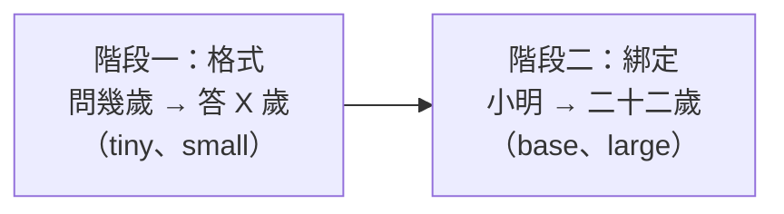

# 字少，為什麼小模型還是得不到大模型那樣的泛化？真的有智慧湧現嗎？

> 問題：Mini-Lang 只有 256 字，為什麼小語言模型在這麼小的字集上，還是得不到像大語言模型那樣的泛化能力？難道真的有「智慧湧現」？
>
> 相關文件：[small-models.md](small-models.md)（湧現的定義與「海市蜃樓」爭論）、[generalization.md](generalization.md)、[data-and-model-size.md](data-and-model-size.md)、[best-model.md](best-model.md)

## 結論

1. **字少不等於語言小。** 限制字集只減少了「符號」的數量，沒有減少世界的複雜度：要記的事實、句子的組合、要學的任務都還在。
2. **大模型的泛化，大部分來自「見過夠多方向」。** 我們的語料約 100 萬字，大模型是數兆個 token，差了上百萬倍。我們補上 13 個方向的語句後，模型對沒看過的句子的 loss 立刻減半。
3. **我們確實在縮放實驗中看到了像「湧現」的跳躍。** 在 16 倍資料下，模型從 15 萬參數增加到 108 萬參數時，答對率從 15% 跳到 91%。連續指標也一起跳，所以這不是評分方式造成的錯覺。
4. **但跳躍有很具體的原因，不是神祕的智慧。** 小模型百分之百學會了「答案的格式」，卻沒學會「把人名和他的事實連起來」。湧現比較像是**某個必要的內部機制，在容量和資料都夠了之後才形成**。
5. **大模型最特別的泛化（看幾個例子就會做新任務）需要大量不同的任務。** 我們的資料只有十幾種任務，所以不管模型多大，都不會出現這種能力。

## 一、字少不等於語言小

256 字能組出的東西並不少：

| 層次 | 數量 |
|---|---|
| 字 | 256 |
| 兩字的組合 | 256² ≈ 6.5 萬 |
| 本實驗的人名 | 256 個（由 16 個字兩兩組成） |
| 人物事實 | 256 人 × 7 種屬性 |
| 一般句子 | 模板可以產生約 9,600 種，自然語句更多 |

更重要的是，**事實是任意的**。「小明二十二歲」沒有任何規則可以推出來，只能記住。字表再小，也不會讓「記住 256 個人的 1,792 個事實，再用各種問法取出來」這件事變簡單。

用一個比喻：英文只有 26 個字母，但學英文並不因此比學中文簡單。難的從來不是符號，而是符號組成的東西。

## 二、大模型的泛化從哪裡來

大模型看起來「什麼都會」，主要是因為它**幾乎什麼都看過**：

| | 本專案（D） | 大型語言模型 |
|---|---:|---:|
| 預訓練語料 | 約 100 萬字 | 數兆個 token |
| 任務種類 | 十幾種 | 數不清 |
| 參數 | 640 萬 | 數百億到上兆 |

本專案的實驗一再顯示同一件事：**模型在資料有提供變化的方向上會泛化，在沒有提供的方向上不會。**

| 資料提供的變化 | 模型學會的泛化 |
|---|---|
| 同一種問題問 256 個人 | 沒練過的人的事實也答得出來（98.6%） |
| 同一個問題有多種問法 | 換一種問法也答得出來（68% → 86%） |
| 13 個生活方向的語句 | 沒看過的句子 loss 減半（6.74 → 3.30） |
| 沒有提供「兩者都新」的組合 | 兩者皆新只有 52–64% |

大模型也有一樣的弱點。例如反轉詛咒：只學過「A 是 B」，就答不出「B 是什麼」（Berglund et al., 2023）。本專案正在用 Mini-Lang 重做這個實驗（[experiments/reversal.py](../mini-lm/experiments/reversal.py)）。

所以，大模型和小模型的差別不在於「會不會泛化」，而在於**見過的方向多到幾乎涵蓋了我們會問的東西**。

## 三、實測：縮放實驗中的「湧現」

我們重新分析了縮放實驗的模型，在同一份驗證集（16 倍資料，358 題沒微調過的事實）上比較三種指標：

| 模型 | 參數 | 完全答對 | 整個答案的機率 | 每字正確機率 | 答案類型正確 |
|---|---:|---:|---:|---:|---:|
| tiny | 4 萬 | 19.0% | 7.9% | 64.7% | 100% |
| small | 15 萬 | 15.1% | 7.6% | 65.3% | 100% |
| base | 108 萬 | 90.8% | 74.7% | 94.8% | 100% |
| large | 640 萬 | 98.6% | 93.5% | 98.7% | 100% |

* 「整個答案的機率」是模型給正確答案（含結尾）的機率，取幾何平均。
* 「答案類型正確」是指問年齡就答「X 歲」、問住哪就答「X 邊」，即使答錯了內容。
* 「每字正確機率」在小模型也有 65%，因為「歲」「邊」和結尾符號這類格式字很好猜。

### 1. 這次不是評分方式造成的錯覺

Schaeffer et al.（2023）指出，很多「湧現」只是因為用了「完全答對才算」的評分，換成連續指標就變成平滑的曲線（見 [small-models.md](small-models.md#二湧現是什麼)）。

但在這裡，**連續指標也一起跳**：答案機率從 7.6% 跳到 74.7%，每字 loss 從 0.84 降到 0.10。所以這個跳躍是真的。

### 2. 跳的是什麼：從「格式」到「綁定」

小模型的答案**類型 100% 正確**，答對率卻和「猜最常見答案」差不多（約 25%）。它學會了：

* 問「幾歲」要回答「某某歲」；
* 問「住哪裡」要回答「某邊」。

但它沒學會**把「小明」這兩個字和小明的事實連起來**。base 以上的模型才學會這一步。

### 3. 為什麼要到某個大小才會綁定

要回答「小明幾歲？」，模型要做兩件事：

1. 把「小」「明」兩個字組成一個「人」的表示（256 個名字由 16 個字組成，很多名字共用字）；
2. 用這個表示，取出預訓練時讀過的事實。

**這不是記憶空間不夠。** 粗略估計 256 人的事實資訊量：年齡約 6 位元、朋友約 8 位元、其他屬性各 1.6–2 位元，每人約 23 位元，總共約 6,000 位元。Allen-Zhu & Li（2024）估計語言模型每個參數最多能存約 2 位元的知識，15 萬參數的 small 理論上存得下 30 萬位元。

所以我推測瓶頸在**計算**而不是**儲存**：small 只有 2 層、寬度 64，要在這麼少的層數裡完成「組字成名 → 用名字查事實」，而且還要同時學 8,000 多句一般句子，訓練 2,000 步不足以讓這條路徑形成。這只是推測，還沒有實驗證明。

### 4. 是門檻還是陡坡？還不知道

我們只有 4 種大小，相鄰兩種差了約 7 倍。15 萬到 108 萬之間可能是一個門檻，也可能是一條很陡但連續的曲線，只是我們沒有取樣到中間。要分辨，需要：

* 在 15 萬到 108 萬之間多訓練幾種大小；
* 記錄訓練過程中答對率的變化，看「綁定」是逐漸出現，還是在某一步突然出現。

## 四、所以，真的有智慧湧現嗎？

「湧現」這個詞包含三種不同的現象：

| 現象 | 說明 | 是否神祕 |
|---|---|---|
| 評分造成的錯覺 | 全有全無的評分，讓平滑的進步看起來像突然出現 | 不神祕 |
| 多個子能力相乘 | 一個任務需要 $k$ 個步驟都做對，成功率約 $p^k$。每一步都只是慢慢變好，整體卻像突然出現 | 不神祕 |
| 內部機制的相變 | 某個電路在訓練中突然形成，例如 induction head（Olsson et al., 2022）、grokking（Power et al., 2022） | 真的會突然出現，但小模型也有 |

本專案看到的是第三種的一個小例子：**「綁定」機制在模型夠大之後才形成。** 這和 induction head 一樣，是可以分析、可以解釋的機制，不是無法理解的「智慧」。

最值得注意的是：**這些相變在小模型上也會發生。** Induction head 在兩層的模型就會出現，grokking 最早是在很小的模型上觀察到的。所以「湧現」本身和模型大小沒有必然關係，而是**任務需要的機制，在容量與資料都足夠時才形成**。大模型之所以展現很多湧現能力，是因為它的資料裡有很多種任務，每一種都可能在某個大小形成對應的機制。

## 五、小模型缺的到底是什麼

大模型最讓人驚訝的泛化，是**看幾個例子就會做從沒練過的任務**（in-context learning）。Chan et al.（2022）發現，這種能力是否出現，取決於**資料的分布性質**：資料中要有大量不同的類別、很多罕見的項目、相關的例子要成群出現。

本專案的資料只有十幾種任務，模型永遠只需要「記住並取用」，從來不需要「從眼前的例子推出新規則」。所以：

| 缺的東西 | 本專案的狀況 | 加大模型能解決嗎 |
|---|---|---|
| 容量 | small 以下不夠綁定；large 已經足夠 | 能，而且已經解決 |
| 資料量 | 約 100 萬字 | 不能 |
| 方向的覆蓋 | 補上 13 個方向後大幅進步 | 不能 |
| 任務的多樣性 | 十幾種 | 不能，這是 in-context learning 的前提 |

**結論：在 Mini-Lang 上，現在的瓶頸已經不是模型大小，而是資料中任務的多樣性。** 字集小讓我們能數清楚每一個方向，但不會讓「學會學習」這件事自動發生。

## 六、可以做的實驗

| 實驗 | 要回答的問題 |
|---|---|
| 在 15 萬到 108 萬參數之間多訓練幾種大小 | 「綁定」是門檻還是陡坡？ |
| 記錄訓練過程中的答對率與 loss | 綁定是在訓練的某一步突然出現嗎？ |
| 加深但不加寬（或反過來） | 綁定需要的是層數還是寬度？ |
| 用探針找出「人名」的表示在哪一層形成 | 小模型是組不出名字，還是查不到事實？ |
| 在資料中加入「看例子做新任務」的格式 | 小模型能不能出現 in-context learning？ |

## 參考文獻

* Wei et al. (2022). *Emergent Abilities of Large Language Models.* TMLR.
* Schaeffer, Miranda & Koyejo (2023). *Are Emergent Abilities of Large Language Models a Mirage?* NeurIPS.
* Olsson et al. (2022). *In-context Learning and Induction Heads.* Transformer Circuits Thread.
* Power et al. (2022). *Grokking: Generalization Beyond Overfitting on Small Algorithmic Datasets.*
* Chan et al. (2022). *Data Distributional Properties Drive Emergent In-Context Learning in Transformers.* NeurIPS.
* Allen-Zhu & Li (2024). *Physics of Language Models: Part 3.3, Knowledge Capacity Scaling Laws.*
* Berglund et al. (2023). *The Reversal Curse: LLMs trained on "A is B" fail to learn "B is A".*
