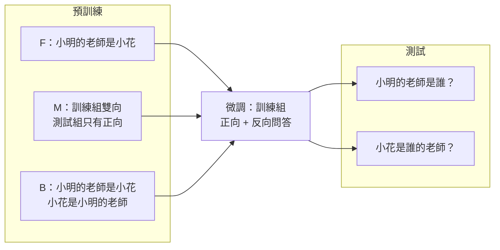
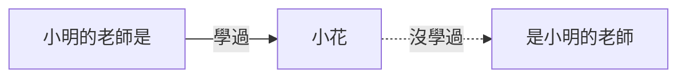

# 反轉詛咒：學過「小明的老師是小花」，答得出「小花是誰的老師？」嗎？

> 問題：大型語言模型有「反轉詛咒」（Berglund et al., 2023）：只學過「A 是 B」，就答不出「B 是什麼」。Mini-Lang 的小模型也會這樣嗎？看過別人的雙向例子，能不能學會「反過來想」？
>
> 程式：[experiments/reversal.py](../mini-lm/experiments/reversal.py)；數據：[reversal_results.csv](../mini-lm/experiments/reversal_results.csv)。相關文件：[applications.md](applications.md)、[emergence.md](emergence.md)

## 結論

1. **反轉詛咒在 640 萬參數的模型上完全重現。** 只學過「小明的老師是小花」的模型，被問「小花是誰的老師？」時，64 題答對 0 題。
2. **看別人的雙向例子也學不會反過來想。** 訓練組有雙向說法、測試組只有正向時（M），反向仍然 0/64。
3. **只要語料中有反向的說法，就答得出來。** 每一對都有雙向說法時（B），反向答對 35/64，和正向（33/64）差不多。
4. **模型不是「想不起來」，而是那個方向的知識根本不存在。** F 和 M 答反向問題時，從來沒有說出測試組學生的名字，只會說出微調時練過的答案。

## 一、設計

**世界：** 128 對師生，學生和老師的名字不重疊，每個老師只教一個學生，所以「小花是誰的老師？」只有一個答案。

**三種預訓練語料**（都另外混入一般句子、手寫句子與 13 個方向的語句，和[最佳模型 D](best-model.md) 相同）：

| 設定 | 訓練組 64 對 | 測試組 64 對 |
|---|---|---|
| F 只有正向 | 只有「小明的老師是小花。」這類學生在前的說法 | 同左 |
| M 部分雙向 | 正向 + 反向（「小花是小明的老師。」「小花在學校教小明。」） | 只有正向 |
| B 全部雙向 | 正向 + 反向 | 正向 + 反向 |

每個方向都有 4 種說法。

**微調：** 三種設定相同，只用訓練組，正向與反向的問題都練：

```
<Q>小明的老師是誰？<A>小花
<Q>小花是誰的老師？<A>小明
```

**測試：** 沒微調過的測試組 64 對，正反各問一次。另外讓還沒微調的預訓練模型直接續寫：「小明的老師是」→ 小花？「小花是」→ 小明？

**模型：** d=256、6 層、8 頭，640 萬參數；預訓練 2,000 步、微調 1,000 步。三個設定同時訓練，各約 32 分鐘。



## 二、結果

| 設定 | 訓練組 正向 | 訓練組 反向 | 測試組 正向 | **測試組 反向** | 續寫 正向 | **續寫 反向** |
|---|---:|---:|---:|---:|---:|---:|
| F 只有正向 | 64/64 | 64/64 | 24/64 | **0/64** | 38/64 | **0/64** |
| M 部分雙向 | 64/64 | 64/64 | 55/64 | **0/64** | 45/64 | **0/64** |
| B 全部雙向 | 64/64 | 64/64 | 33/64 | **35/64** | 43/64 | **34/64** |

亂猜一個測試組學生的答對率約 1/64。

### 答錯時說了什麼

| 設定 | 反向問題答成「訓練組的學生」 | 答成「測試組的學生」 |
|---|---:|---:|
| F | 61/64 | 0/64 |
| M | 55/64 | 0/64 |
| B | 21/64 | 40/64 |

F 和 M 從來沒有說出任何一個測試組學生的名字。測試組學生在預訓練中出現過很多次，但永遠只出現在「〇〇的老師是…」的**前面**。模型從來沒有學過「從老師的名字走到學生的名字」這條路，所以只能說出微調時練過的答案。

## 三、發現

### 1. 知識是有方向的

模型學到的不是「小明和小花是師生」這個關係，而是「看到『小明的老師是』，接下來是『小花』」。在只會往後預測的模型中，這兩件事完全不同：



續寫測試證實這不是問答格式的問題：還沒微調的預訓練模型，「小花是」之後同樣從來沒接出測試組的學生（0/64）。

### 2. 「反過來想」不是可以學會的規則

M 是這個實驗中最重要的設定。模型在預訓練時看過 64 對師生的雙向說法，微調時也練過 64 對的反向問答，訓練組的反向題 64/64 全對。照理說它有充分的例子可以學會「A 的老師是 B ⇔ B 是 A 的老師」。

但測試組的反向仍然是 0/64。**模型學會的是「這 64 對的反向事實」，不是「反過來想」這個規則。** 這和 Berglund et al.（2023）在大型模型上的發現一致，也和 Allen-Zhu & Li（Physics of LMs 3.2）的結論一致：知識的反向取用，必須在預訓練資料中就出現。

### 3. 解法是資料，不是模型

B 只是在語料中加入反向說法，反向就從 0 升到 35/64，和正向（33/64）一樣。所以：

* 要讓模型「知道」一個關係的兩個方向，**兩個方向都要寫進資料**；
* 這也是[定向覆蓋](best-model.md)的又一個例子：資料提供哪個方向，模型就學會哪個方向——這次連字面上的「方向」也是。

### 4. 單一亂數種子的誤差很大

測試組正向的答對率，三個設定差很多（24、55、33）。正向資料在三個設定中完全相同，所以這個差距大部分是訓練的隨機性。結論只採用差距大、而且方向一致的結果：反向 0 / 0 / 35。

## 四、對 Mini-Lang 與 mini-talk 的意義

* **產生語料時，關係要雙向寫。** 例如 `gen_minilang.py` 的「朋友」事實，在 4 種說法時有「小花是小明的朋友」這種朋友在前的句子，所以模型有機會答「小花是誰的朋友？」；但其他屬性（年齡、工作）沒有「二十二歲的是小明」這種說法，依本實驗的結果，模型會答不出「誰二十二歲？」。
* **mini-talk 中，模型從對話學到的知識也有方向。** 聽到「小明幾歲？二十二歲」之後，模型能回答換一種問法的同一題，但很可能答不出「誰二十二歲？」。
* **這是一個證明「模型記住的是字串的接續，不是事實」的乾淨實驗**，可以放進論文的理解（6.4 節）討論。

## 五、可以接著做的實驗

| 實驗 | 要回答的問題 |
|---|---|
| 3 個亂數種子 | 把正向答對率的隨機誤差量出來 |
| B 的反向說法減為 1 種 | 反向需要幾種說法才夠？ |
| 只有部分事實寫成雙向（例如 10%） | 反向答對率和雙向比例的關係 |
| 在 mini-talk 中問「誰二十二歲？」 | 對話學到的知識是不是也只有一個方向？ |

## 參考文獻

* Berglund et al. (2023). *The Reversal Curse: LLMs trained on "A is B" fail to learn "B is A".*
* Allen-Zhu & Li (2023). *Physics of Language Models: Part 3.2, Knowledge Manipulation.*
