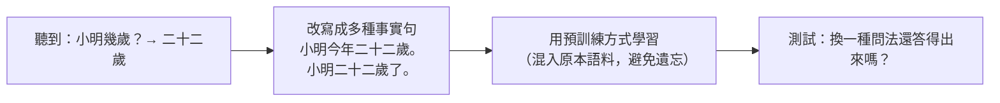
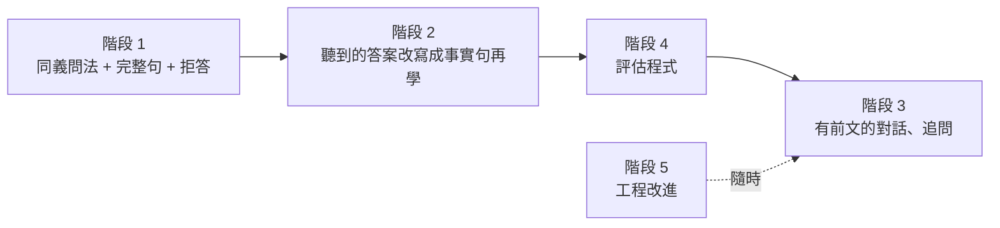

# 改進路線圖：mini-lm / Mini-Lang / mini-talk

> 根據目前實驗觀察到的問題，整理可以改進的方向與優先順序。
>
> 相關文件：[understanding.md](understanding.md)、[slot-filling.md](slot-filling.md)、[mini-talk/talk.md](../mini-talk/talk.md)

## 一、目前觀察到的問題

| # | 問題 | 證據 |
|---|---|---|
| P1 | **只記住「問題 → 答案」，沒有變成知識** | 從對話學習後只答得出聽過的題目（20/20），同一個人的其他事實仍答不出 |
| P2 | **不通順的問題也照樣回答** | 「小明的外在哪裡？」→「南邊」 |
| P3 | **每種問題只有一種說法** | 語料中「幾歲」只有「X幾歲？」這一種問法，換句話問很可能失效 |
| P4 | **答案是片段，不是句子** | 回答「二十二歲」而不是「小明二十二歲。」，對話不太像語言 |
| P5 | **發問和前文無關** | 問題是隨機產生的，聽到「朋友是大心」後不會接著問大心 |
| P6 | **planets 語料無法推廣** | 只有 50 句，驗證集 0% |
| P7 | **生成速度慢** | `generate` 每產生一個字都重算整個序列，沒有 KV cache |

## 二、改進方向

### 階段 1：資料（改 `gen_minilang.py`）

資料是這個專案最有效的槓桿：模型很小，能學到什麼幾乎完全取決於資料。

| 改進 | 做法 | 解決 |
|---|---|---|
| **同義問法** | 每個屬性用 2–3 種問法，例如「小明幾歲？／小明今年幾歲？／小明多大了？」 驗證時保留一種問法完全不訓練 | P3 |
| **完整句回答** | 答案改成「小明今年二十二歲。」，同時保留短答案格式供評估 | P4 |
| **拒答訓練** | 隨機打亂、刪字、換字產生不通順的問題，答案為「我不懂」；不存在的人回答「我不知道」 | P2 |
| **兩步推理** | 「小明的朋友住在哪裡？」這類問題，部分訓練、部分保留驗證 | 測試組合能力 |
| **slot 標註** | 產生句子時順便輸出 QA-SRL 形式的 slot 問答（見 [slot-filling.md](slot-filling.md)） | 讓理解可以檢查 |

### 階段 2：學習方式（改 `talk.py` 的 `--learn`）

P1 的根本原因：模型學到的是「這串字後面接那串字」。研究指出，語言模型要能**抽取**知識，同一個事實需要在預訓練時以多種說法出現（例如 Allen-Zhu & Li 的 *Physics of Language Models* 系列）。

改進做法：**把聽到的答案改寫成事實句，再用預訓練的方式學**。

| 比較 | 現在 | 改進後 |
|---|---|---|
| 學習材料 | 問答對 | 事實句（多種說法）+ 問答對 |
| 預期 | 只答得出原問題 | 換句話問也答得出 |
| 評估 | 聽過的題目答對率 | 聽過的事實用**沒聽過的問法**問，答對率 |

### 階段 3：對話（改 `talk.py` 與訓練格式）

| 改進 | 做法 | 解決 |
|---|---|---|
| **有前文的對話** | 訓練資料改成多輪對話，模型看得到前幾句；`seq_len` 需加大到 256 左右 | P5 |
| **追問** | 訓練資料加入「聽到朋友是誰 → 接著問那個朋友」的對話範例 | P5 |
| **開場與結束** | 「你好」「謝謝」「再見」由模型生成，而不是寫死 | 對話更自然 |
| **溝通成功率** | 說話者先決定要表達的 slot 再說出句子，聽者拆回 slot，比對一致率 | 直接測量「有沒有聽懂」 |

### 階段 4：評估（新增測試程式）

把 [understanding.md](understanding.md) 的測試做成可重複執行的評估：

| 測試 | 指標 |
|---|---|
| 換句話問 | 同一事實不同問法的答對率 |
| 換人問 | 答案隨人名正確改變的比例；與亂猜基準比較 |
| 拒答 | 不通順或不存在的問題，回答「我不懂／我不知道」的比例 |
| 兩步推理 | 保留題的答對率 |
| 置換答案 | 故意給錯答案時，聽者學到錯誤知識的比例 |
| slot filling | 各欄位正確率，與「只看位置」的基準比較 |

### 階段 5：工程

| 改進 | 說明 | 解決 |
|---|---|---|
| KV cache | 生成時保留前面的 key/value，不必每次重算整個序列，交談與評估會快很多 | P7 |
| 裝置選擇 | 加上 `--device`，支援 MPS／CUDA；小模型不一定變快，需實測 | 速度 |
| 語料比重 | 合併語料時可指定各語料的抽樣比例，避免小語料被淹沒 | P6 |
| 設定檔 | 用一個 YAML／JSON 記錄實驗參數，結果可重現 | 管理實驗 |
| 實驗紀錄 | 每次執行把參數與結果寫進 `runs/<名稱>/result.json`，方便比較 | 管理實驗 |

## 三、建議順序

1. **先做階段 1 + 2。** 它們直接針對最明顯的缺點 P1、P2、P3，而且只需要改資料產生器和學習流程，模型不用動。
2. **再做階段 4。** 有了同義問法和拒答資料，評估才有東西可測。
3. **階段 3 最大。** 需要改訓練格式和加大 `seq_len`，等前面穩定後再做。
4. **階段 5** 視需要隨時加入，其中 KV cache 對交談速度幫助最大。

## 四、成功的標準

| 目標 | 目前 | 希望達到 |
|---|---|---|
| 換一種問法問聽過的事實 | 未測（預期接近 0%） | 明顯高於亂猜 |
| 不通順問題的拒答率 | 0% | 80% 以上 |
| 兩步推理保留題 | 未測 | 明顯高於亂猜 |
| 對話中的追問 | 沒有 | 聽到新人名後會接著問 |
