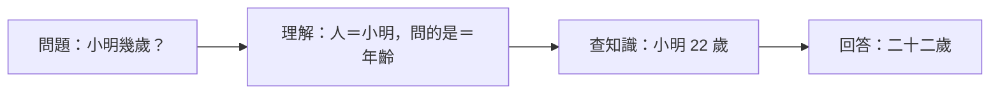
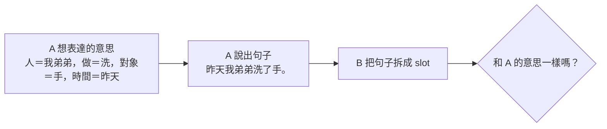

# 用 slot filling 判斷模型是否理解句子

> 問題：如果讓模型把句子拆成「主詞、動詞、受詞」等欄位（slot）再填進去，對判斷它是否理解會有幫助嗎？
>
> 相關文件：[understanding.md](understanding.md)（如何確定兩個模型理解對方）

## 結論

**有幫助，而且很適合 Mini-Lang。** slot filling 讓模型把「它以為這句話是什麼意思」明確寫出來。原本只能看最後的答案，現在可以直接檢查中間的理解。

但要注意兩件事：

1. 欄位要用**語意角色**（誰做、做什麼、對什麼、什麼時候、在哪裡），而不是只看文法位置。
2. Mini-Lang 的語序固定，模型可能光靠「第幾個詞」就填對。測試時必須加入位置和角色不一致的句子。

## 一、為什麼有幫助

### 1. 把「理解」和「答對」分開

問答只看最後答案，答對可能是猜的。slot filling 把理解拆成兩步：



| 理解（slot） | 答案 | 診斷 |
|---|---|---|
| 對 | 對 | 理解了，也知道事實 |
| 對 | 錯 | 語言沒問題，**知識**有問題 |
| 錯 | 對 | 猜對的，**沒有理解** |
| 錯 | 錯 | 語言理解就出錯了 |

在 [mini-talk](../mini-talk/talk.md) 觀察到「小明的外在哪裡？」被回答成「南邊」。如果要求模型先填 slot，就能看出它到底把這句話當成在問什麼。

### 2. 精確指出錯在哪裡

不只知道「錯了」，還知道是哪個欄位錯，例如：

* 「我哥哥比我弟弟高」：誰是比較的主體、誰是對象有沒有搞反？
* 「昨天我沒寫字」：否定和時間有沒有抓到？
* 「因為下雨了，所以我不去外邊」：原因和結果有沒有分清楚？

### 3. 讓其他理解測試更精確

[understanding.md](understanding.md) 中的測試都可以改成比對 slot，不必只看答案：

| 測試 | 用 slot 怎麼判斷 |
|---|---|
| 換句話說 | 「小明今年二十二歲。」和「小明二十二歲了。」應該填出**相同**的 slot |
| 換一個人 | 名字換掉，只有「人」這一格應該改變，其他不變 |
| 不通順的句子 | 「小明的外在哪裡？」應該填不出合理的「問的是」，而不是硬填一個 |
| 組合推廣 | 訓練時沒見過「我爸爸 + 洗 + 衣服」這個組合，測試時還能正確拆解 |

第 4 項就是 SCAN、COGS 這類組合推廣（compositional generalization）研究的做法。

### 4. 直接測量「對方有沒有聽懂」

兩個模型交談時，slot 可以當作「意思」的標準答案：



**A 想說的 slot = B 聽到的 slot**，就是「B 理解了 A」最直接的定義。比對一致的比例，就是溝通成功率。

### 5. Mini-Lang 可以免費得到標準答案

[gen_minilang.py](../mini-lm/gen_minilang.py) 本來就是先選好主詞、動詞、受詞、時間、地點，再組成句子。只要在產生句子時順便輸出這些選擇，每一句都會自動附帶正確的 slot，不必人工標註。

## 二、欄位怎麼設計

### 用語意角色，不只用文法位置

| 欄位 | 意思 | 「昨天我弟弟在家裡洗了手。」 |
|---|---|---|
| 誰 | 做動作的人 | 我弟弟 |
| 做什麼 | 動作 | 洗 |
| 對什麼 | 動作的對象 | 手 |
| 什麼時候 | 時間 | 昨天 |
| 在哪裡 | 地點 | 家裡 |
| 有沒有做 | 肯定或否定 | 有 |
| 做完了嗎 | 時態 | 做完了 |

不同句型需要不同的欄位組合：

| 句型（[mini-lang.md](../mini-lang/mini-lang.md) 規則） | 例子 | 需要的欄位 |
|---|---|---|
| 動作句（規則 1–3） | 我在學校學中文。 | 誰、做什麼、對什麼、在哪裡 |
| 「是」字句（規則 4） | 他是老師。 | 誰、是什麼 |
| 「有」字句（規則 5） | 我有兩個朋友。 | 誰、有什麼、多少 |
| 性質句（規則 6） | 天氣很冷。 | 什麼、怎麼樣、程度 |
| 比較句（規則 13） | 他比我高。 | 誰、比誰、哪方面 |
| 複句（規則 17） | 因為下雨了，所以我不去。 | 原因（一組 slot）、結果（一組 slot） |
| 問句（規則 10） | 小明喜歡吃什麼？ | 問誰、問哪一項 |

### 用 Mini-Lang 自己的問句當欄位名稱

欄位名稱不必另外發明符號，可以直接用 Mini-Lang 的疑問詞。slot filling 就變成對同一句話問一連串的 wh 問題：

```
<Q>昨天我弟弟在家裡洗了手。誰？<A>我弟弟
<Q>昨天我弟弟在家裡洗了手。做什麼？<A>洗手
<Q>昨天我弟弟在家裡洗了手。什麼時候？<A>昨天
<Q>昨天我弟弟在家裡洗了手。在哪裡？<A>家裡
```

好處有三個：

* 全部只用 256 字，詞表不變。
* 和現有的 `<Q>…<A>…` 格式相同，mini-lm 不用改程式就能訓練。
* 這種做法在研究上稱為 **QA-SRL**（用問答表示語意角色標註，He et al., 2015）。

## 三、限制與陷阱

### 1. 位置捷徑

Mini-Lang 語序固定，「誰」幾乎總在句首。模型可能只學到「第一個名詞就是誰」，看起來全對，其實沒有理解。

對策是加入**位置和角色不一致**的句子，並和「只看位置」的簡單基準比較：

| 句子 | 陷阱 |
|---|---|
| 書，我放在這裡。 | 對象在句首 |
| 今天我在家。 | 時間在主詞前面 |
| 我哥哥比我弟弟高。 | 兩個人都在句中，角色不同 |
| 我的朋友的媽媽是老師。 | 「是老師」的是媽媽，不是朋友 |

### 2. slot 不等於全部的意思

slot 只表示句子結構裡「誰對什麼做了什麼」。以下這些它表達不了：

* 語氣：「好吧」和「好」不同。
* 隱含的意思：「太貴了」其實是「我不想買」。
* 前後文：「他」指的是誰。

所以 slot filling 適合檢驗**句子層次的理解**，對話層次的理解還需要其他測試，例如後續行動。

### 3. 填得對不代表會用

模型可能很會拆句子，卻不會根據拆出來的結果回答或行動。所以 slot filling 應該**搭配問答一起看**，用上面「理解 × 答案」的四格表來診斷，而不是取代問答。

## 四、評估方式

| 指標 | 說明 |
|---|---|
| 完全一致率 | 一句話的所有欄位都對才算對 |
| 各欄位正確率 | 分別統計「誰」「對什麼」「時間」…，找出最弱的欄位 |
| 換句話一致率 | 同一意思的不同說法，填出相同 slot 的比例 |
| 組合推廣正確率 | 只在訓練時沒見過的詞語組合上計算 |
| 位置基準 | 「第一個名詞是誰、動詞後面是對什麼」的簡單規則能得幾分；模型要明顯超過它才有意義 |
| 溝通成功率 | 交談時，說話者想表達的 slot 和聽者拆出的 slot 一致的比例 |

## 五、小結

slot filling 把看不見的「理解」變成看得見、可以逐欄打分數的結構。它最大的價值在於：

* **區分**語言理解錯誤和知識錯誤；
* **精確定位**錯在哪個角色；
* 讓「換句話說、組合推廣、溝通成功」都有明確的標準答案。

使用時要用語意角色設計欄位，並刻意加入能打破位置捷徑的句子，否則高分可能只是假象。
