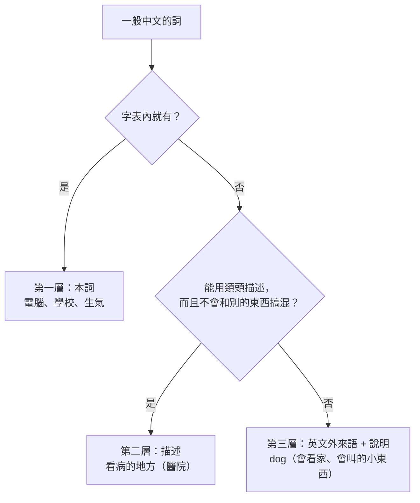

# 通用 Mini-Lang：用 297 字說所有的事

> 目標：任何一篇中文文章，都能翻譯成只用 [Mini-Lang 297 字](mini-lang.md#附錄完整字表)的版本；反過來，Mini-Lang 的文章也能翻譯回一般中文。
>
> 本文件是[基礎 Mini-Lang](mini-lang.md) 的擴充：字表完全相同，但語法、構詞與詞典擴充到能表達一般中文的所有概念。

## 結論

| 問題 | 做法 |
|---|---|
| 字只有 297 個，概念卻有幾萬個 | **類頭構詞**：概念 = 描述 + 類頭，例如「看病的地方」（醫院）、「天上的色」（藍色） |
| 有些東西只能叫名字，描述不出來 | **外來語**：用英文寫，例如 dog（狗）、Beijing（北京），就像中文本來就借用 app、email、DNA |
| 描述太長，一篇文章說不完 | **先定義、後沿用**：外來語第一次出現時加說明，之後直接用 |
| 數字 | **阿拉伯數字**：3個人、2024年、30歲、20% |
| 字表沒有「被、把、著、已經、雖然…」 | **語法替代表**：每一種中文語法結構，都有只用 297 字的標準說法（第 5 節） |
| 要能翻回一般中文 | **詞典**：每個說法對應一個一般中文詞（[lexicon/](lexicon/)），外來語可以用英漢詞典還原 |

**保證：** 中文文章裡的任何東西，不是能用 297 字描述，就是有英文名字。所以**任何文章都翻譯得過去**：描述讓文章讀得懂，英文外來語讓「描述不出是哪一個」的東西（物種、地名、人名、術語）也能精確地說出來。297 個漢字不變；英文字母、阿拉伯數字和標點一樣，不算在 297 字裡。

## 1. 翻譯得過去，也翻譯得回來

### 1.1 和基礎 Mini-Lang 的關係

| | 基礎 Mini-Lang | 通用 Mini-Lang |
|---|---|---|
| 字表 | 297 字 | **同一份 297 字** |
| 用途 | 學中文的人入門溝通 | 翻譯任何中文文章 |
| 語法 | 17 條句型，不用複句 | 加上複句、被動、使役等的標準替代說法 |
| 詞 | 中文本來就有的組合詞 | 加上「描述 + 類頭」與英文外來語 |
| 詞典 | 不需要 | 需要，才能翻回一般中文 |

基礎 Mini-Lang 是通用 Mini-Lang 的子集：基礎版的每一句話，也都是通用版的句子。

### 1.2 兩個原則

1. **每一句都是自然的中文。** 不發明新字義、不造不合中文習慣的詞。描述可以長，但一般中文母語者都要讀得懂，不需要先學規則。英文外來語第一次出現時一定附上說明，所以不懂那個英文詞的讀者也看得懂。
2. **意思不能變，風格可以變。** 翻譯保留事實、關係、時間、原因、態度；文體、雙關、押韻、字形相關的趣味可能會失去（第 10 節）。

## 2. 三層表達

翻譯每一個詞時，依序嘗試三層：



| 層 | 用在 | 例子 | 一般中文 |
|---|---|---|---|
| 本詞 | 字表內的字組成的中文詞，**一律保留原樣** | 電腦、飛機、醫學、動物、小時 | 同左 |
| 描述 | 一般名詞、動作、性質、抽象概念 | 看病的地方、紅藍的色、不想說真話 | 醫院、紫色、說謊 |
| 外來語 | 人名、地名、物種、化學物、專門術語 | Beijing、dog、DNA | 北京、狗、DNA |

### 2.1 先定義、後沿用

一篇文章中，描述不出來的詞**第一次出現時，寫英文，後面括號接說明**；之後只用英文。這和學術文章「第一次出現時寫出全名」的習慣相同。

```zh
我家有一個 dog（會看家、會叫的小東西）。
我天天和 dog 出去走走。
```

一般中文：我家有一隻狗。我天天跟狗出去散步。

### 2.2 選哪一層

* **常用、說得清楚的，用描述。** 例如醫院、銀行、司機、便宜，描述既短又不會搞混。
* **專有的、數量很多的，用英文外來語。** 例如人名、地名、動植物的種類、化學物質。這些東西描述只能說出「哪一類」，說不出「哪一個」。
* **一個詞在文章中出現很多次，即使描述得出來，也可以改用「先定義、後沿用」，讓文章短一點。**

## 3. 外來語：用英文寫

### 3.1 為什麼用英文

297 個漢字描述得出「是哪一類」，但很多東西要說出「是哪一個」：哪一種動物、哪一個城市、哪一個人、哪一種化學物。這些東西一般中文也是靠專用的字或名字，Mini-Lang 不可能都收進 297 字。

通用 Mini-Lang 把它們當成**外來語，直接用英文寫**：

* **中文本來就這樣做。** app、email、Wi-Fi、DNA、T恤、PM2.5 都已經出現在一般中文文章裡。
* **精確。** 英文名字和中文詞幾乎一對一，用一般的英漢詞典就能翻回中文。
* **不佔字表。** 英文字母和阿拉伯數字、標點一樣，不算在 297 字裡。

### 3.2 規則

1. **什麼時候用：** 只有在 297 字描述不出「是哪一個」的時候。描述得清楚的，例如醫院（看病的地方）、司機（開車的人），仍然用描述。
2. **選哪個英文詞：**

   | 種類 | 用 | 例子 |
   |---|---|---|
   | 一般名詞 | 最常用的英文詞 | dog、cat、apple、glass |
   | 地名 | 通行的英文名 | Beijing、London、South America |
   | 外國人名 | 原本的拉丁字母寫法 | Einstein、Shakespeare |
   | 中國人名 | 漢語拼音，姓在前 | Wang Xiaoming、Kong Zi |
   | 中國特有的東西 | 英文已經借用的拼音 | tofu、kungfu、baozi |
   | 學術名詞 | 英文術語或縮寫 | DNA、virus、atom |

3. **不變化：** 外來語和中文的詞一樣，沒有單複數、沒有時態。寫「很多 dog」，不寫「很多 dogs」。
4. **動作盡量用中文：** 動作幾乎都能用字表內的字組出來（第 4.4 節），外來語主要用在名詞。
5. **寫法：** 英文和中文之間空一格，中文標點旁邊不空。專有名詞大寫開頭，一般名詞小寫。
6. **先定義、後沿用：** 第一次出現時，後面用括號加上 297 字的說明（第 2.1 節）。

### 3.3 例子

| 一般中文 | Mini-Lang 說法 |
|---|---|
| 北京 | Beijing（中國北邊的大地方，國家的大事都在這裡做） |
| 狗 | dog（會看家、會叫的小東西） |
| 老虎 | tiger |
| 孔子 | Kong Zi（很早以前教人怎麼做人的老師） |
| 倫敦 | London |
| 愛因斯坦 | Einstein（一個很有名的學問家） |
| 貓 | cat |
| 病毒 | virus |

```zh
我們走進了一個有很多很多 apple 的大地方。
他每天早上都吃2個 apple。
```

### 3.4 反過來：外來語還原成中文

1. **詞典：** [lexicon/](lexicon/) 登記的外來語，直接對應到原本的中文詞（dog → 狗）。
2. **英漢詞典：** 詞典沒有的，用一般的英漢詞典或翻譯工具。
3. **說明：** 第一次出現時的說明，可以幫助選出正確的中文詞（例如 mouse 是「老鼠」還是「滑鼠」）。

## 4. 構詞：描述 + 類頭

### 4.1 類頭

類頭是描述的最後一個詞，說明「這是哪一類東西」。通用 Mini-Lang 固定使用下列類頭：

| 類頭 | 類別 | Mini-Lang 說法 | 一般中文 |
|---|---|---|---|
| 人 | 人、職業、身分 | 開車的人 | 司機 |
| 東西 | 物品、動物 | 寫字用的東西 | 筆 |
| 地方 | 場所、建築用途 | 放錢的地方 | 銀行 |
| 時候 | 時段、季節、時代 | 天氣熱起來的時候 | 春天 |
| 事 | 事件、活動 | 很多人一起玩的大事 | 比賽、活動 |
| 話 | 言語、文體 | 不是真的話 | 謊話 |
| 樣子 | 外觀、方式、狀態 | 生氣的樣子 | 怒容 |
| 意思 | 概念、想法 | 大家都一樣的意思 | 平等 |
| 心 | 情感、心態 | 想家的心 | 鄉愁 |
| 學問 | 學科、知識 | 人的身體和病的學問 | 醫學 |
| 工作 | 職務、行業 | 教書的工作 | 教職 |
| 病 | 疾病 | 頭很熱的病 | 發燒 |
| 機 | 機器、電器 | 洗衣機、會自己做事的機 | 洗衣機、機器人 |
| 車 | 交通工具 | 地下走的電車 | 地鐵 |
| 房子 | 建築 | 很高很高的房子 | 大樓 |
| 書 | 文件、出版品 | 天天出來、說國家大事的書 | 報紙 |
| 文 | 文章、文字 | 中文、說事的文 | 中文、記敘文 |
| 話 / 語 | 語言 | UK 話、中國話 | 英語、中文 |
| 國 / 家 | 國家、家庭 | 外國、自己家 | 外國、自家 |
| 店 | 商店 | 賣書的店 | 書店 |
| 水 | 液體 | 從眼裡出來的水 | 眼淚 |
| 氣 | 氣體、天氣、氣味 | 天氣、從口裡出來的氣 | 天氣、呼吸 |
| 色 | 顏色 | 紅藍的色 | 紫色 |
| 錢 | 款項 | 每個月的工錢 | 月薪 |
| 路 | 道路、途徑 | 車走的大路 | 公路 |
| 口 | 出入口 | 門口、出口 | 門口、出口 |
| 頭 | 開端、頭目 | 開頭、工頭 | 開頭、工頭 |

### 4.2 描述的公式

描述放在類頭前面，用「的」連起來。最常用的五種：

| 公式 | Mini-Lang 說法 | 一般中文 |
|---|---|---|
| 做什麼用的 | 坐飛機的地方 | 機場 |
| 在哪裡的 | 水裡的東西 | 水中生物 |
| 像什麼的 | 和火一樣紅的色 | 火紅色 |
| 由誰做、屬於誰的 | 國家的錢 | 公款 |
| 有什麼特點的 | 很長、會在地上走、沒有手的東西 | 蛇（一般還要加外來語 snake） |

**區分同類的東西時，說出最重要的不同。** 例如「醫生」和「護士」都在看病的地方工作：醫生是「看病的人」，護士是「幫醫生看病的人」。

### 4.3 性質的擴充

字表只有 32 個性質字，用下列方式擴充：

| 方式 | Mini-Lang 說法 | 一般中文 |
|---|---|---|
| 不 + 反義 | 不貴、不對、不重、不高 | 便宜、錯、輕、矮 |
| 好 / 難 + 動作 | 好看、好聽、難看、難吃、好用 | 美、悅耳、醜、難吃、方便 |
| 有 / 沒 + 名詞 | 有名、有錢、有意思、有用、沒意思 | 著名、富有、有趣、有用、無聊 |
| 心 的組合 | 開心、小心、好心、心大、心小 | 高興、謹慎、善良、豁達、小氣 |
| 程度 | 有一點、很、太、真、最 | 稍微、很、太過、非常、最 |
| 像…一樣 | 和冰一樣冷、和山一樣高 | 冰冷、極高 |
| 「…起來」 | 看起來很新、聽起來不對 | 看似、聽來 |

### 4.4 動作的擴充

| 方式 | Mini-Lang 說法 | 一般中文 |
|---|---|---|
| 動作 + 結果 | 打開、關上、拿走、找到、看懂、學會 | 打開、關閉、取走、發現、理解、掌握 |
| 動作 + 方向 | 走過去、拿回來、站起來、說出來 | 經過、取回、起立、說出 |
| 快 / 慢 + 地 + 動作 | 很快地走 | 跑 |
| 用 + 東西 + 動作 | 用手拿、用電腦寫 | 握、打字 |
| 叫 / 給 + 人 + 動作 | 叫他走、給他看 | 使他離開、出示 |
| 「做 + 名詞」 | 做飯、做工、做買賣 | 煮飯、工作、經商 |
| 描述動作的樣子 | 從上邊到下邊很快地走 | 跳下 |
| 否定 | 不記得、不想說、沒看見 | 忘記、拒絕、忽略 |

字表外的常用動作都登記在詞典的「動作」類（[lexicon/actions.tsv](lexicon/actions.tsv)）。

### 4.5 抽象名詞

抽象名詞改寫成「…的事」「…的樣子」「…的意思」「…的心」，或直接改成句子：

| 一般中文 | Mini-Lang 說法 |
|---|---|
| 自由 | 想做什麼就能做什麼 |
| 平等 | 人人都一樣、沒有誰比誰高的意思 |
| 經濟 | 國家的錢和買賣的事 |
| 文化 | 一個國家的人說話、吃飯、過日子的樣子 |
| 歷史 | 以前的事 |
| 未來 | 以後的時候 |
| 知識 | 知道的東西 |
| 責任 | 得做好的事 |
| 能力 | 能做到的事 |
| 原因 | 為什麼會這樣 |
| 結果 | 最後怎麼樣了 |

**原則：抽象名詞能改成句子時，就改成句子。** 一般中文「經濟的發展帶來了文化的改變」，在 Mini-Lang 說成：

```zh
國家有了更多的錢，人過日子的樣子也和以前不一樣了。
```

## 5. 語法：每一種中文結構的說法

基礎 Mini-Lang 的語序（主語、時間、能願、介詞、動詞、補語、賓語）不變。下面列出一般中文的各種結構，在 Mini-Lang 中的標準說法。

### 5.1 時間與體

| 一般中文 | 結構 | 例句 |
|---|---|---|
| 我昨天去了學校。 | 過去：了 | 我昨天去了學校。 |
| 我已經吃了。 | 已經 → 了／先…了 | 我吃了。他先走了。 |
| 我去過日本。 | 經驗：過 | 我去過外國。 |
| 他正在吃飯。 | 進行：在 | 他在吃飯。 |
| 他坐著看書。 | 著 → 在…裡、V 在那裡 | 他坐在那裡看書。 |
| 門開著。 | 狀態 → 了 | 門開了。 |
| 明天將會下雨。 | 將來：會、要…了 | 明天會下雨。要下雨了。 |
| 他剛到。 | 剛 → 沒多少時間 | 他到了沒多少時間。 |
| 他曾經是老師。 | 曾經 → 以前…過／以前是 | 他以前做過老師。 |
| 天開始冷了。 | 開始 → …起來 | 天冷起來了。他說起話來了。 |
| 請繼續說。 | 繼續 → V 下去、還在 V | 請說下去。他還在等。 |
| 他不再喝酒了。 | 停止 → 不再 V 了 | 他不再喝了。 |
| 他變成老師了。 | 變成 → 做了／…起來了 | 他做了老師。 |
| 我做完了。 | 完成：V 完 | 我做完了。 |

### 5.2 語氣與能願

| 一般中文 | 結構 | 例句 |
|---|---|---|
| 你必須走了。 | 必須 → 得 | 你得走了。 |
| 你應該多喝水。 | 應該 → 要、最好 | 你要多喝水。你最好早點睡。 |
| 他可能不來了。 | 可能 | 他可能不來了。 |
| 他一定會來。 | 一定 → 真的會 | 他真的會來。 |
| 你不必來。 | 不必 → 不用 | 你不用來。 |
| 我願意幫你。 | 願意 → 想、要 | 我想幫你。 |
| 我能夠做到。 | 能夠 → 能 | 我能做到。 |
| 也許吧。 | 也許 → 可能 | 可能吧。 |
| 竟然下雨了！ | 意外 → 真的…了 | 真的下雨了！ |

### 5.3 被動、處置、使役

| 一般中文 | 結構 | 例句 |
|---|---|---|
| 這本書是他寫的。 | 被動（說出是誰）→ 是…的 | 這個書是他寫的。 |
| 錢被他拿走了。 | 被動（不好的事）→ 給 | 錢給他拿走了。 |
| 他被打了。 | 被動（不說是誰）→ 有人 | 有人打了他。 |
| 我把書放在這裡。 | 把 → 拿…V、先說東西 | 我拿書放在這裡。書，我放在這裡了。 |
| 媽媽讓我回家。 | 讓、使 → 叫 | 媽媽叫我回家。 |
| 這件事讓他很生氣。 | 使…怎樣 → 叫 | 這個事叫他很生氣。 |
| 讓我看看。 | 讓（允許）→ 給 | 給我看看。 |

### 5.4 比較

| 一般中文 | 結構 | 例句 |
|---|---|---|
| 他比我高。 | 比 | 他比我高。 |
| 他比我高得多。 | 比…多了 | 他比我高多了。 |
| 他跟我一樣高。 | 跟 → 和 | 他和我一樣高。 |
| 他不如我高。 | 不如 → 沒有 | 他沒有我高。 |
| 他最高。 | 最 | 他最高。 |
| 天氣越來越冷。 | 越來越 → 一天比一天 | 天氣一天比一天冷。 |
| 越多越好。 | 越…越 → 更…更 | 多一點更好。 |

### 5.5 數量與範圍

| 一般中文 | 結構 | 例句 |
|---|---|---|
| 所有的人都來了。 | 所有、都 | 所有的人都來了。 |
| 任何人都知道。 | 任何 → 誰都、什麼都 | 誰都知道。他什麼都不想吃。 |
| 沒有一個人知道。 | 沒有一個 | 沒有一個人知道。 |
| 大約三十歲。 | 大約 → 左右 | 他30歲左右。 |
| 幾乎到了。 | 幾乎 → 快…了 | 我們快到了。 |
| 三分之一 | 分數 | 1/3 |
| 百分之二十 | 百分比 | 20% |
| 除了他，大家都來了。 | 除了 → …以外 | 他以外，大家都來了。 |
| 只有他沒來。 | 只有 | 只有他沒來。 |

### 5.6 連接句子

| 一般中文 | 關係 | 例句 |
|---|---|---|
| 因為下雨，所以我不去。 | 原因 | 因為下雨，所以我不去了。 |
| 雖然他很忙，但還是來了。 | 讓步 → 是…，可是 | 他是很忙，可是還是來了。 |
| 即使下雨，我也要去。 | 讓步假設 → 就是…也 | 就是下雨，我也要去。 |
| 如果你來，我就做飯。 | 假設 → 要是…就 | 要是你來，我就做飯。 |
| 只要你想，就能學會。 | 條件 → 只要…就 | 只要你想，就能學會。 |
| 只有學了才會。 | 唯一條件 → 不…就不 | 不學就不會。 |
| 無論誰來，我都歡迎。 | 無論 → 誰都、什麼都 | 誰來我都歡迎。 |
| 快走，否則就晚了。 | 否則 → 要不 | 快點走，要不就晚了。 |
| 為了學中文，他去了中國。 | 目的 → 為了 | 為了學中文，他去了中國。 |
| 他不但會說，而且會寫。 | 遞進 → 不只…也、還 | 他不只會說，也會寫。 |
| 先吃飯，然後看書。 | 先後 → 先…再、後來 | 我先吃飯，再看書。 |
| 你要茶或咖啡？ | 選擇（問）→ 還是 | 你要茶還是要水？ |
| 茶或水都可以。 | 選擇（說）→ …也可以 | 茶也可以，水也可以。 |
| 例如蘋果和香蕉。 | 舉例 → 比方說 | 比方說水果和菜。 |
| 也就是說…… | 換句話說 | 也就是說，他不來了。 |
| 總之…… | 總結 → 說到最後 | 說到最後，這是他的事。 |
| 關於這件事…… | 話題 → 說到、對…來說 | 說到這個事，我不知道。對我來說，這很難。 |
| 根據他的說法…… | 根據 → 從…看、他說 | 從他的話看，明天不下雨。 |
| 當我到家的時候…… | 時間 → …的時候 | 我到家的時候，他在睡覺。 |

### 5.7 修飾與引述

| 一般中文 | 結構 | 例句 |
|---|---|---|
| 教我中文的那位老師 | 關係子句 → …的 | 教我中文的那個老師 |
| 我昨天買的書 | 關係子句 → …的 | 我昨天買的書很好看。 |
| 他說他明天來。 | 間接引述 | 他說他明天來。 |
| 他說：「我明天來。」 | 直接引述 | 他說：「我明天來。」 |
| 他問我去不去。 | 間接問句 | 他問我去不去。 |
| 我不知道他是誰。 | 嵌入問句 | 我不知道他是誰。 |
| 常常、有時、總是、從不 | 頻率 | 天天、有的時候、每次都、從來不 |
| 突然、終於、馬上、互相 | 方式 | 一下子、到最後、現在就、你幫我，我幫你 |

### 5.8 代詞

| 一般中文 | Mini-Lang |
|---|---|
| 她、它、牠 | 他 |
| 她們、它們 | 他們 |
| 咱們 | 我們 |
| 您 | 你 |
| 此、該 | 這個 |
| 如此 | 這樣 |
| 某人、某些 | 一個人、有些 |

## 6. 數字、單位與符號

**數字一律用阿拉伯數字 0–9。** 規則和台灣公文的數字用法相同：

| 用法 | 寫法 | 例句 |
|---|---|---|
| 計數、計量、年齡、價錢 | 阿拉伯數字 | 我有3個哥哥。他30歲。這個120塊。 |
| 日期、時間 | 阿拉伯數字 | 2026年3月5日下午3點20分 |
| 第幾 | 第 + 阿拉伯數字 | 第1次、第3個 |
| 小數、分數、百分比 | 3.5、1/3、20% | 100個人裡有20個、20% |
| 很大的數 | 直接寫，或用「萬」 | 100000000、1萬萬、3萬 |
| 「一」當作「一個」（英文的 a） | 中文 | 我家有一個 dog。他是一個好人。 |
| 固定的詞 | 中文 | 一樣、一起、一點、一下子、一些、一半、一天比一天 |

判斷方法：**能換成別的數字還說得通的，就是數字，用阿拉伯數字。**「我有3個哥哥」可以改成「4個」，所以寫 3；「一樣」不能改成「兩樣」，所以是固定的詞。

| 一般中文 | Mini-Lang 說法 |
|---|---|
| 二十二歲 | 22歲 |
| 一百零五 | 105 |
| 三點五 | 3.5 |
| 二〇二六年三月五日 | 2026年3月5日 |
| 一小時、一秒 | 1小時、1 s |
| 五公里、三公斤 | 5 km、3 kg |
| 攝氏三十度 | 30 °C |
| 春、夏、秋、冬 | 天氣熱起來的時候、熱天、天氣冷起來的時候、冷天 |

**單位用國際符號**（s、km、kg、°C、%）。和英文外來語一樣，數字、符號都不算在 297 字裡。

## 7. 專有名詞

| 種類 | 做法 | Mini-Lang 說法 |
|---|---|---|
| 人名 | 英文或拼音；第一次出現時說是誰 | Einstein（一個很有名的學問家）、Kong Zi |
| 地名 | 英文名 | Beijing、London、South America |
| 機構 | 描述；需要時用英文名 | 國家的大學校、UN |
| 書名、作品名 | 意譯或英文名，放在《》裡 | 《Lao Zi》 |
| 品牌、產品 | 原本的拉丁字母寫法 | Google、iPhone |

## 8. 翻譯的流程

### 8.1 中文 → Mini-Lang


1. **斷句。** 一般中文的長句常有好幾層修飾，Mini-Lang 拆成幾個短句。
2. **換結構與數字。** 依第 5 節，把「被、把、雖然、已經」等換成標準說法；依第 6 節，數字換成阿拉伯數字。
3. **換詞。** 先查詞典（[lexicon/](lexicon/)），詞典沒有的，依第 2 節的三層決定。
4. **檢查。** 用 `python check.py "…"` 確認只用到 297 字。
5. **讀一次。** 確認是自然的中文，而且意思沒有變。

### 8.2 Mini-Lang → 中文

1. **外來語還原。** 英文詞依詞典（或英漢詞典）換回中文，第一次出現時的說明一併去掉。
2. **描述還原。** 詞典中登記的描述，換回原本的詞，例如「看病的地方」→ 醫院。
3. **結構還原（可以不做）。** 「是…，可是」可以改回「雖然…但是」，讓文章更像一般的書面中文。

Mini-Lang 本身就是中文，所以**就算不做任何還原，一般中文讀者也看得懂**，只是比較長、比較口語。還原的目的是讓文章變短、變正式。

## 9. 詞典

詞典放在 [lexicon/](lexicon/)，依領域分檔，目前共 1,236 條：

| 檔案 | 領域 | 條數 |
|---|---|---:|
| [grammar.tsv](lexicon/grammar.tsv) | 功能詞、量詞、代詞（第 5 節的替代說法） | 95 |
| [mind.tsv](lexicon/mind.tsv) | 情感、思考、品德、抽象名詞、形容詞、副詞 | 212 |
| [actions.tsv](lexicon/actions.tsv) | 字表外的常用動詞 | 195 |
| [knowledge.tsv](lexicon/knowledge.tsv) | 學科、教育、科學、數學、電腦、媒體、藝術、運動 | 191 |
| [life.tsv](lexicon/life.tsv) | 食物、衣物、家具、工具、建築、交通、身體、健康 | 183 |
| [nature.tsv](lexicon/nature.tsv) | 動物、植物、天氣、地理、天文、材料、顏色 | 175 |
| [people.tsv](lexicon/people.tsv) | 親屬、職業、社會、政治、法律、經濟、宗教、歷史 | 163 |
| [places.tsv](lexicon/places.tsv) | 洲、國家、城市 | 22 |

方式的分布：描述 586、組詞 257、外來語 214、本詞 179。外來語多半用在動植物、食物、器物、材料與地名（第 3 版加入「樹、鳥、魚、海、聲…」後，有 46 個外來語改回中文）；抽象概念和動作幾乎都能用描述或組詞說出來。

每行一個詞，用 tab 分隔：

| 欄位 | 內容 |
|---|---|
| 中文 | 一般中文的詞 |
| Mini-Lang | Mini-Lang 的說法（描述、組詞或英文外來語） |
| 說明 | 外來語第一次出現時，括號裡的說明；其他方式空白 |
| 方式 | 本詞、組詞、描述、外來語 其中之一 |

工具：

| 工具 | 用途 |
|---|---|
| [check_universal.py](check_universal.py) | 檢查本文件的例句與詞典只用到 297 字、格式正確、沒有重複，描述裡用到的英文詞都有登記 |
| [translate.py](translate.py) | 翻譯輔助：`--to-mini` 標出一般中文中要換的詞，`--to-zh` 把描述與外來語還原 |

```bash
python check_universal.py --stats
python translate.py --to-mini "雖然下雨，我還是去了醫院。"
python translate.py --to-zh "我家有一個 dog（會看家、會叫的小東西）。"
```

`translate.py` 不是完整的翻譯器：正向只查詞典，語法替換、數字與改寫要由人或大型語言模型完成；反向只還原詞典登記的描述與外來語（兩個字以下的描述太常見，不還原）。

## 10. 失去什麼

翻譯成 Mini-Lang 一定會失去一些東西。下面是會失去的，以及能保留到什麼程度：

| 會失去的 | 一般中文 | 能保留的程度 |
|---|---|---|
| 字形與雙關 | 拆字謎、諧音笑話 | 只能加說明 |
| 韻律 | 詩、對聯、押韻 | 意思能保留，韻律不能 |
| 文體與正式程度 | 公文、文言文 | 全部變成口語 |
| 成語與典故 | 畫蛇添足 | 說出意思：做了不用做的事，反而不好 |
| 量詞 | 一隻狗、一本書、一張紙都說成「一個」 | 翻回中文時要依名詞改回原本的量詞 |
| 讀者要懂一點英文 | dog、tree | 第一次出現時有 297 字的說明，不懂英文也看得懂；之後就要記住 |
| 近義詞的細微差別 | 看、望、瞧、盯 | 只能用「看」加上「很久地」「從遠的地方」等描述 |
| 長度 | 專門文章 | 通常變長 1.5–3 倍 |
| 專門術語的精確 | 醫學、法律名詞 | 用英文術語加說明，精確，但第一次出現時很長 |

**能保留的：** 誰、做了什麼、對誰、在哪裡、什麼時候、為什麼、結果怎樣、說話的人怎麼想。也就是文章的事實與邏輯。

## 11. 範例：翻過去，再翻回來

兩段原創的短文。Mini-Lang 版由人依本文件的規則翻譯，反譯由 `translate.py --to-zh` 自動產生（只查詞典，不改句子結構）。更多範例（新聞、科普、議論、寓言、說明、書信，以及從 Mini-Lang 翻回中文）見 [examples.md](examples.md)。

### 範例一：新聞

原文：

```text
二〇二四年，科學家在南美洲的森林裡發現了一種新的青蛙。這種青蛙只有一公分長，顏色是鮮豔的黃色。研究人員認為，牠的毒性可能比其他青蛙更強。雖然這個發現很重要，但是森林正在快速消失，很多動物也面臨危險。
```

Mini-Lang：

```zh
2024年，有幾個做學問、找出為什麼的人，在 South America（America 南邊的一塊大地方）有很多很多樹的大地方，找到了一樣新的 frog（住在水邊、下雨天很會叫的小東西）。這樣的 frog 只有 1 cm 長，他的色是很好看的金色。用心地找出為什麼的人覺得，他身上的 poison（吃了會叫人生病、不在了的東西）可能比這個以外的 frog 更大。找到這個是很重要，可是有很多很多樹的大地方在很快地看不見了，很多動物也很可能出事。
```

自動反譯：

```text
2024年，有幾個科學家，在南美洲森林，找到了一樣新的青蛙。這樣的青蛙只有 1 cm 長，他的色是漂亮的金色。研究的人覺得，他身上的毒可能比別的青蛙更大。找到這個是很重要，可是森林在快速消失，很多動物也危險。
```

### 範例二：議論

原文：

```text
學習一種新的語言，不只是記住單字和文法，更是了解另一種文化的方法。當我們能用別人的語言思考時，就會發現世界比我們想像的更大。因此，我認為每個人都應該至少學會一種外語。
```

Mini-Lang：

```zh
學一樣新的外語，不只是要記住字、記住文法；學會了，你也就能知道說這個外語的人怎麼說話、吃飯、過日子。我們能用人家的話好好想想的時候，就會看到天下比我們在腦子裡想出來的更大。所以，我覺得每個人都要最少學會一樣外語。
```

自動反譯：

```text
學一樣新的外語，不只是要記住字、記住文法；學會了，你也就能知道說這個外語的人怎麼說話、吃飯、過日子。我們能用人家的話思考的時候，就會看到天下比我們想像的更大。所以，我覺得每個人都要最少學會一樣外語。
```

### 比較

| 項目 | 結果 |
|---|---|
| 漢字數 | 範例一：原文 89 字 → Mini-Lang 147 字（約 1.7 倍；其中 51 字是外來語第一次出現時的說明）；範例二：76 → 95 字 |
| 保留的 | 時間、地點、誰做了什麼、數量、比較、因果、作者的看法 |
| 字表內就有的詞 | 樹、動物、金色、文法：第 3 版字表加入「樹、動、物、金、法」後，直接寫原本的詞 |
| 反譯救回的詞 | 科學家、南美洲、森林、青蛙、毒、研究、消失、思考、想像 |
| 反譯救不回的 | 「鮮豔的黃色」變成「漂亮的金色」，「面臨危險」變成「危險」，「一種」變成「一樣」；「另一種文化的方法」在 Mini-Lang 中改寫成句子，反譯後仍是句子 |
| 讀起來 | Mini-Lang 版是口語、比較長；外來語第一次出現時有說明，一般中文讀者不用學任何規則就看得懂 |
