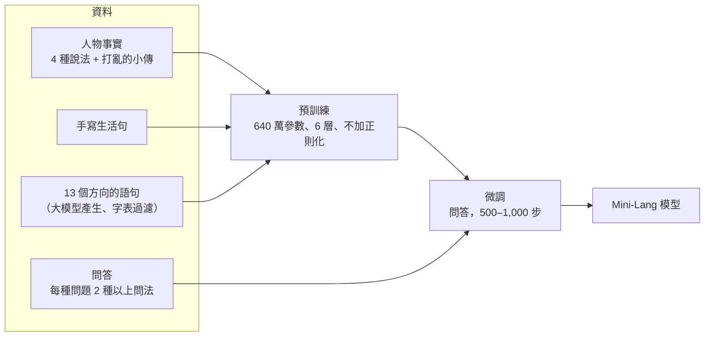

# 設計泛化能力最好的 Mini-Lang 模型

> 問題：
> 1. 在自動產生的語料中混入其他語句，泛化能力會更好嗎？
> 2. 如果每個方向都混入語句，是不是對所有方向都有幫助？
> 3. 根據前面的實驗與推測，設計一個在 Mini-Lang 上泛化能力最好的模型。
>
> 相關文件：[data-and-model-size.md](data-and-model-size.md)（縮放實驗）、[generalization.md](generalization.md)、[small-models.md](small-models.md)

## 結論

* **混入語句有幫助，但只對「那些語句代表的方向」有幫助。** 加入同義問法，換句話問就變強；加入自然的生活句子，沒看過的句子就說得更好。對其他方向幫助不大，有時甚至變差。
* **每個方向都混入語句，確實能大幅提升整體的語言能力。** 用大模型依 13 個方向產生約 1,800 句後，模型對沒看過的句子的 loss 從 **6.74 降到 3.30**，每一個方向都進步了一半左右。
* **但問答準確率有取捨。** 加入更多形式後，「換句話問」變強了（68% → 81–86%），「原本的問法 + 沒練過的事實」卻從 99% 降到 79–85%。
* **目前最好的整體設計是 D**：640 萬參數的模型，搭配加強的人物資料、手寫句子與 13 個方向的語句。它的語言能力遠勝其他設定，問答也維持在 80% 左右。

## 一、混入語句為什麼「只對那個方向」有幫助

模型學到的是**資料中出現過的變化**。加入的語句帶來哪一種變化，模型就在那個方向學會推廣。

### 如果每個方向都混入呢？

原則上對，大型語言模型就是靠海量、多樣的文字覆蓋各種方向。但有四個限制：

1. **組合是相乘的。** 有 $k$ 個方向、每個方向 $n$ 種變化時，各自覆蓋只需要約 $n \times k$ 種例子，所有組合卻有 $n^k$ 種。所以目標是**每個方向各自覆蓋夠多，讓模型自己學會組合**，而不是列舉所有組合。
2. **方向越多，需要的容量越大。** 縮放實驗中，小模型在資料變多時反而變差。
3. **混合比例會互相稀釋。** 訓練量固定時，每多一個方向，其他方向分到的訓練就變少。
4. **永遠有預料之外的方向。** 大型語言模型的解法是取樣自然的人類語言，而不是逐一列舉。

Mini-Lang 的優勢是**方向數得完**：256 字、17 條語法規則、有限的生活情境。所以「每個方向都混入」在 Mini-Lang 上是可行的。

## 二、設計

### 1. 模型

依[縮放實驗](data-and-model-size.md#四實驗結果)選擇：

| 設計 | 根據 |
|---|---|
| large：d=256、6 層、8 頭，約 640 萬參數 | 每種資料量下都是最大的模型最好 |
| 不加正則化 | 資料多時，正則化讓答對率從 91% 掉到 34% |
| 預訓練 2,000 步、微調 500–1,000 步 | 與縮放實驗相同，方便比較 |

### 2. 資料：四種設定

| 設定 | 人物資料 | 其他語句 |
|---|---|---|
| **A 基準** | 256 人，每個事實 2 種說法，每種問題 1 種問法 | 模板句子 |
| **B 加強資料** | 每個事實 4 種說法，每人 2 段打亂順序的小傳，每種問題 2 種問法 | 模板句子 |
| **C 加強＋手寫** | 同 B | + 118 句手寫句子（[corpus/handwritten](../mini-lm/corpus/handwritten/)） |
| **D 加強＋手寫＋方向語句** | 同 B | + 手寫句子 + 13 個方向約 1,800 句（[corpus/directions](../mini-lm/corpus/directions/)） |

B 的加強做法來自 Allen-Zhu & Li（*Physics of Language Models 3.1*）：同一事實要用多種說法出現，模型才能在問答中取用。

### 3. 方向語句怎麼產生

用大模型（本專案中是 Claude 的七個子代理）依方向分工撰寫，做法類似 TinyStories：

| 方向 | 內容 |
|---|---|
| 日常社交 | 打招呼、道謝、道歉、邀請 |
| 多輪問答 | 追問、「我不知道」、「我不懂，請你再說一次」 |
| 時間與數量 | 幾點幾分、週一到週日、多少、第幾 |
| 買東西與吃喝 | 問價錢、點菜、太貴了 |
| 地點與方向 | 問路、東南西北、左右前後 |
| 交通 | 走路、坐車、火車、飛機 |
| 家庭人物與工作 | 家人、工作、比較 |
| 健康與身體 | 生病、看醫生 |
| 學習與語言 | 學中文、字的意思、組字成詞 |
| 天氣與自然 | 冷熱、下雨、山與花 |
| 情感與看法 | 喜歡、覺得、開心、生氣 |
| 推理與因果 | 因為所以、如果就、兩步推理 |
| 短篇故事 | 每行一個 3–6 句的連貫小故事 |

[build_directions.py](../mini-lm/build_directions.py) 會用 256 字表檢查每一行、排除疑似人名的句子（避免和人物事實衝突）、去重，並從每個方向保留 10% 當測試句。

範例：

```
「你有沒有時間？」「有，什麼事？」「你可以幫我一個忙嗎？」「可以，你說吧。」
如果他是醫生，他就會看病，他不會看病，所以他不是醫生。
我哥哥是我爸爸媽媽的孩子，我也是，所以我們是一家人。
```

### 4. 評估：四種泛化

| 測試 | 意思 | 題數 |
|---|---|---:|
| 新事實 | 微調沒練過的事實，用原本的問法問（和縮放實驗的驗證集相同） | 358 |
| 新問法 | 練過的事實，用微調從沒出現過的問法問，例如「誰是小明的朋友？」 | 1,434 |
| 兩者皆新 | 沒練過的事實 + 沒出現過的問法 | 358 |
| 新句子 | 手寫測試句與各方向測試句的每字 loss（越低越好） | 40 + 194 句 |

亂猜一個字的 loss 是 $\ln 269 \approx 5.59$。

## 三、結果

程式：[experiments/best_model.py](../mini-lm/experiments/best_model.py)；數據：[best_model_results.csv](../mini-lm/experiments/best_model_results.csv)。

### 問答與新句子

| 設定 | 新事實 | 新問法 | 兩者皆新 | 手寫新句子 loss | 方向新句子 loss |
|---|---:|---:|---:|---:|---:|
| A 基準 | **99%** | 68% | 57% | 5.54 | 6.74 |
| B 加強資料 | 81% | **86%** | **64%** | 5.91 | 6.92 |
| C 加強＋手寫 | 84% | 74% | 53% | 4.89 | 5.99 |
| D 加強＋手寫＋方向語句 | 79% | 81% | 52% | **2.35** | **3.30** |

### 各方向的新句子 loss

| 方向 | A | B | C | D |
|---|---:|---:|---:|---:|
| 日常社交 | 6.58 | 6.74 | 5.42 | **3.17** |
| 多輪問答 | 7.64 | 8.52 | 6.87 | **3.42** |
| 時間與數量 | 7.30 | 7.45 | 6.08 | **3.76** |
| 買東西與吃喝 | 6.22 | 6.26 | 5.97 | **3.45** |
| 地點與方向 | 6.84 | 7.50 | 6.24 | **3.19** |
| 交通 | 7.14 | 7.09 | 6.40 | **3.48** |
| 家庭人物與工作 | 6.05 | 6.25 | 5.38 | **2.61** |
| 健康與身體 | 6.61 | 6.52 | 5.61 | **3.25** |
| 學習與語言 | 6.63 | 6.86 | 6.16 | **3.33** |
| 天氣與自然 | 6.45 | 6.41 | 5.86 | **3.23** |
| 情感與看法 | 6.40 | 6.41 | 5.14 | **3.02** |
| 推理與因果 | 6.12 | 6.32 | 5.86 | **3.41** |
| 短篇故事 | 7.67 | 7.62 | 6.81 | **3.54** |

### 實際生成的句子

用同樣的開頭讓預訓練模型接下去（溫度 0.7）：

| 開頭 | A 基準 | D |
|---|---|---|
| 今天早上下雨了， | 我姐姐就在家裡看書。 | 我們回家吧。 |
| 請問，看病的地方 | 山沒有孩子。 | 不在這邊，在那邊。 |
| 我的手機壞了， | 我在學校學習吧。 | 我不知道了。可是那裡的人都很好，有一個人還幫我們找到了住的地方。 |

A 只會模板的句子，前後接不起來；D 能接出合理的回應，甚至寫出多句的連貫內容。

## 四、發現

### 1. 混入的語句只幫助它代表的方向

| 加入的語句 | 進步的方向 | 數字 |
|---|---|---|
| 同義問法（B） | 換句話問 | 68% → 86% |
| 手寫生活句（C） | 沒看過的自然句子 | 5.54 → 4.89 |
| 13 個方向的語句（D） | 所有方向的新句子 | 6.74 → 3.30 |

B 加入了同義問法，但手寫句子的 loss 反而變差（5.54 → 5.91），因為 B 加入的只有人物問答的變化。

### 2. 每個方向都覆蓋，整體語言能力大幅提升

D 的方向語句只佔語料約 10%，卻讓**每一個方向**的新句子 loss 都降了約一半。

A、B 對自然句子的 loss（5.5–6.9）甚至**比亂猜還差**（5.59）。這代表只用模板訓練的模型不只是不會，而是很有把握地猜錯。

### 3. 問答準確率有取捨

| 測試 | A | B、C、D |
|---|---:|---:|
| 原本的問法 + 沒練過的事實 | 99% | 79–85% |
| 換一種問法 | 68% | 74–86% |

加入更多形式後，同樣的訓練量要分散到更多說法上。我做了兩個檢查：

* **預訓練完、還沒微調的模型：** A 和 B 接續事實句的正確率差不多（75% 對 72%），所以事實本身有學到。
* **把 B 的微調從 1,000 步減為 500 步：** 新事實從 81% 回到 85%，新問法從 86% 降到 81%。

微調太久會沖掉一部分預訓練的知識，但只能解釋一小部分差距。

### 4. 單一亂數種子的誤差很大

B 和 C 只差不到 1% 的手寫句子，新問法卻差了 12 個百分點（86% 對 74%）。B、C、D 之間的問答差距，大多在這個誤差範圍內。可靠的只有差距大、而且方向一致的結果：

* 加入同義問法 → 換句話問變強；
* 加入方向語句 → 新句子的 loss 大幅下降。

## 五、推薦的設計

**目前最好的整體設計是 D**：



它的語言能力遠勝其他設定，問答也維持在 80% 左右。

### 下一步

| 改進 | 目的 |
|---|---|
| 每個設定跑 3 個亂數種子 | 把隨機誤差和真正的差異分開 |
| 微調時混入預訓練語料（replay） | 減少微調沖掉知識，找回「新事實」的準確率 |
| 增加預訓練步數 | D 的語料更大，2,000 步可能不夠 |
| 繼續擴充方向語句（每個方向數千句） | 縮放實驗顯示，資料多時大模型進步最多 |
| 加入拒答、兩步推理的問答 | 覆蓋目前問答還沒有的方向 |
| 方向語句也做成問答 | 讓問答能力不只限於人物事實 |

## 參考文獻

* Allen-Zhu & Li (2023). *Physics of Language Models: Part 3.1, Knowledge Storage and Extraction.*
* Eldan & Li (2023). *TinyStories: How Small Can Language Models Be and Still Speak Coherent English?*
* Kirkpatrick et al. (2017). *Overcoming catastrophic forgetting in neural networks.*
