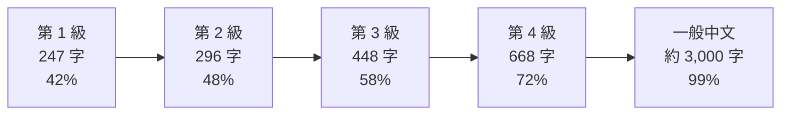

# Mini-Lang 字表擴充：哪些常用字還沒收，要怎麼加

> 問題：Mini-Lang 現在只有 247 字。如果繼續擴充（超過 256 字也可以），哪些字很常用、卻還不在字表裡？要怎麼擴充？
>
> 相關文件：[mini-lang.md](../mini-lang/mini-lang.md)（字表）、[universal.md](../mini-lang/universal.md)（通用版規則）、[examples.md](../mini-lang/examples.md)（翻譯範例）

## 結論

1. **247 字只涵蓋一般中文用字的 42%。** 另外 58% 都要靠描述、外來語或改寫句子來處理。
2. **建議分級擴充，而不是一次換掉字表。** 每一級都是下一級的子集，現有的 247 字（第 1 級）保持不變，之前的實驗和語料都還能用。
3. **第 2 級（+49 字，共 296 字）：先補結構字。** 被、把、著、已經、雖然、或、讓、才、她、種、像、別……。這些字一缺，就得改寫整句的結構，不只是換一個詞。
4. **第 3 級（+152 字，共 448 字）：補生活核心字。** 笑、哭、怕、跑、聲、樹、鳥、魚、腳、臉、街、城、甜、綠……。補完後，範例文章要改寫的字從 37% 降到 22%，詞典裡能直接寫原詞的從 101 條增加到 371 條。
5. **第 4 級（+220 字，共 668 字）：補書面常用字。** 涵蓋率到 72%，範例只剩 12% 的字要改寫。但越往後，每加一個字的效果越小，也越接近一般中文本身。
6. **我建議把第 3 級（約 450 字）當作通用版的新目標，** 第 1 級繼續用在教學入門與模型實驗。

## 一、怎麼找出來的

| 資料 | 用途 |
|---|---|
| jieba 的詞頻表（約 35 萬個詞，以新聞、書籍為主），用 OpenCC 轉成繁體 | 估計每個字在一般中文中出現的頻率 |
| 詞典（[lexicon/](../mini-lang/lexicon/)，1,236 條） | 這些都是「字表外、只好改寫」的詞，代表 Mini-Lang 實際碰到的困難 |
| 6 段範例文章的原文（[examples.md](../mini-lang/examples.md)） | 實際翻譯時，有多少字要改寫 |

對每個字表外的字算兩個指標：

* **字頻：** 這個字在一般中文中出現多少次。
* **解鎖價值：** 加入這個字以後，「只差這個字就能直接寫」的詞，總共出現多少次。例如加入「同」，同時、不同、同學、同意都能直接寫。這個指標比字頻更能反映「加了有沒有用」。

詞頻表以新聞為主，所以民、政、軍、委、省、縣、黨這類字排得很前面。這些字一般生活用不太到，所以**不列入建議**；人名、地名用字也一樣。

## 二、效果

| 級 | 字數 | 一般用字涵蓋率 | 詞典 1,236 條中能直接寫原詞的 | 範例 645 字中要改寫的 |
|---|---:|---:|---:|---:|
| 1（現在） | 247 | 42.0% | 101 | 239（37%） |
| 2：+ 結構字 | 296 | 48.3% | 164 | 207（32%） |
| 3：+ 生活核心字 | 448 | 58.4% | 371 | 143（22%） |
| 4：+ 書面常用字 | 668 | 72.1% | 620 | 76（12%） |

只依字頻往上加時的涵蓋率，可以看出越後面效果越小：

| 加入的字數 | 50 | 100 | 200 | 300 | 500 | 750 | 1,000 | 1,500 |
|---|---:|---:|---:|---:|---:|---:|---:|---:|
| 涵蓋率 | 52.4% | 58.6% | 67.0% | 72.7% | 80.2% | 86.0% | 89.6% | 93.8% |



被刪掉的「二三四五六七八九十」合計只佔一般用字的 0.78%，而且阿拉伯數字完全能代替，所以**不建議加回來**。

## 三、第 2 級：結構字（+49）

| 類別 | 字 |
|---|---|
| 被動、處置、狀態 | 被 把 著 已 經 剛 久 始 變 成 |
| 連接與邏輯 | 雖 然 而 或 與 及 並 卻 才 讓 使 將 當 於 之 又 另 必 該 應 較 越 像 般 直 常 |
| 代詞與範圍 | 她 它 其 此 某 何 各 全 無 別 種 類 定 |

**這一級的意義是「語法回到一般中文」。** [universal.md](../mini-lang/universal.md) 第 5 節的替代表大部分都不需要了：

| 現在的說法 | 第 2 級可以直接說 |
|---|---|
| 錢給他拿走了、有人打了他 | 錢被他拿走了、他被打了 |
| 我拿書放在這裡 | 我把書放在這裡 |
| 他是很忙，可是還是來了 | 雖然他很忙，但還是來了 |
| 他坐在那裡看書 | 他坐著看書 |
| 天冷起來了、他做了老師 | 天開始冷了、他變成了老師 |
| 不學就不會 | 只有學了才會 |
| 一天比一天冷 | 越來越冷 |
| 一樣新的 | 一種新的 |

**要你決定的一件事：** 第 1 級規定第三人稱一律寫「他」。第 2 級加入「她、它」後，要不要恢復「他、她、它」的區分？我建議恢復，翻譯一般文章時比較不會失去資訊；第 1 級仍然只用「他」。

## 四、第 3 級：生活核心字（+152）

| 類別 | 字 |
|---|---|
| 動作 | 發 行 動 加 入 達 改 受 選 帶 認 收 考 求 感 拉 推 算 需 送 答 講 讀 換 跑 跳 哭 抱 唱 借 怕 死 活 試 識 視 聞 報 笑 |
| 自然與動物 | 海 湖 江 河 石 土 風 光 空 星 雲 雪 冰 夜 樹 草 葉 魚 馬 牛 羊 狗 貓 雞 鳥 豬 蛋 |
| 身體與健康 | 血 臉 腳 腿 牙 耳 鼻 髮 藥 痛 累 餓 渴 |
| 地方、學校、社會 | 市 城 村 街 院 園 館 場 部 業 公 班 課 網 圖 號 處 程 |
| 性質與顏色 | 強 弱 深 淺 輕 低 亮 暗 靜 吵 滿 乾 淨 髒 苦 甜 怪 舊 胖 瘦 富 窮 美 醜 黃 綠 藍 平 安 實 原 相 |
| 抽象名詞與語文 | 主 本 法 面 代 理 力 化 物 具 數 聲 詞 句 歌 畫 信 |
| 食物 | 米 麵 油 鹽 糖 酒 |

**這一級的意義是「最常說的事不用再繞」。** 例如：

| 現在的說法 | 第 3 級可以直接說 |
|---|---|
| 樂了 | 笑了 |
| 覺得會有壞事 | 怕 |
| 很快地走 | 跑 |
| 難過得眼裡都是水 | 哭 |
| 不在了 | 死了 |
| dog、tree、fish、bird | 狗、樹、魚、鳥 |
| 看病的地方、大家去走走、玩玩的地方 | 醫院、公園 |
| 天上的色、山的色 | 藍色、綠色 |
| 想吃東西、想喝水 | 餓、渴 |
| 雨下得很大 | 雨聲很大 |

外來語會大量減少：動物、身體、食物、天氣這些最常用的外來語，大多換回中文。樹林、鳥、魚這類詞也能直接寫；不過「森林」的「森、林」和「球」不在第 3 級，球場、足球要到第 4 級才能寫（「森、林」四級都沒有）。

## 五、第 4 級：書面常用字（+220）

依字頻往下取 200 字（排除新聞、政治、人名、地名用字），再加上範例文章中缺、又很日常的字：

```text
同表者內員正度合性位由立利元量期世特總通義科展品提王社首共形兒計司式基流至解稱張決術結交管便族反保京條規目專組接指濟運論取技神界傳古廣質陽件聯線官商即步舉連爭非研眾據歷裝轉調英士格根造型親單價約器案積群功料備影究往遊極育許令告觀精整辦參隨包持示劃投勢透值片望里源鐵斷夫速象列引律紀支況境證訊且編除雙未居織確初標青球節察響置率施均幹準失防甚落客擊離營顯存足素護副食餘照興巴洲佔費階佈域木寶效底宮音批切鄉倒父母味夏春票秋床隻睛杯窗冬餐碗烤顆煮廚
```

這一級混合了兩種字：

* **日常字：** 春、夏、秋、冬、父、母、床、窗、杯、碗、煮、烤、味、票，以及量詞「隻、條、張、件、顆、片」。
* **書面字：** 科、論、研、究、技、術、經濟的「濟」、證、律。它們在新聞與說明文中很常見，但生活對話不太用。

如果要做第 4 級，我建議先把這 220 字分成「日常」與「書面」兩半，人工審過再決定，不要直接照字頻收。

## 六、擴充會牽動的地方

| 項目 | 影響 |
|---|---|
| 一個位元組 | 超過 256 字就放不進一個位元組。對語言模型沒有影響（詞表 300 到 700 個 token 仍然很小），只是「2⁸」的設計特色會變成只屬於第 1 級 |
| 詞典 | 每一條要標出「從第幾級開始可以直接寫原詞」。例如「樹」在第 1、2 級寫 tree，第 3 級以上寫樹 |
| 量詞 | 第 4 級加入隻、條、張、件、顆、片後，可以恢復自然的量詞（一隻狗、一張紙） |
| 規則 | 第 2 級以上的語法替代表大幅縮短；第 1 級維持現在的 17 條句型 |
| 檢查工具 | check.py、網頁翻譯器、提示詞都要能選級別 |
| 模型實驗 | 第 1 級不變，所以之前的實驗不受影響；之後可以比較「字表越大，小模型學得越好還是越差」 |

## 七、我的建議

1. **字表改成分級，第 1 級（247 字）不動。**
2. **先做第 2、3 級（共 448 字），** 這兩級的字都很明確，效果也最大：範例要改寫的字從 37% 降到 22%。
3. **第 4 級先人工審過再決定，** 只收日常字，書面字另外考慮。
4. 每一級都要附上：字表、該級可以直接寫的詞（從詞典自動算）、語法替代表，以及給 LLM 用的提示詞。

## 參考

* jieba 詞頻表：jieba 套件內建的 dict.txt（約 35 萬詞）。用字頻率依「詞頻 × 字在詞中出現的次數」計算。
* 繁簡轉換：OpenCC（s2twp，轉成台灣用詞）。
