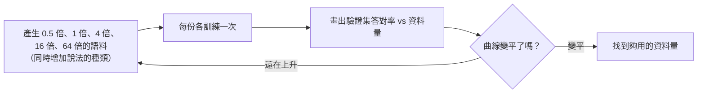

# 資料要多大？把模型縮小，泛化會更好嗎？

> 問題：資料要到多大才夠？或者反過來，把模型縮得更小，泛化能力會不會更好？
>
> 相關文件：[generalization.md](generalization.md)、[small-models.md](small-models.md)

## 結論

* **資料要多大：** 沒有單一的數字。重要的不是總字數，而是**涵蓋了多少種組合**，以及**每個事實有幾種說法**。最可靠的做法是畫**學習曲線**實際量出來。Mini-Lang 是由程式產生的，資料要多少有多少，很適合這樣做。
* **把模型縮小：** **可能有一點幫助，但風險很大，通常不是最好的方法。** 縮到剛好背得下資料時，泛化可能反而**最差**（雙重下降的高峰）；縮得太小又會學不會規則。比較可靠的是保留容量，再用**正則化和更多樣的資料**讓死背變得不划算。

## 一、資料要多大

### 1. 經驗法則只能當參考

Chinchilla（Hoffmann et al., 2022）建議資料量約為參數量的 20 倍：

$$
1.08 \times 10^6 \text{ 參數} \times 20 \approx 2 \times 10^7 \text{ token（約 2000 萬字）}
$$

mini-lm 一個字就是一個 token，相當於約 100 萬句 Mini-Lang 句子，是現在的 1000 倍。

不過這個比例是「在固定計算量下讓 loss 最低」的建議，**不是泛化的門檻**。只是把同樣的模板重複產生 100 萬次，模型學不到新東西。

### 2. 真正重要的是「涵蓋比例」與「變化」

| 因素 | 意思 | 研究依據 |
|---|---|---|
| **涵蓋比例** | 所有可能的組合中，訓練資料涵蓋了多少 | 頓悟（grokking）研究：訓練資料佔全部組合的比例低於某個門檻時，模型只會死背；超過門檻才會學到規則（Power et al., 2022） |
| **每個事實的說法數** | 同一個事實用幾種不同說法出現 | Allen-Zhu & Li（*Physics of Language Models 3.1*）：每個人的資料只有一種寫法時，模型很難把知識用在問答上；同一事實有多種寫法、句子順序也打亂後，對沒練過問答的人也能答對大部分 |
| **推論與事實的比例** | 需要推理的例子，相對於基本事實有多少 | Wang et al.（2024, *Grokked Transformers are Implicit Reasoners*）：兩步推理能否學會，取決於「推論例子 ÷ 基本事實」的**比例**，而不是資料總量 |

這三點的共同結論是：**比例比總量重要。** 資料要多，指的是「變化」要多。

### 3. 用學習曲線量出來

Mini-Lang 語料是產生出來的，所以可以直接做實驗：

曲線變平，代表再加資料也沒用。這時要嘛換更大的模型，要嘛增加資料的**種類**，而不只是數量。

### 4. 粗略估計

以 Mini-Lang 為例，大致的量級是：

| 目標 | 需要的資料 | 量級 |
|---|---|---|
| 人物問答推廣到沒練過的人 | 每個事實 3–5 種說法、句子順序打亂 | 數千到數萬句 |
| 換句話問也答得出來 | 每種問題多種問法，保留一種問法只用來驗證 | 數萬句 |
| 兩步推理 | 足夠比例的推理例子 | 數萬句 |
| 自由的 Mini-Lang 對話與短文 | 像 TinyStories 一樣大量、多樣的文章 | 數百萬到數千萬字 |

這些只是量級的估計，實際數字要用學習曲線確認。

## 二、把模型縮小，泛化會更好嗎？

### 1. 支持的理由：容量限制本身就是一種正則化

模型小到背不下全部資料時，死背行不通，只好去找規則。這就是 [generalization.md](generalization.md) 說的「讓死背變得不划算」。

而且 Mini-Lang 的世界很小（256 字、16 個人、幾十種句型），真正需要的容量很少。目前的 108 萬參數可能遠多於需要。

### 2. 反對的理由一：可能正好掉進雙重下降的高峰

雙重下降（Nakkiran et al., 2019）顯示，驗證誤差在「剛好能背下所有資料」的大小時**最高**。從現在的位置往小縮，很可能先經過這個高峰，泛化反而變差。

### 3. 反對的理由二：縮過頭就學不會

* **太窄**：概念擠在一起互相干擾，連訓練集都答不好。
* **太淺**：層數決定一次能做幾步推理。縮減層數對兩步推理特別傷。

### 4. 反對的理由三：大模型的好處也一起丟了

[generalization.md](generalization.md) 提到，大模型偏好簡單的解、概念分得開、樣本效率高。縮小模型也會一起失去這些好處。

### 5. 更好的做法：保留容量，控制「有效容量」

| 方法 | 效果 | 和縮小模型比 |
|---|---|---|
| Weight decay（例如 0.1） | 讓權重保持小而簡單 | 不損失表達能力 |
| Dropout（例如 0.1） | 不能依賴單一路徑死背 | 同上 |
| 用驗證集提早停止 | 在開始死背前停下來 | 同上 |
| 資料擴增、更多樣的資料 | 死背的成本變高 | **最有效** |

現代大型語言模型的經驗是：**大模型 + 正則化 + 大量多樣的資料**，勝過小模型。

### 6. 模型大小應該和資料一起調整

模型大小不是獨立的設定。資料變多、變多樣時，模型也應該跟著變大；資料不變時，硬把模型縮小只是換一種方式受限。

## 三、可以做的實驗

用一個表格同時回答兩個問題：

| 模型大小 ＼ 資料 | 0.5 倍 | 1 倍（現在） | 4 倍 | 16 倍 |
|---|---|---|---|---|
| 極小（d=32，2 層，約 4 萬參數） | | | | |
| 小（d=64，2 層，約 15 萬參數） | | | | |
| 現在（d=128，4 層，約 108 萬參數） | | 50% | | |
| 大（d=256，6 層，約 640 萬參數） | | | | |

每一格記錄 Mini-Lang 驗證集答對率，另外再固定模型大小，比較加入 weight decay 與 dropout 的效果。

**預測**：

* 固定資料時，驗證答對率隨模型大小呈現「先降後升」或接近持平，不會單純因為變小而變好。
* 加入正則化，效果會比單純縮小模型更穩定。
* 增加資料的變化，所有模型大小都會進步，大模型進步最多。

## 參考文獻

* Hoffmann et al. (2022). *Training Compute-Optimal Large Language Models.*
* Nakkiran et al. (2019). *Deep Double Descent: Where Bigger Models and More Data Hurt.*
* Power et al. (2022). *Grokking: Generalization Beyond Overfitting on Small Algorithmic Datasets.*
* Allen-Zhu & Li (2023). *Physics of Language Models: Part 3.1, Knowledge Storage and Extraction.*
* Wang et al. (2024). *Grokked Transformers are Implicit Reasoners.*
* Eldan & Li (2023). *TinyStories: How Small Can Language Models Be and Still Speak Coherent English?*
