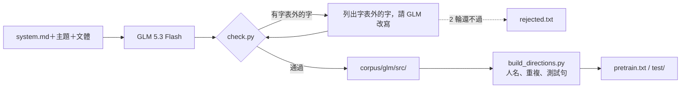

# 用 GLM 5.3 Flash 產生 Mini-Lang 語料

> 問題：請大型語言模型大量寫 Mini-Lang（297 字）語料，拿來訓練 mini-lm，模型會變好嗎？

## 1. 怎麼產生

[mini-lm/gen_glm.py](../mini-lm/gen_glm.py) 呼叫 NVIDIA 的 `z-ai/glm-5.3-flash`（reasoning_effort low），系統提示詞是 [mini-lang/prompts/system.md](../mini-lang/prompts/system.md)（含完整字表）。

* **請求：** 18 類 × 每類 10 個主題 × 4 種文體（句子、對話、小故事、說明），共 720 個請求。
* **每一行都要通過 [mini-lang/check.py](../mini-lang/check.py) 的檢查：** 漢字都在字表內，也沒有英文字母。
* **不合格就改寫：** 把字表外的字列給模型，請它逐行改寫，最多 2 輪；還是不合格就丟掉（記在 `rejected.txt`）。
* **整理：** [build_directions.py](../mini-lm/build_directions.py) `--dir corpus/glm` 再檢查一次字表，去掉疑似人名的句子（避免和人物事實衝突）、和其他語料重複的句子、其他語料的測試句，每類切 10% 當測試句。



整個語料最後再用一行指令確認：

```bash
python mini-lang/check.py --file mini-lm/corpus/glm/pretrain.txt mini-lm/corpus/glm/test/*.txt
# 檢查了 9 個檔案、3554 行：✅ 全部在字表內
```

### 產生的結果

| 項目 | 數字 |
|---|---:|
| 完成的請求 | 303 / 720（8 類：animals、body、daily、family、food、nature、school、work） |
| 模型寫出的行 | 3,931 |
| 一次就全部在字表內 | 1,950（50%） |
| 改寫後在字表內 | 3,687（94%） |
| 整理後：訓練句 / 測試句 | 3,203 / 351 |

* GLM 5.3 Flash 在 low 推理下**不會自己逐字檢查**，一半的行有字表外的字（最常見：把、才、面、著、床、錯、讓）。把字表外的字明確告訴它，幾乎都能改好。
* 改寫有時會繞彎，例如「鹽」寫成「那個白色的、叫菜好吃的東西」，「年輕人」寫成「不老的人」。
* 其餘 417 個請求因為網路中斷，以及之後 NVIDIA 持續回 429（請求太多），沒有完成。`gen_glm.py` 可以接著做：再執行一次就只做還沒完成的請求。

## 2. 訓練實驗

[mini-lm/experiments/glm_corpus.py](../mini-lm/experiments/glm_corpus.py)。模型都是 large（d=256、8 頭、6 層，約 640 萬參數），語料都是第 3 版字表；人物問答語料用和 [best-model.md](best-model.md) 相同的設定重新產生。

| 設定 | 語料 | 預訓練步數 |
|---|---|---:|
| D | 人物資料（加強）＋手寫句子＋方向語句 | 2000 |
| E | D ＋ GLM 語料 | 2000 |
| E2 | D ＋ GLM 語料 | 4000 |

| 設定 | 新事實 | 新問法 | 兩者皆新 | 手寫句 loss | 方向句 loss | GLM 句 loss |
|---|---:|---:|---:|---:|---:|---:|
| D | **263/358 (74%)** | **1328/1434 (93%)** | **199/358 (56%)** | 2.430 | 3.160 | 4.740 |
| E | 175/358 (49%) | 1132/1434 (79%) | 109/358 (30%) | 2.327 | **3.133** | **3.526** |
| E2 | 235/358 (66%) | 1003/1434 (70%) | 123/358 (34%) | **2.168** | 3.285 | 3.775 |

（新事實、新問法、兩者皆新：人物問答的泛化；loss：沒看過的句子的每字 loss，越低越好。）

## 3. 觀察

1. **語言能力變好了。** 加入 GLM 語料後，沒看過的 GLM 句子 loss 從 4.74 降到 3.53（困惑度 114 → 34），手寫句也從 2.43 降到 2.17–2.33。模型學到了更多樣的日常說法。
2. **人物問答變差了。** 三種問答測試都下降，「兩者皆新」從 56% 掉到 30–34%。
3. **可能的原因：**
   * **稀釋：** GLM 句子比人物事實句長很多，加入後預訓練看到人物事實的比例下降，事實記得比較少（E2 預訓練加倍後，新事實回升到 66%，支持這個解釋）。
   * **說法衝突：** GLM 語料裡有大量「我、他、我的朋友」的日常描述，和人物事實的句型相近但內容不同，可能干擾問答。
   * **只有一次訓練：** 每個設定只跑一個隨機種子，差距的一部分可能是雜訊。
4. **結論：** 大型模型寫的 Mini-Lang 語料能提升小模型的「語言」能力，但在這個資料量與步數下，會犧牲「人物問答」的能力。要兩者兼得，可能需要控制語料混合比例，或先用 GLM 語料預訓練、再用人物資料訓練。
