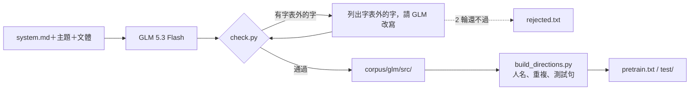

# 用 GLM 5.3 Flash 產生 Mini-Lang 語料

> 問題：請大型語言模型大量寫 Mini-Lang（297 字）語料，拿來訓練 mini-lm，模型會變好嗎？

## 1. 怎麼產生

[mini-lm/gen_glm.py](../mini-lm/gen_glm.py) 呼叫 NVIDIA 的 `z-ai/glm-5.3-flash`（reasoning_effort low），系統提示詞是 [mini-lang/prompts/system.md](../mini-lang/prompts/system.md)（含完整字表）。

* **請求：** 18 類 × 每類 10 個主題 × 4 種文體（句子、對話、小故事、說明），共 720 個請求。
* **每一行都要通過 [mini-lang/check.py](../mini-lang/check.py) 的檢查：** 漢字都在字表內，也沒有英文字母。
* **不合格就改寫：** 把字表外的字列給模型，請它逐行改寫，最多 2 輪；還是不合格就丟掉（記在 `rejected.txt`）。
* **整理：** [build_directions.py](../mini-lm/build_directions.py) `--dir corpus/glm` 再檢查一次字表，去掉疑似人名的句子（避免和人物事實衝突）、和其他語料重複的句子、其他語料的測試句，每類切 10% 當測試句。



整個語料最後再用一行指令確認：

```bash
python mini-lang/check.py --file mini-lm/corpus/glm/pretrain.txt mini-lm/corpus/glm/test/*.txt
# 檢查了 9 個檔案、3554 行：✅ 全部在字表內
```

### 產生的結果

| 項目 | 數字 |
|---|---:|
| 完成的請求 | 303 / 720（8 類：animals、body、daily、family、food、nature、school、work） |
| 模型寫出的行 | 3,931 |
| 一次就全部在字表內 | 1,950（50%） |
| 改寫後在字表內 | 3,687（94%） |
| 整理後：訓練句 / 測試句 | 3,203 / 351 |

* GLM 5.3 Flash 在 low 推理下**不會自己逐字檢查**，一半的行有字表外的字（最常見：把、才、面、著、床、錯、讓）。把字表外的字明確告訴它，幾乎都能改好。
* 改寫有時會繞彎，例如「鹽」寫成「那個白色的、叫菜好吃的東西」，「年輕人」寫成「不老的人」。
* 其餘 417 個請求因為網路中斷，以及之後 NVIDIA 持續回 429（請求太多），沒有完成。`gen_glm.py` 可以接著做：再執行一次就只做還沒完成的請求。

## 2. 訓練實驗

[mini-lm/experiments/glm_corpus.py](../mini-lm/experiments/glm_corpus.py)。模型都是 large（d=256、8 頭、6 層，約 640 萬參數），語料都是第 3 版字表；人物問答語料用和 [best-model.md](best-model.md) 相同的設定重新產生。

| 設定 | 語料 | 預訓練步數 |
|---|---|---:|
| D | 人物資料（加強）＋手寫句子＋方向語句 | 2000 |
| E | D ＋ GLM 語料 | 2000 |
| E2 | D ＋ GLM 語料 | 4000 |

| 設定 | 新事實 | 新問法 | 兩者皆新 | 手寫句 loss | 方向句 loss | GLM 句 loss |
|---|---:|---:|---:|---:|---:|---:|
| D | **263/358 (74%)** | **1328/1434 (93%)** | **199/358 (56%)** | 2.430 | 3.160 | 4.740 |
| E | 175/358 (49%) | 1132/1434 (79%) | 109/358 (30%) | 2.327 | **3.133** | **3.526** |
| E2 | 235/358 (66%) | 1003/1434 (70%) | 123/358 (34%) | **2.168** | 3.285 | 3.775 |

（新事實、新問法、兩者皆新：人物問答的泛化；loss：沒看過的句子的每字 loss，越低越好。）

## 3. 觀察

1. **語言能力變好了。** 加入 GLM 語料後，沒看過的 GLM 句子 loss 從 4.74 降到 3.53（困惑度 114 → 34），手寫句也從 2.43 降到 2.17–2.33。模型學到了更多樣的日常說法。
2. **人物問答變差了。** 三種問答測試都下降，「兩者皆新」從 56% 掉到 30–34%。
3. **可能的原因：**
   * **稀釋：** GLM 句子比人物事實句長很多，加入後預訓練看到人物事實的比例下降，事實記得比較少（E2 預訓練加倍後，新事實回升到 66%，支持這個解釋）。
   * **說法衝突：** GLM 語料裡有大量「我、他、我的朋友」的日常描述，和人物事實的句型相近但內容不同，可能干擾問答。
   * **只有一次訓練：** 每個設定只跑一個隨機種子，差距的一部分可能是雜訊。
4. **結論：** 大型模型寫的 Mini-Lang 語料能提升小模型的「語言」能力，但在這個資料量與步數下，會犧牲「人物問答」的能力。要兩者兼得，可能需要控制語料混合比例，或先用 GLM 語料預訓練、再用人物資料訓練。

## 4. 為什麼問答變差：分析

以下的數字來自 `runs/glm/` 的 D、E、E2 三個模型（不必重新訓練），問答以「兩者皆新」（358 題）為主。

### 4.1 不只是稀釋

預訓練是從所有句子中均勻抽字元，所以各語料被看到的比例 ≈ 字數比例：

| 語料 | 句數 | 平均字數 | D 中的比例 | E 中的比例 |
|---|---:|---:|---:|---:|
| 人物事實、小傳 | 9,342 | 13.1 | 49.7% | 36.5% |
| 一般句子 | 6,857 | 11.7 | 32.5% | 23.8% |
| 方向語句 | 1,806 | 23.6 | 17.2% | 12.6% |
| GLM | 3,203 | **28.0** | — | **26.6%** |

GLM 句子只佔 3,203 句，卻佔了四分之一的字數。人物事實被看到的次數：D 約 25 遍、E 約 18 遍、**E2 約 37 遍**。E2 看人物事實的次數比 D 還多，問答卻仍然比 D 差（兩者皆新 34% 對 56%），所以**稀釋只能解釋一部分**。

### 4.2 答案的格式跑掉了

把錯誤分成「答了另一個合理答案」（例如 2個 → 3個）和「答了不像答案的東西」：

| 模型 | 答對 | 答錯，但是一個合理答案 | 不像答案 |
|---|---:|---:|---:|
| D | 199 | 125 | 34 |
| E | 109 | 171 | **78** |
| E2 | 123 | 149 | **86** |

「不像答案」的輸出多了一倍以上，例如：

| 問題 | 正解 | D | E |
|---|---|---|---|
| 小雨多大了？ | 21歲 | 21歲 | 你的土要慢地 |
| 小天多大了？ | 65歲 | 工人 | 小天有26個字菜 |
| 明紅多大了？ | 22歲 | 22歲 | （空白） |

微調的資料和步數（1000 步）三個模型完全相同，差別只在起點。預訓練裡多了大量長而多樣的敘述句以後，模型遇到**沒把握的問題**（尤其是沒見過的問法「多大了？」），就退回最常見的「繼續說下去」模式，而 1000 步的微調不足以把它拉回「只答一個短答案」。依題型看，「多大了」從 12/52 掉到 2/52，「有幾個孩子」從 41/57 掉到 16/57。

### 4.3 人名和常用詞撞在一起

人名用「明山花文天月雨心東南白紅新樂真方」兩兩組成，其中有些本身就是常用詞。GLM 語料裡有 123 行含有和人名相同的字串，幾乎都是當一般詞用：

| 字串 | 在 GLM 語料出現 | 意思 |
|---|---:|---|
| 明天 | 54 | 時間 |
| 白天 | 19 | 時間 |
| 小心 | 18 | 動作 |
| 明白 | 10 | 懂 |
| 大雨、小雨、雨天 | 13 | 天氣 |

`build_directions.py` 的人名過濾特意放過這些常用詞，但對模型來說，「明天」這兩個字在 GLM 語料裡強烈地是「時間」，問「明天多大了？」時就更難把它當成一個人。

不過這只是**小原因**。256 個人名中只有 14 個出現在 GLM 語料裡（南方、大山、大雨、天真、小天、小心、小明、小花、小雨、明天、明白、白天、白花、雨天），只佔約 6% 的題目。把題目分成「含這 14 個人名」和「其他」：

| 測試 | 題目 | D | E |
|---|---|---:|---:|
| 新事實 | 含撞名（22 題） | 18 | 10 |
| | 其他（336 題） | 245（73%） | 165（49%） |
| 新問法 | 含撞名（76 題） | 67 | 61 |
| | 其他（1,358 題） | 1,261（93%） | 1,071（79%） |
| 兩者皆新 | 含撞名（22 題） | 13 | 8 |
| | 其他（336 題） | 186（55%） | 101（30%） |

人名完全沒撞到的題目，E 一樣大幅下降。所以把人名改成英文（或改用不撞常用詞的組合）能消除這 6% 的干擾，但解釋不了主要的退步；主要原因是 4.2 的答案格式跑掉與 4.4 的任務不相符。

### 4.4 GLM 語料裡幾乎沒有問答需要的東西

| 說法 | GLM 語料 | 人物事實 |
|---|---:|---:|
| 喜歡吃 | 18 | 1,162 |
| 喜歡喝 | 3 | 764 |
| 的朋友是 | 1 | 365 |
| 的家在 | 1 | 391 |
| 有幾個孩子 | 0 | — |

GLM 語料增加的是**語言的多樣性**（日常、對話、故事），不是問答測試需要的**任務的多樣性**（同一個事實的不同說法、不同問法）。對 640 萬參數的小模型來說，它和人物事實競爭的是同一份容量：GLM 句子難預測（loss 3.5 以上），在預訓練中占了較大的梯度，人物事實（loss 已經很低）分到的更新就少了。這和 [emergence.md](emergence.md) 的結論一致：小模型的瓶頸是資料中「任務」的多樣性，而不是語言本身的量。

### 4.5 雜訊

每個設定只訓練一次。不過「D 對、E 錯」有 119 題，「E 對、D 錯」只有 29 題，差距遠大於雜訊。

### 4.6 可以怎麼改

| 原因 | 做法 |
|---|---|
| 答案格式跑掉 | 微調步數加長，或微調時混入少量 GLM 句子以外的短答範例 |
| 稀釋與容量競爭 | 控制混合比例（例如 GLM 只佔 10%），或先用 GLM 語料預訓練、再用人物資料預訓練（課程式） |
| 人名撞常用詞 | 人名避開常用詞（不用明天、白天、小心、明白、大雨、小雨等組合） |
| 沒有問答需要的東西 | 請 GLM 產生「同一件事的多種說法」與各種問法的問答，而不只是日常句子 |
