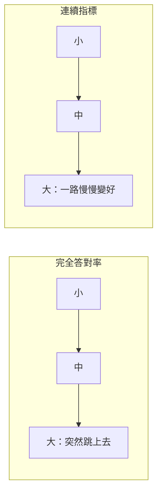

# 小模型為什麼沒有「智慧湧現」？

> 問題：mini-lm 遇到的許多問題，是不是因為模型太小，達不到 LLM 的智慧湧現？為什麼小模型做不到？
>
> 相關文件：[generalization.md](generalization.md)（小模型為什麼泛化不足）、[roadmap.md](roadmap.md)、[understanding.md](understanding.md)

## 結論

**只對了一部分。** 模型小確實是限制，但 mini-lm 目前的問題大多來自**資料太少、太單調**，以及**訓練格式**沒有教到。甚至有些問題連 GPT-4 等級的大模型也有。

目前的狀況其實是：**模型對這份資料來說已經太大，資料才是瓶頸。**

## 一、先看數字

| | mini-lm（Mini-Lang） | GPT-3 | Chinchilla 建議比例 |
|---|---:|---:|---:|
| 參數量 | 約 108 萬 | 1750 億 | — |
| 不重複的訓練資料 | 約 2 萬字 | 約 3000 億 token | — |
| 資料量 ÷ 參數量 | 約 0.02 | 約 1.7 | 約 20 |
| 訓練時看過的 token | 約 614 萬（同一份資料重複約 300 次） | 約 3000 億 | — |

Chinchilla（Hoffmann et al., 2022）的研究指出，要充分訓練一個模型，資料量大約要是參數量的 20 倍。mini-lm 只有 0.02 倍，**差了一千倍**。

證據就在訓練結果裡：訓練集 100% 答對。模型有足夠的容量把所有資料背下來，但資料裡沒有足夠的變化，讓它學會「推廣」。

## 二、「湧現」是什麼

**湧現（emergent abilities）**：小模型完全做不到，模型大到某個程度後突然做得到的能力，例如多位數算術、多步推理、照著範例做新任務（Wei et al., 2022）。

不過後來的研究（Schaeffer et al., 2023, *Are Emergent Abilities of Large Language Models a Mirage?*）指出，「突然」有一部分是**評分方式造成的錯覺**：

* 用「完全答對才算分」這種全有全無的標準，能力看起來像突然出現。
* 改用連續的指標（例如答案的機率、部分正確），能力其實是**隨模型變大平滑地進步**。

所以與其說小模型「沒有湧現」，不如說：**能力是逐步累積的，小模型累積得不夠多。** mini-talk 用的正是「完全答對」的評分方式，很容易低估小模型其實學到的部分。

## 三、小模型真正的限制

### 1. 記憶容量

研究估計，語言模型每個參數大約能儲存 2 bits 的知識（Allen-Zhu & Li, *Physics of Language Models 3.3*）：

$$
1.08 \times 10^6 \text{ 參數} \times 2 \text{ bits} \approx 2 \times 10^6 \text{ bits} \approx 270 \text{ KB}
$$

記住 16 個人的事實綽綽有餘，但要記住整個世界的常識就完全不夠。**這不是目前的瓶頸。**

### 2. 層數決定一次能想幾步

Transformer 生成一個字時，資訊只能往上經過固定的層數。mini-lm 只有 4 層，代表「讀完問題就直接說出答案」時，中間能做的推理步驟很有限。

兩步推理（「小明的朋友住在哪裡？」）需要先找出「朋友是誰」，再找「那個人住哪裡」，在一次前向計算裡完成，需要足夠的深度。

大模型會用**思維鏈**（chain of thought）把中間步驟寫出來，等於借用生成的字來增加計算步數。不過這也要訓練資料裡有「一步一步寫出來」的例子才學得會。

### 3. 寬度不夠時，概念會擠在一起

每一層的向量只有 128 維。要表示的概念（人、屬性、動作、時間、語法角色…）一多，就得共用同樣的維度，彼此干擾。模型越寬，概念越能分開表示。

## 四、mini-lm 的問題，哪些是大小造成的？

| 問題（見 [roadmap.md](roadmap.md)） | 主要原因 | 大模型也有嗎？ |
|---|---|---|
| 只記住「問題 → 答案」，沒變成知識 | **資料**：每個事實只有固定說法 | **有。** Allen-Zhu & Li（3.1）發現，事實只用一種說法出現時，大模型也無法從其他角度取用；加入多種說法後才學得會 |
| 換句話問就答不出來 | **資料**：每種問題只有一種問法 | 較少。大模型看過海量的同義說法 |
| 不通順的問題也照樣回答 | **訓練目標**：從來沒教過拒答 | **有。** 未經對齊訓練的基礎模型，也常一本正經地回答無意義的問題 |
| 只會正向推論 | **資料方向** | **有。** 「反轉詛咒」（Berglund et al., 2023）：大模型學了「A 是 B」，常答不出「B 是誰」 |
| 兩步推理 | **深度與訓練方式** | 大模型好很多，但不用思維鏈時仍不穩定 |
| 發問和前文無關 | **格式**：`seq_len` 只有 96，訓練資料也沒有多輪對話 | 無 |

六個問題裡，只有兩步推理主要和模型大小有關，其餘都是資料或格式的問題。

## 五、小模型也做得到的事

**TinyStories**（Eldan & Li, 2023）是和 Mini-Lang 最接近的研究：

* 用 GPT-4 產生大量故事，只用三、四歲小孩懂的詞彙。
* 訓練只有 **100 萬到 3000 萬參數**的小模型。
* 結果小模型就能寫出文法正確、前後連貫、帶一點推理的短篇故事。

它的結論正好說明我們的處境：**語言範圍小、資料又多又多樣時，小模型也能表現出類似大模型的能力。** 關鍵在資料的多樣性，而不只是模型大小。

其他例子：

* **歸納頭**（induction heads, Olsson et al., 2022）：讓模型照著前文模式接下去的機制，2 層的小模型就會出現。
* **頓悟**（grokking, Power et al., 2022）：小模型在小資料上訓練很久之後，會從「背答案」突然轉為「學會規則」。後續研究發現，這樣訓練的小 Transformer 也能學會兩步推理。

## 六、對 Mini-Lang 的意義

Mini-Lang 和 TinyStories 的思路一樣：**縮小語言，讓小模型也學得完整。** 我們的瓶頸在資料：

| 槓桿 | 現況 | 方向 | 預期效果 |
|---|---|---|---|
| **資料多樣性** | 模板產生，句型少 | 同義說法；或像 TinyStories 用大模型產生 Mini-Lang 文章，再用 `check.py` 過濾 | **最大** |
| **資料量** | 2 萬字 | 百萬字以上 | 大 |
| **訓練格式** | 單句問答 | 多輪對話、思維鏈、拒答 | 大 |
| **模型大小** | 1M 參數、4 層 | 10M–30M 參數、6–8 層（TinyStories 的範圍） | 資料夠多之後才有效 |
| **訓練時間** | 2000 步 | 更長，加 weight decay（有機會出現 grokking） | 中 |

順序很重要：**先增加資料的量和多樣性，再加大模型。** 資料不變只加大模型，只會背得更快，不會變得更聰明。

## 七、可以驗證的實驗

這些判斷可以用一個小型的縮放實驗（scaling experiment）驗證：

| | 小資料（現在） | 大資料（多樣化） |
|---|---|---|
| 小模型（1M） | 現況 | ？ |
| 大模型（10M） | ？ | ？ |

**預測**：

* 小資料時，大模型和小模型的驗證結果差不多。
* 大資料時，兩者都變好，而且大模型進步更多。

如果結果符合預測，就能確認目前的瓶頸是資料，而不是模型大小。

## 參考文獻

* Wei et al. (2022). *Emergent Abilities of Large Language Models.*
* Schaeffer, Miranda & Koyejo (2023). *Are Emergent Abilities of Large Language Models a Mirage?*
* Hoffmann et al. (2022). *Training Compute-Optimal Large Language Models.*（Chinchilla）
* Allen-Zhu & Li (2023–2024). *Physics of Language Models*, Part 3.1（知識儲存與抽取）、Part 3.3（知識容量）。
* Berglund et al. (2023). *The Reversal Curse.*
* Eldan & Li (2023). *TinyStories: How Small Can Language Models Be and Still Speak Coherent English?*
* Olsson et al. (2022). *In-context Learning and Induction Heads.*
* Power et al. (2022). *Grokking: Generalization Beyond Overfitting on Small Algorithmic Datasets.*
