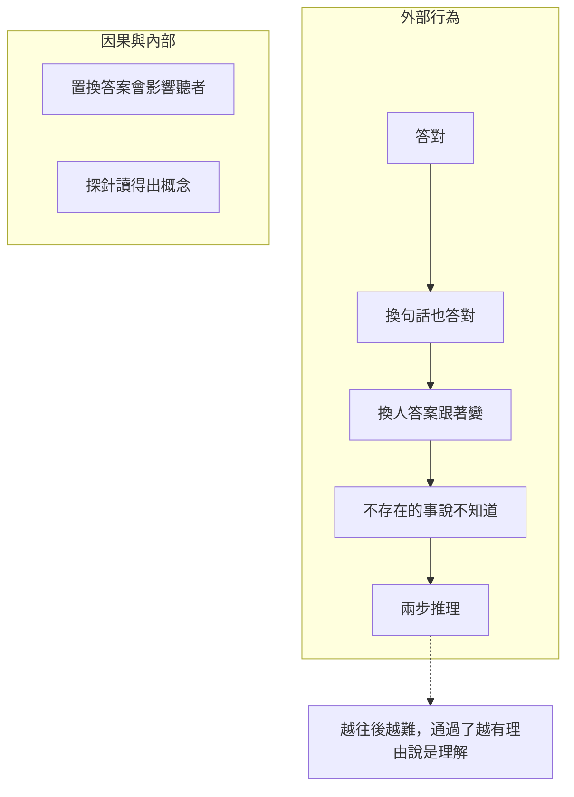

# 如何確定兩個語言模型理解了對方的話

> 背景：[mini-talk](../mini-talk/talk.md) 讓兩個 Mini-Lang 小語言模型 A、B 互相問答。本文整理一個問題：怎麼知道它們真的「理解」對方，而不只是背下字串的對應？

## 核心觀念

我們看不到模型「心裡」懂不懂（人與人之間其實也一樣），只能從**行為**推斷。所以要先把「理解」定義成可以測量的行為，再設計測試，區分：

* **真的理解**：抓到句子的意思，能在新的情況下正確使用。
* **只是背誦**：記住「這串字後面接那串字」，換個說法就失效。

mini-talk 有一個很大的優勢：每個問題的正確答案都記錄在 `mini-talk/corpus/truth.txt`，所以每項測試都能打分數。

## 一、目前已經測量的

| 測試 | 怎麼判斷 | 能說明什麼 |
|---|---|---|
| 答得對不對 | 回答和 `truth.txt` 比對 | 模型至少把問題對應到了正確的事實 |
| 資訊有沒有傳過去 | A 聽完答案再微調，比較學習前後能否答出 B 那組人的問題 | 對方說的話帶有資訊，而且聽的一方能把它變成自己的知識 |

這兩項還不夠：回答的一方微調時看過一模一樣的問題，答對也可能只是記憶。

## 二、還應該做的測試

### 1. 換句話問：同一個意思，不同說法

```
小明幾歲？     → 二十二歲
小明今年幾歲？ → ？
```

真的理解，答案應該不變；換個說法就答錯，代表只認得固定的字串。

### 2. 換一個人問：改一個地方，答案要跟著改

把問題中的名字換掉，答案應該換成另一個人的事實。如果不管問誰都答「東邊」，就是在猜最常見的答案。

分數要和**亂猜的基準**比較。例如「住在哪裡」有 4 種答案，亂猜也有 $1/4 = 25\%$。

### 3. 問不存在或沒有意義的事：知道自己不知道

```
小王幾歲？         → 應該說「我不知道」
小明喜歡喝什麼車？  → 不應該自信地回答
```

對不存在的人也一本正經地回答，代表模型沒有理解問題，只是照著格式產生答案。

### 4. 兩步推理：把兩個事實組合起來

```
小明的朋友住在哪裡？
```

要先知道「小明的朋友是大心」，再知道「大心住在東邊」。這種問題從來沒有在訓練資料中出現過，答得出來才代表模型能組合知識，而不只是查表。

### 5. 置換答案的因果測試

研究湧現式溝通（emergent communication）時常用的方法：故意把 B 的回答換成錯的或隨機的。

* A 學到的知識跟著變錯 → A 真的在使用 B 說的內容。
* A 不受影響 → A 根本沒在聽。

### 6. 對話中有沒有接著用：後續行動

B 說「小明的朋友是大心」之後，A 會不會接著問「大心住在哪裡？」。能利用對方剛說的資訊決定下一句話，是對話理解的重要指標。目前 A 的問題是隨機產生的，還做不到。

### 7. 探針（probing）：看模型內部

取出模型讀完問題後的隱藏向量，訓練一個簡單的線性分類器，看能不能讀出「問的是誰」「問的是哪一項」。讀得出來，代表模型內部確實把問題拆解成了這些概念。



## 三、mini-talk 中已經觀察到的證據

發問溫度 1.0 時，模型生成了不通順的問題，對方卻照樣回答：

```
B：小明的外在哪裡？
A：南邊
A：大天的家在覺幾個孩子？
B：兩個
```

模型是根據問題的**局部特徵**（人名、「哪裡」、「幾個孩子」）挑答案，而不是理解整句話。這正是測試 3 想抓出來的現象。

另外，從對話學習後，A、B 只答得出**聽過的題目**（各 20/20），沒聽過的同一個人的其他事實仍然答不出來。資訊確實傳了過去，但模型記住的是「問題 → 答案」，而不是「關於這個人的知識」。

## 四、預期與意義

以這麼小的模型和資料量，預期測試 2、3 部分通過，測試 1、4 失敗。因為訓練時每種問題只有一種說法，也沒有兩步推理的例子。

這些測試的價值在於**精確指出模型懂到哪裡、不懂在哪裡**，接下來就知道該補什麼資料（同義問法、兩步推理問答）。

我們無法證明模型「真正理解」，但可以逐步排除「只是背誦」的可能。通過的測試越多、越難，就越有理由說它理解了對方的話。
