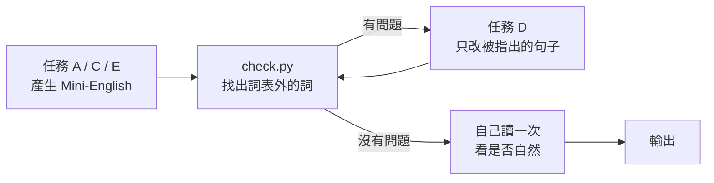

# Mini-English 任務模板

> 把 [system.md](system.md) 中「---」之間的內容整段放進系統提示詞，再把下面某一個任務放進使用者的訊息。

## 任務一覽

| 代號 | 任務 | 說明 |
|---|---|---|
| A | 一般英文 → Mini-English | 改寫，意思不變 |
| B | Mini-English → 一般英文 | 還原成自然的英文 |
| C | 用 Mini-English 寫作 | 直接寫一篇文章或一段對話 |
| D | 修改 | 只改被指出的違規句，其他字一個都不要動 |
| E | 用 Mini-English 回答問題 | 回答要簡短、只回答問題 |
| F | 查詞 | 給一個表外的英文詞，問它怎麼用 Mini-English 說 |

## 任務 A：一般英文 → Mini-English

```text
請把下面的文章改寫成 Mini-English。意思要完全一樣，不可以加東西，也不可以漏東西。

規則：
1. 只能用 system.md 第 1 節的詞表。
2. 表外的概念用描述（10 個詞以內）或外來詞（第一次出現時加括號說明）。
3. 數字用阿拉伯數字。
4. 不要用被動、完成式、關係子句，改用第 4 節的替代說法。
5. 寫完後用 check.py 檢查；不通過的話，把違規的詞列給我，讓你逐句改寫。

文章：
{{article}}
```

## 任務 B：Mini-English → 一般英文

```text
請把下面的 Mini-English 還原成一般英文。

規則：
1. 還原成一般、好的英文：句子要自然，長短要像一般文章。
2. Mini-English 裡的描述（例如 a place where doctors help sick people）要還原成那個概念的原詞。
3. 外來詞保留原樣。
4. 不要自己加原文沒有的意思。

文章：
{{article}}
```

## 任務 C：用 Mini-English 寫作

```text
請用 Mini-English 寫一篇{{genre}}，大約{{length}}詞，題目是：{{topic}}

規則：
1. 只能用 system.md 第 1 節的詞表。
2. 遇到表外的概念，用描述或外來詞。
3. 寫完後用 check.py 檢查；不通過就改到通過為止。
```

## 任務 D：修改（最常用的迴圈）

```text
下面的文章有幾個地方不在 Mini-English 的詞表內。請只修改含有這些詞的句子，
其他句子一個字都不要動，也不要再解釋。

違規詞：
{{bad_words}}

文章：
{{article}}
```

## 任務 E：用 Mini-English 回答問題

```text
請用 Mini-English 回答下面的問題。答案要短，只回答問題，不要多寫。

問題：{{question}}
```

## 任務 F：查詞

```text
下面的英文詞不在 Mini-English 的詞表內。請給我它的 Mini-English 說法。

詞：{{word}}

規則：
1. 優先用描述（10 個詞以內）；說不出是「哪一類」時用外來詞，並在括號裡說明。
2. 回答格式：
   English	Minie-English	方式	說明
3. 說明只能用 Mini-English 的詞。
```

## 建議的工作流程



實測：能力較強的模型大多一次就寫對；較弱的模型常常會用上一兩個表外的詞。
**建議照上面的流程走**：檢查 → 只改被指出的句子 → 再檢查。通常 1 到 2 輪就會全部通過。
