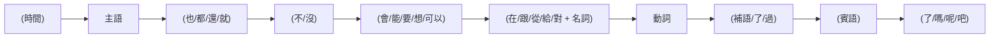
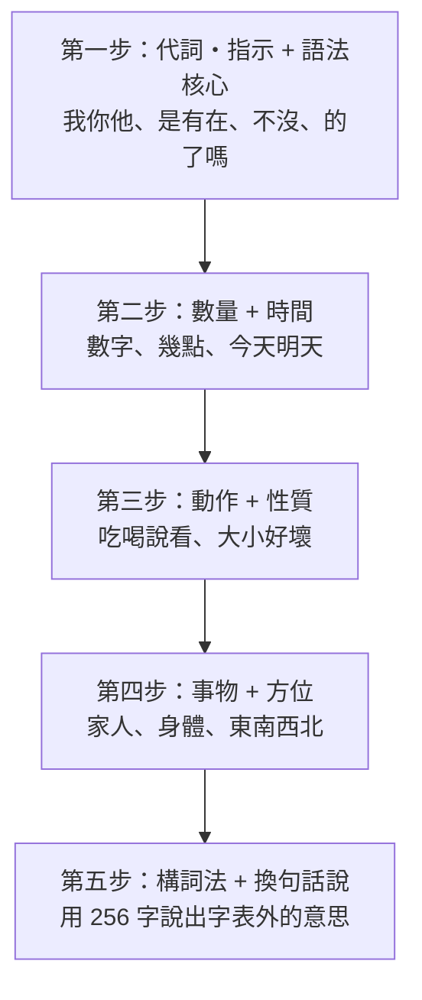

# Mini-Lang：256 字基礎中文

> 用 256 個漢字、固定的構詞法與語法，組出一套「學了就能溝通」的小中文。
> 構想來自 C. K. Ogden 在 1930 年提出的 Basic English：只用 850 個英文詞，就能表達日常生活中大部分的意思。
>
> 要翻譯任何中文文章，請看擴充版：[通用 Mini-Lang](universal.md)（同一份 256 字，加上完整的語法替代、構詞、英文外來語、阿拉伯數字與詞典）。

## 1. 設計目標

| 目標 | 做法 |
|---|---|
| **字少** | 全部只有 256 字，剛好 $2^8$，每個字可以用一個位元組（byte）編碼 |
| **是真正的中文** | Mini-Lang 是現代標準中文的**子集**：每一句合乎規則的 Mini-Lang 句子，都是母語者聽得懂、而且說法自然的中文 |
| **詞靠組合** | 字是積木，詞是組合；學會 256 字，就能讀懂幾百個常用詞 |
| **語法固定** | 只用一套固定語序與 17 條句型規則，不用「把」字句、「被」字句等較難的結構 |
| **說不出來就換句話說** | 字表外的詞用「…的地方」「…的人」「不 + 反義詞」等方式改寫 |

### 和 Basic English 的對照

| | Basic English | Mini-Lang |
|---|---|---|
| 單位 | 850 個英文 word | 256 個漢字 |
| 事物 | 600 個名詞 | 59 個事物字，透過組合產生更多名詞 |
| 性質 | 150 個形容詞 | 30 個性質字，加上「不 + 反義」 |
| 動作 | 18 個動詞 + 介系詞 | 50 個動作字 + 動補組合（看見、聽懂、做完） |
| 擴充方式 | 詞 + 介系詞（put on, get up） | 字 + 字（電 + 腦 = 電腦） |

## 2. 字表（256 字）

分成九類。每一類的字數如下：

| 類別 | 字數 | 用途 |
|---|---:|---|
| 代詞・指示 | 15 | 我、你、這、什麼、怎麼樣… |
| 語法 | 41 | 的、了、嗎、不、因為所以、如果… |
| 數量 | 23 | 數字、量詞、年齡、錢 |
| 時間 | 17 | 年月日、今明昨、早晚、分鐘、週 |
| 方位 | 17 | 上下左右前後裡外、東南西北 |
| 動作 | 50 | 來去、吃喝、說聽看寫、買賣… |
| 性質 | 30 | 大小、多少、好壞、冷熱、顏色… |
| 事物 | 59 | 人、家人、身體、食物、地方、器物… |
| 社交 | 4 | 請、謝、歡迎、關係 |
| **合計** | **256** | |

> 拼音標的是本語言中最常用的讀音。一字多音時，以斜線列出（例如「覺 jué / jiào」）。

### 2.1 代詞・指示（15）

| 字 | 拼音 | 英文 | 組合例 |
|---|---|---|---|
| 我 | wǒ | I, me | 我們、自己 |
| 你 | nǐ | you | 你們、你好 |
| 他 | tā | he, she | 他們 |
| 們 | men | (plural) | 我們、你們、他們 |
| 這 | zhè | this | 這個、這裡、這樣 |
| 那 | nà | that | 那個、那裡、那樣 |
| 誰 | shéi | who | 是誰 |
| 什 | shén | (what) | 什麼 |
| 麼 | me | (suffix) | 什麼、怎麼 |
| 哪 | nǎ | which, where | 哪個、哪裡 |
| 怎 | zěn | how | 怎麼、怎麼樣 |
| 樣 | yàng | way, kind | 一樣、這樣、怎麼樣 |
| 自 | zì | self | 自己 |
| 己 | jǐ | self | 自己 |
| 每 | měi | every | 每天、每個人 |

### 2.2 語法（41）

| 字 | 拼音 | 英文 | 組合例 |
|---|---|---|---|
| 的 | de | 's, of | 我的、好的 |
| 了 | le | (done / change) | 吃了、好了 |
| 過 | guò / guo | pass; ever | 去過、過來 |
| 嗎 | ma | (yes/no question) | 好嗎、是嗎 |
| 呢 | ne | and…? | 你呢 |
| 吧 | ba | let's; right? | 走吧、好吧 |
| 不 | bù | not | 不是、不要、對不起 |
| 沒 | méi | not (have) | 沒有、沒關係 |
| 是 | shì | be | 是的、不是、還是 |
| 有 | yǒu | have; there is | 沒有、有意思 |
| 在 | zài | at; (-ing) | 現在、在家 |
| 和 | hé | and | 我和你 |
| 也 | yě | also | 我也是 |
| 都 | dōu | all | 都好、每天都 |
| 很 | hěn | very | 很好、很多 |
| 太 | tài | too | 太大了、太太 |
| 最 | zuì | most | 最好、最大 |
| 更 | gèng | more | 更好、更多 |
| 還 | hái | still; or | 還有、還是、還好 |
| 就 | jiù | then; just | 就是、這就去 |
| 再 | zài | again | 再見、再來 |
| 會 | huì | can (skill); will | 會說、不會 |
| 能 | néng | be able | 能來、不能 |
| 要 | yào | want; will | 要去、不要、想要 |
| 可 | kě | can | 可以 |
| 以 | yǐ | (by means of) | 可以、所以、以前、以後 |
| 得 | de | (degree) | 說得好、記得、覺得 |
| 給 | gěi | give; for | 給我、給你看 |
| 對 | duì | right; toward | 對不起、不對、對他說 |
| 跟 | gēn | with | 跟我來、跟他說 |
| 從 | cóng | from | 從家裡來 |
| 到 | dào | arrive; to | 到了、看到、到家 |
| 為 | wèi | for | 為什麼、因為 |
| 因 | yīn | cause | 因為 |
| 所 | suǒ | (so) | 所以 |
| 如 | rú | if | 如果 |
| 果 | guǒ | fruit; result | 如果、水果 |
| 但 | dàn | but | 但是 |
| 只 | zhǐ | only | 只有、只要 |
| 起 | qǐ | rise | 一起、起來、對不起 |
| 比 | bǐ | compare | 比他高 |

### 2.3 數量（23）

| 字 | 拼音 | 英文 | 組合例 |
|---|---|---|---|
| 一 | yī | one | 一個、一起、一樣、一點 |
| 二 | èr | two | 二十、第二 |
| 三 | sān | three | 三月、三個 |
| 四 | sì | four | 四點 |
| 五 | wǔ | five | 五十 |
| 六 | liù | six | 六月 |
| 七 | qī | seven | 七天 |
| 八 | bā | eight | 八點 |
| 九 | jiǔ | nine | 九十 |
| 十 | shí | ten | 十一、二十 |
| 百 | bǎi | hundred | 一百 |
| 千 | qiān | thousand | 三千 |
| 萬 | wàn | ten thousand | 一萬 |
| 兩 | liǎng | two (of) | 兩個、兩點 |
| 幾 | jǐ | how many | 幾個、幾點、幾歲 |
| 半 | bàn | half | 一半、兩點半 |
| 第 | dì | (ordinal) | 第一、第一次 |
| 個 | ge | (measure word) | 一個、這個 |
| 些 | xiē | some | 一些、這些、那些 |
| 次 | cì | time(s) | 一次、下次、上次 |
| 點 | diǎn | dot; o'clock; a bit | 三點、一點、快點 |
| 塊 | kuài | yuan; piece | 十塊、一塊 |
| 歲 | suì | years old | 十歲、幾歲 |

### 2.4 時間（17）

| 字 | 拼音 | 英文 | 組合例 |
|---|---|---|---|
| 年 | nián | year | 今年、明年、去年 |
| 月 | yuè | month; moon | 一月、這個月 |
| 日 | rì | day; sun | 生日、日子 |
| 天 | tiān | day; sky | 今天、每天、天氣 |
| 時 | shí | time | 時間、時候、小時 |
| 候 | hòu | (time) | 時候 |
| 今 | jīn | this (time) | 今天、今年 |
| 明 | míng | next; bright | 明天、明年、明白 |
| 昨 | zuó | yesterday | 昨天 |
| 早 | zǎo | early; morning | 早上、早飯、你早 |
| 晚 | wǎn | late; evening | 晚上、晚飯、太晚了 |
| 午 | wǔ | noon | 中午、上午、下午 |
| 現 | xiàn | present | 現在 |
| 分 | fēn | minute; divide | 三點十分、分開 |
| 鐘 | zhōng | clock | 分鐘、十分鐘 |
| 週 | zhōu | week | 這週、下週、週一、週日 |
| 先 | xiān | first | 先生、先走 |

### 2.5 方位（17）

| 字 | 拼音 | 英文 | 組合例 |
|---|---|---|---|
| 上 | shàng | up; on; last | 上邊、早上、上次、上車 |
| 下 | xià | down; next | 下邊、下午、下次、下雨 |
| 左 | zuǒ | left | 左邊、左手 |
| 右 | yòu | right | 右邊、右手 |
| 前 | qián | front; before | 前邊、以前 |
| 後 | hòu | back; after | 後邊、以後、後天 |
| 裡 | lǐ | inside | 這裡、家裡 |
| 外 | wài | outside | 外邊、外國 |
| 中 | zhōng | middle | 中間、中國、中文 |
| 間 | jiān | between; room | 中間、時間、房間 |
| 東 | dōng | east | 東邊、東西 |
| 西 | xī | west | 西邊、東西 |
| 南 | nán | south | 南邊 |
| 北 | běi | north | 北邊 |
| 邊 | biān | side | 這邊、那邊、左邊 |
| 方 | fāng | direction; place | 地方 |
| 地 | dì / de | ground; (adverb) | 地方、地上、慢慢地 |

### 2.6 動作（50）

| 字 | 拼音 | 英文 | 組合例 |
|---|---|---|---|
| 來 | lái | come | 回來、起來、進來 |
| 去 | qù | go | 回去、出去、去年 |
| 走 | zǒu | walk; leave | 走路、走吧 |
| 坐 | zuò | sit; ride | 坐下、坐車 |
| 站 | zhàn | stand; station | 站起來、火車站 |
| 住 | zhù | live | 住在、記住 |
| 回 | huí | return | 回家、回來 |
| 進 | jìn | enter | 進來、進去 |
| 出 | chū | go out | 出去、出來 |
| 開 | kāi | open; drive | 開門、開車、開心 |
| 關 | guān | close | 關門、關係 |
| 拿 | ná | take, hold | 拿來、拿出去 |
| 放 | fàng | put | 放下、放在 |
| 用 | yòng | use | 不用、有用 |
| 做 | zuò | do; make | 做飯、做事 |
| 作 | zuò | work | 工作 |
| 說 | shuō | speak | 說話、小說 |
| 話 | huà | words | 說話、電話、中國話 |
| 聽 | tīng | listen | 好聽、聽見、聽懂 |
| 看 | kàn | look; read | 看書、好看、看見 |
| 見 | jiàn | see; meet | 看見、聽見、再見 |
| 寫 | xiě | write | 寫字 |
| 學 | xué | learn | 學生、學校、學習 |
| 習 | xí | practice | 學習 |
| 教 | jiāo | teach | 教書 |
| 問 | wèn | ask | 請問、問題 |
| 叫 | jiào | call; be named | 叫做、叫他來 |
| 想 | xiǎng | think; want; miss | 想要、想家 |
| 知 | zhī | know | 知道 |
| 道 | dào | way | 知道 |
| 懂 | dǒng | understand | 看懂、聽懂 |
| 記 | jì | remember | 記得、記住 |
| 覺 | jué / jiào | feel; sleep | 覺得、睡覺 |
| 喜 | xǐ | joy | 喜歡 |
| 歡 | huān | glad | 喜歡、歡迎 |
| 愛 | ài | love | 愛人、可愛 |
| 吃 | chī | eat | 吃飯、好吃 |
| 喝 | hē | drink | 喝水、喝茶 |
| 睡 | shuì | sleep | 睡覺 |
| 買 | mǎi | buy | 買東西 |
| 賣 | mài | sell | 賣東西 |
| 找 | zhǎo | look for | 找到、找錢 |
| 等 | děng | wait | 等一下、等等 |
| 幫 | bāng | help | 幫忙、幫我 |
| 穿 | chuān | wear | 穿衣服 |
| 洗 | xǐ | wash | 洗手、洗手間 |
| 玩 | wán | play | 好玩、玩玩 |
| 打 | dǎ | hit; make (a call) | 打電話、打開 |
| 生 | shēng | be born; life | 生日、學生、先生、生病、生氣 |
| 完 | wán | finish | 做完、吃完、完了 |

### 2.7 性質（30）

| 字 | 拼音 | 英文 | 組合例 |
|---|---|---|---|
| 大 | dà | big | 大人、大家、大小 |
| 小 | xiǎo | small | 小孩、小時、小姐 |
| 多 | duō | many | 多少、很多 |
| 少 | shǎo | few | 多少、不少 |
| 長 | cháng | long | 很長 |
| 短 | duǎn | short | 長短 |
| 高 | gāo | tall, high | 很高、高山 |
| 老 | lǎo | old | 老師、老人 |
| 好 | hǎo | good | 你好、好吃、好看 |
| 壞 | huài | bad | 壞人、壞了 |
| 新 | xīn | new | 新年、新的 |
| 快 | kuài | fast | 快樂、快點、很快 |
| 慢 | màn | slow | 慢走、慢慢 |
| 冷 | lěng | cold | 很冷、冷水 |
| 熱 | rè | hot | 熱水、很熱 |
| 難 | nán | hard | 很難、難看 |
| 容 | róng | (easy) | 容易 |
| 易 | yì | (easy) | 容易 |
| 真 | zhēn | real | 真的、真好 |
| 忙 | máng | busy | 很忙、幫忙 |
| 病 | bìng | ill | 生病、看病 |
| 重 | zhòng | heavy; important | 很重 |
| 遠 | yuǎn | far | 很遠、不遠 |
| 近 | jìn | near | 很近 |
| 白 | bái | white | 白天、明白 |
| 黑 | hēi | black | 黑色、天黑 |
| 紅 | hóng | red | 紅色、紅茶 |
| 色 | sè | color | 白色、黑色、紅色 |
| 樂 | lè | happy | 快樂 |
| 貴 | guì | expensive | 太貴了、不貴 |

### 2.8 事物（59）

| 字 | 拼音 | 英文 | 組合例 |
|---|---|---|---|
| 人 | rén | person | 大人、男人、外國人 |
| 男 | nán | male | 男人、男孩 |
| 女 | nǚ | female | 女人、女孩、女朋友 |
| 子 | zi | (suffix) | 孩子、日子、房子 |
| 孩 | hái | child | 孩子、小孩 |
| 爸 | bà | dad | 爸爸 |
| 媽 | mā | mom | 媽媽 |
| 哥 | gē | elder brother | 哥哥 |
| 姐 | jiě | elder sister | 姐姐、小姐 |
| 弟 | dì | younger brother | 弟弟 |
| 妹 | mèi | younger sister | 妹妹 |
| 朋 | péng | friend | 朋友 |
| 友 | yǒu | friend | 朋友、男朋友 |
| 師 | shī | teacher; master | 老師、醫師 |
| 家 | jiā | home; family | 回家、大家、國家 |
| 名 | míng | name | 名字、有名 |
| 字 | zì | character, word | 名字、寫字、中文字 |
| 身 | shēn | body | 身體 |
| 體 | tǐ | body | 身體 |
| 頭 | tóu | head | 頭上、後頭 |
| 手 | shǒu | hand | 左手、手機、洗手 |
| 眼 | yǎn | eye | 眼前 |
| 口 | kǒu | mouth; opening | 路口、門口、人口 |
| 心 | xīn | heart | 開心、小心、中心 |
| 水 | shuǐ | water | 喝水、水果 |
| 火 | huǒ | fire | 火車 |
| 山 | shān | mountain | 高山、山上 |
| 雨 | yǔ | rain | 下雨、大雨 |
| 氣 | qì | air | 天氣、生氣 |
| 電 | diàn | electricity | 電話、電腦、電車 |
| 車 | chē | vehicle | 開車、火車、電車 |
| 路 | lù | road | 走路、路口 |
| 門 | mén | door | 開門、門口 |
| 房 | fáng | house; room | 房間、房子 |
| 書 | shū | book | 看書、教書 |
| 衣 | yī | clothes | 衣服 |
| 服 | fú | clothes | 衣服 |
| 錢 | qián | money | 多少錢 |
| 飯 | fàn | meal; rice | 吃飯、早飯、飯店 |
| 菜 | cài | dish; vegetable | 做菜 |
| 茶 | chá | tea | 喝茶、紅茶 |
| 肉 | ròu | meat | 吃肉 |
| 花 | huā | flower; spend | 花錢、紅花 |
| 校 | xiào | school | 學校 |
| 醫 | yī | medicine | 醫生、醫師 |
| 店 | diàn | shop | 書店、飯店 |
| 國 | guó | country | 中國、外國、國家 |
| 文 | wén | writing | 中文、文字 |
| 語 | yǔ | language | 語言、外語 |
| 言 | yán | speech | 語言 |
| 事 | shì | matter | 事情、做事、沒事 |
| 情 | qíng | feeling; situation | 事情 |
| 題 | tí | topic | 問題 |
| 工 | gōng | work | 工作、工人 |
| 腦 | nǎo | brain | 電腦 |
| 機 | jī | machine | 手機、飛機 |
| 飛 | fēi | fly | 飛機 |
| 意 | yì | meaning | 意思、不好意思 |
| 思 | si | thought | 意思 |

### 2.9 社交（4）

| 字 | 拼音 | 英文 | 組合例 |
|---|---|---|---|
| 請 | qǐng | please | 請問、請坐、請進 |
| 謝 | xiè | thank | 謝謝、不用謝 |
| 迎 | yíng | welcome | 歡迎 |
| 係 | xì | relation | 關係、沒關係 |

## 3. 構詞法：用字組詞

Mini-Lang 不另外定義「詞表」：詞全部由字表中的字依下列八種方式組成。這八種都是中文本來就有的構詞方式，因此組出來的就是真正的中文詞。

| 構詞方式 | 結構 | 例子 |
|---|---|---|
| 並列 | 意思相近或相關的兩字並排 | 朋友、身體、衣服、語言、事情、知道、喜歡、學習、容易、東西 |
| 修飾 | 前字修飾後字 | 電腦、火車、飛機、手機、水果、書店、早飯、外國、中文、學生 |
| 動賓 | 動作 + 對象 | 吃飯、喝水、說話、看書、寫字、開車、回家、洗手、睡覺、下雨 |
| 動補 | 動作 + 結果 | 看見、聽見、聽懂、看懂、做完、吃完、找到、記住、站起來 |
| 方向 | 動作 + 來/去 | 進來、出去、回來、拿來、走進來、拿出去 |
| 重疊 | 字重複 | 爸爸、媽媽、哥哥、謝謝、看看、想想、慢慢、天天、人人 |
| 「的」字結構 | 動作/性質 + 的 → 名詞 | 吃的（食物）、喝的（飲料）、穿的（衣服）、開車的（司機）、教書的（老師） |
| 「…的地方／人／東西」 | 用描述代替專有名詞 | 看病的地方（醫院）、放錢的地方（銀行）、賣東西的人（店員） |

### 3.1 疑問詞

| 詞 | 問什麼 | 例句 |
|---|---|---|
| 什麼 | 事物 | 你要什麼？ |
| 誰 | 人 | 他是誰？ |
| 哪裡 | 地方 | 你住在哪裡？ |
| 哪個 | 選擇 | 你要哪個？ |
| 幾 | 小數目 | 你幾歲？ |
| 多少 | 數目、錢 | 這個多少錢？ |
| 什麼時候 | 時間 | 你什麼時候來？ |
| 怎麼 | 方法 | 這個字怎麼寫？ |
| 怎麼樣 | 狀況、意見 | 今天天氣怎麼樣？ |
| 為什麼 | 原因 | 你為什麼不來？ |

### 3.2 換句話說：字表外的詞

字表外的詞不要硬記，用字表內的字改寫：

| 一般中文 | Mini-Lang 說法 | 改寫方式 |
|---|---|---|
| 便宜 | 不貴 | 不 + 反義 |
| 錯 | 不對 | 不 + 反義 |
| 輕 | 不重 | 不 + 反義 |
| 矮、低 | 不高 | 不 + 反義 |
| 舊 | 不新 | 不 + 反義 |
| 漂亮 | 很好看 | 好 + 動作 |
| 忘記 | 不記得 | 不 + 反義 |
| 餓 | 想吃東西 | 描述感覺 |
| 渴 | 想喝水 | 描述感覺 |
| 累 | 想睡覺 | 描述感覺 |
| 跑 | 很快地走 | 性質 + 地 + 動作 |
| 已經…了 | …了 | 只用「了」 |
| 結束 | 完了 | 動補 |
| 醫院 | 看病的地方 | …的地方 |
| 銀行 | 放錢的地方 | …的地方 |
| 機場 | 坐飛機的地方 | …的地方 |
| 圖書館 | 看書的地方 | …的地方 |
| 廚房 | 做飯的房間 | …的房間 |
| 司機 | 開車的人 | …的人 |
| 店員 | 賣東西的人 | …的人 |
| 星期一 | 週一 | 同義字 |
| 不客氣 | 不用謝 | 同義說法 |

## 4. 語法：固定語序

### 4.1 句子的固定位置

Mini-Lang 的句子都依照下面的順序排列，括號內的位置可以省略：



```zh
明天 我 也 不 想 跟 他 去。
今天 我 在 家裡 吃 了 兩個 菜。
你 能 給 我 看 看 嗎？
```

### 4.2 十七條句型規則

**規則 1　主語 + 動詞 + 賓語。** 中文和英文一樣，基本是「誰 + 做 + 什麼」。

```zh
我吃飯。
他看書。
我們學中文。
```

**規則 2　時間放在動詞前面。** 時間可以在主語前，也可以在主語後，但一定在動詞前。

```zh
我明天去。
今天晚上我在家。
```

**規則 3　地點用「在 + 地方」，放在動詞前面。**

```zh
我在學校學中文。
他住在東邊。
```

**規則 4　「是」連接兩個名詞。**

```zh
他是老師。
這是我的書。
```

**規則 5　「有」表示擁有或存在。** 否定一律說「沒有」，不說「不有」。

```zh
我有兩個朋友。
這裡有很多人。
我沒有錢。
```

**規則 6　性質直接當謂語，前面加「很、太、不、真、最」等。** 不加「是」：說「他很高」，不說「他是高」。

```zh
他很高。
今天太熱了。
這個不貴。
```

**規則 7　修飾語在前，用「的」連接。** 單字的性質修飾名詞時，「的」可以省略。

```zh
我的朋友
很好吃的菜
大車、小孩、新書
```

**規則 8　數字 + 量詞 + 名詞。** 本語言只用六個量詞：

| 量詞 | 用在 | 例子 |
|---|---|---|
| 個 | 人和大部分東西 | 一個人、兩個問題、三個地方 |
| 些 | 不定數量 | 一些書、這些東西 |
| 次 | 次數 | 一次、第二次 |
| 點 | 時刻、少量 | 三點、一點水 |
| 塊 | 錢 | 十塊 |
| 歲 | 年齡 | 二十歲 |

年、天、週、分鐘本身就是量詞，直接加數字：「三年、兩天、十分鐘」。月要加「個」：「三個月」。

> 書、車、衣服、紙、水、茶等名詞在標準中文中有自己的量詞（一本書、一杯茶）。Mini-Lang 不教這些量詞，因此**不直接數它們**，改用「一些書、這些衣服、一點茶」。這樣說出來的句子仍然是正確的中文。

**規則 9　否定：「不」用於現在、將來、習慣與性質；「沒」用於過去與「有」。**

```zh
我不吃肉。
他明天不來。
我昨天沒去。
我沒有手機。
```

**規則 10　問句。**

* 是非問句：句尾加「嗎」。
* 疑問詞問句：疑問詞放在答案原本的位置，**不移到句首**。
* 選擇問句：用「還是」。
* 追問：用「…呢？」

```zh
你是學生嗎？
你叫什麼名字？
你喝茶還是喝水？
我很好，你呢？
```

**規則 11　動作的時間狀態。**

| 狀態 | 字 | 位置 | 例子 |
|---|---|---|---|
| 完成 | 了 | 動詞後 | 我吃了飯。 |
| 改變、新情況 | 了 | 句尾 | 下雨了。 |
| 經驗 | 過 | 動詞後 | 我去過中國。 |
| 正在 | 在 | 動詞前 | 他在看書。 |
| 將要 | 要／會 | 動詞前 | 我要回家了。明天會下雨。 |

**規則 12　能願動詞放在動詞前。**

| 字 | 意思 | 例子 |
|---|---|---|
| 想 | 想要做 | 我想喝茶。 |
| 要 | 打算、需要 | 我要去學校。 |
| 會 | 學會的能力；可能 | 我會說中文。 |
| 能 | 有能力、條件允許 | 你能來嗎？ |
| 可以 | 允許 | 我可以進來嗎？ |

**規則 13　比較。**

```zh
他比我高。
這個比那個更貴。
我跟你一樣大。
他是最好的老師。
```

**規則 14　方向：「來」朝向說話的人，「去」離開說話的人。**

```zh
請進來。
他回家去了。
我拿出去。
```

**規則 15　「得」描述動作做得怎麼樣：動詞 + 得 + 性質。**

```zh
你說得很好。
他走得很慢。
```

**規則 16　介詞片語放在動詞前：在、跟、從、給、對、到。**

```zh
我跟朋友一起吃飯。
他從中國來。
我給媽媽打電話。
```

**規則 17　連接句子。** 每種關係只用一組連接詞：

| 關係 | 連接詞 | 例子 |
|---|---|---|
| 並列（名詞） | 和 | 我和你 |
| 原因 | 因為…所以… | 因為下雨，所以我不去。 |
| 條件 | 如果…就… | 如果你有時間，就來吧。 |
| 轉折 | 但是 | 中文很難，但是很有意思。 |
| 選擇（問句） | 還是 | 你要這個還是那個？ |

另外，請求用「請 + 動詞」，禁止用「不要 + 動詞」，建議用句尾的「吧」：

```zh
請坐。
不要說話。
我們走吧。
```

### 4.3 Mini-Lang 不用的結構

為了讓語法固定、容易學，下列結構不屬於 Mini-Lang，一律改用一般語序：

| 結構 | 一般中文 | Mini-Lang |
|---|---|---|
| 「把」字句 | 我把書放在這裡。 | 書，我放在這裡。 |
| 「被」字句 | 錢被他拿走了。 | 他拿走了錢。 |
| 「著」表示狀態 | 門開著。 | 門開了。 |
| 「已經」 | 我已經吃了。 | 我吃了。 |

## 5. 範例對話

### 對話一：自我介紹

```zh
小明：你好！我叫小明。你叫什麼名字？
大山：你好，我叫大山。我是外國人，我在學中文。
小明：你學中文學了幾年了？
大山：我學了兩年。中文很難，但是很有意思。
小明：你說得很好！
大山：謝謝！你是學生嗎？
小明：不是，我是老師。我在一個學校教中文。
大山：真的嗎？那你可以教我寫字嗎？
小明：可以，我們一起學習吧。
```

### 對話二：問路

```zh
大山：請問，火車站在哪裡？
路人：火車站在東邊。你先走到前邊的路口，左邊就是。
大山：遠不遠？
路人：不遠，走十分鐘就到了。
大山：謝謝你！
路人：不用謝。
```

### 對話三：買東西

```zh
店家：你好，你要買什麼？
大山：我想買水果。這個多少錢？
店家：這個三十塊。
大山：太貴了！那個呢？
店家：那個不貴，十塊。
大山：好，我要兩個。給你錢。
店家：謝謝，歡迎再來！
```

### 對話四：生病

```zh
醫生：你怎麼了？
大山：我生病了，頭很熱，身體不好。
醫生：你是什麼時候病的？
大山：昨天晚上。
醫生：你要多喝水，多睡覺。如果明天還不好，就再來看病。
大山：好的，謝謝醫生。
```

### 對話五：學中文

這段對話示範 Mini-Lang 的學習方式：用已經學會的字，解釋新的詞。

```zh
大山：老師，「電腦」是什麼意思？
老師：「電」是電，「腦」是頭裡邊想事情的東西。電腦就是用電來想事情的東西。
大山：我懂了！那「手機」呢？
老師：手機就是手上拿的電話。
大山：中文的字真有意思！一個字和一個字放在一起，就是新的意思。
老師：對！你學會了這些字，就能說很多話。
```

## 6. 已知的取捨

| 取捨 | 說明 |
|---|---|
| 第三人稱只用「他」 | 書面中文女性用「她」，兩字讀音相同。為節省字數，本語言統一寫「他」 |
| 只用「…邊」不用「…面」 | 「前邊、上邊、裡邊」與「前面、上面、裡面」都是標準說法，本語言只用前者 |
| 只用「週」不用「星期」 | 「週一…週日」是標準說法，省下「星、期」兩字 |
| 量詞只有六個 | 需要特殊量詞的名詞不直接數（見規則 8） |
| 沒有動物、天氣字不多 | 256 字以日常溝通的核心需要為主，動物、自然等主題留給擴充字表 |
| 構詞不是任意的 | 字可以組合，但只有中文本來就有的詞才算 Mini-Lang 的詞，例如「電車」可以，「電飯」不行 |

## 7. 學習順序建議



## 8. 與 mini-lm 的結合

256 字剛好可以放進一個位元組，字的編碼就是它在下面完整字表中的順序（0–255）。因此 Mini-Lang 很適合拿來當 [mini-lm](../mini-lm/) 的訓練語言：

* 詞表固定為 256 字加上標點，不會因為資料不同而改變。
* [gen_minilang.py](../mini-lm/gen_minilang.py) 依本文件的規則產生語料到 `mini-lm/corpus/minilang/`，用法見 [run.md](../mini-lm/run.md)。
* 可以用 [check.py](check.py) 檢查模型生成的句子是否只用到字表內的字。

## 附錄：完整字表

以下字表供 [check.py](check.py) 讀取，以 `#` 開頭的行是類別名稱。

```text
# 代詞・指示
我你他們這那誰什麼哪怎樣自己每
# 語法
的了過嗎呢吧不沒是有在和也都很太最更還就再會能要可以得給對跟從到為因所如果但只起比
# 數量
一二三四五六七八九十百千萬兩幾半第個些次點塊歲
# 時間
年月日天時候今明昨早晚午現分鐘週先
# 方位
上下左右前後裡外中間東西南北邊方地
# 動作
來去走坐站住回進出開關拿放用做作說話聽看見寫學習教問叫想知道懂記覺喜歡愛吃喝睡買賣找等幫穿洗玩打生完
# 性質
大小多少長短高老好壞新快慢冷熱難容易真忙病重遠近白黑紅色樂貴
# 事物
人男女子孩爸媽哥姐弟妹朋友師家名字身體頭手眼口心水火山雨氣電車路門房書衣服錢飯菜茶肉花校醫店國文語言事情題工腦機飛意思
# 社交
請謝迎係
```
