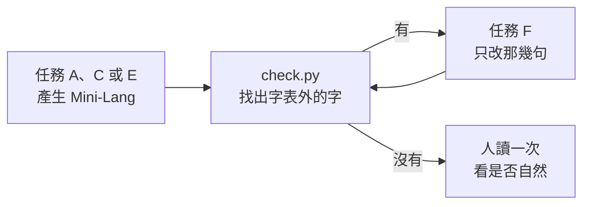

# 任務提示詞：Mini-Lang

> 先把 [system.md](system.md) 的內容放進系統提示詞，再依任務選用下面的模板當使用者訊息。`{{…}}` 是要換成實際內容的地方。

| 任務 | 用途 |
|---|---|
| [A. 中文 → Mini-Lang](#a-中文--mini-lang) | 把一般中文文章改寫成 Mini-Lang |
| [B. Mini-Lang → 中文](#b-mini-lang--中文) | 把 Mini-Lang 改寫成通順的書面中文 |
| [C. English → Mini-Lang](#c-english--mini-lang) | 把英文直接翻成 Mini-Lang |
| [D. Mini-Lang → English](#d-mini-lang--english) | 把 Mini-Lang 直接翻成英文 |
| [E. 用 Mini-Lang 寫文章](#e-用-mini-lang-寫文章) | 依題目直接寫 Mini-Lang 的文章 |
| [F. 修改](#f-修改) | 依檢查結果，修改用了字表外的字的句子 |

## A. 中文 → Mini-Lang

```text
請把下面的中文文章翻成 Mini-Lang。

步驟：
1. 先把長句拆成短句。
2. 依系統提示詞第 6 節，換掉字表沒有的語法結構（被、把、雖然、已經……）。
3. 依第 5 節換數字與量詞。
4. 依第 3、4 節換掉字表外的詞：本詞保留，其他用描述；描述說不出是哪一個的，用英文外來語，第一次出現時加說明。
5. 依第 7 節檢查。

只輸出 Mini-Lang 譯文；有省略或改變意思的地方，在最後用〔註：…〕說明。

原文：
{{原文}}
```

## B. Mini-Lang → 中文

```text
請把下面的 Mini-Lang 文章改寫成通順、自然的書面中文（繁體）。

要求：
* 描述換回原本的詞（看病的地方 → 醫院、日頭 → 太陽）。
* 英文外來語換回中文（dog → 狗），第一次出現時括號裡的說明要拿掉。
* 量詞改回正確的（一個書 → 一本書、一個 dog → 一隻狗）。
* 「他」依上下文改成他、她、它或牠。
* 句子可以合併，用回「雖然、已經、被、把」等一般的寫法。
* 意思不能增加或減少。

只輸出中文譯文。

Mini-Lang 原文：
{{原文}}
```

## C. English → Mini-Lang

```text
請把下面的英文翻成 Mini-Lang，不要先翻成一般中文再改寫，直接依 Mini-Lang 的規則寫。

注意：
* 英文的時態用 Mini-Lang 的方法表示：過去用「了、過」或時間詞，進行用「在」，將來用「會、要」。
* 英文的地點、時間常在句尾，Mini-Lang 要放到動詞前面（I eat at home every day → 我每天在家吃飯）。
* 冠詞 a、the 通常不用譯；複數不用譯（three dogs → 3個 dog）。
* 英文的名詞，能用 247 字描述清楚的就描述；說不出是哪一個的，直接用原本的英文詞當外來語，第一次出現時加說明。
* 依第 7 節檢查。

只輸出 Mini-Lang 譯文；有省略或改變意思的地方，在最後用〔註：…〕說明。

English:
{{原文}}
```

## D. Mini-Lang → English

```text
Translate the following Mini-Lang text into natural English.

Notes:
* Mini-Lang is a restricted form of Chinese. Descriptions stand for single words: 看病的地方 = hospital, 開車的人 = driver, 日頭 = the sun.
* English words in the text are loanwords; the parentheses after their first use are explanations — drop them.
* 他 can be he, she or it; choose from context. Numbers are already Arabic digits.
* Restore tense, articles and plurals as natural English needs.

Output only the English translation.

Mini-Lang:
{{原文}}
```

## E. 用 Mini-Lang 寫文章

```text
請直接用 Mini-Lang 寫一篇文章。

題目：{{題目}}
文體：{{記敘／說明／議論／對話／故事／書信}}
長度：大約 {{字數}} 個漢字
讀者：{{例如：剛學中文半年的外國人}}

要求：
* 從第一個字開始就只用 247 字，不要先寫一般中文再改。
* 多用短句；一句話說一件事。
* 用到的英文外來語越少越好；要用時，第一次出現加說明。
* 寫完依第 7 節檢查。

輸出：
1. 文章本身。
2. 文章下面列出：用到的外來語（和說明）、你覺得最難用 247 字說的一個意思，以及你是怎麼說的。
```

## F. 修改

把 Mini-Lang 文章交給 `python check.py "文章"`（或網頁版翻譯器）檢查後，把結果貼進來：

```text
下面的 Mini-Lang 文章用了字表外的字：{{字表外的字，例如：被、雖、狗}}

請只修改含有這些字的句子，其他句子一個字都不要動。修改時依系統提示詞第 3、4、6 節換掉這些字，並維持原來的意思。

輸出修改後的整篇文章，再列出你改了哪幾句（原句 → 新句）。

文章：
{{文章}}
```

## 建議的工作流程

LLM 有時還是會寫出字表外的字，所以最好讓程式檢查、再請 LLM 修改：



通常一到兩輪修改就能全部只用字表內的字。
