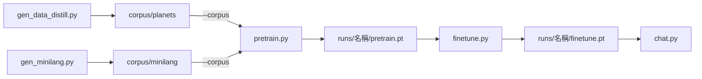

# mini-lm v5 -- 多語料

## 目錄結構

```
mini-lm/
├── model.py            Transformer（RMSNorm、RoPE、SwiGLU）
├── tokenizer.py        字元級 tokenizer + <PAD> <UNK> <EOS> <Q> <A>
├── data.py             讀語料、--corpus 參數、切驗證集
├── pretrain.py         預訓練
├── finetune.py         問答微調 + 評估
├── chat.py             問答（單題 / 互動 / --eval）
├── gen_data_distill.py 用大模型蒸餾語料 → corpus/planets/
├── gen_minilang.py     依 ../mini-lang/mini-lang.md 產生語料 → corpus/minilang/
├── corpus/             語料（納入版本控制）
│   ├── planets/        太陽系八大行星（大模型蒸餾）
│   └── minilang/       Mini-Lang 247 字基礎中文
└── runs/               訓練輸出（不納入版本控制）
    └── <語料名稱>/      vocab.json、pretrain.pt、finetune.pt
```

## 語料格式

一個語料就是一個目錄，裡面放下列檔案（都是 UTF-8，一行一筆，重複的行會自動去掉）：

| 檔案 | 內容 | 必要 |
|---|---|---|
| `pretrain.txt` | 每行一句話 | 預訓練需要 |
| `finetune.txt` | 每行一組 `<Q>問題<A>答案` | 微調需要 |
| `charset.txt` | 一定要放進詞表的字元（例如 Mini-Lang 的完整 247 字與數字 0–9） | 可選 |

要加入新的語料，只要建立一個新目錄並放入這些檔案即可，不必改程式。

## 執行



訓練單一語料：

```bash
./run.sh corpus/planets
```

```bash
PRETRAIN_ARGS="--max_iters 2000" FINETUNE_ARGS="--max_iters 500" ./run.sh corpus/minilang
```

合併多個語料（輸出到 `runs/planets+minilang/`）：

```bash
./run.sh corpus/planets corpus/minilang
```

個別指定檔案，或用 A 語料預訓練、B 語料微調：

```bash
python pretrain.py --pretrain my_text.txt --finetune my_qa.txt --out_dir runs/my
```

```bash
python finetune.py --corpus corpus/minilang --init runs/planets+minilang/pretrain.pt --out_dir runs/mix-ft
```

問答與評估：

```bash
python chat.py --ckpt runs/minilang/finetune.pt "小明幾歲？"
```

```bash
python chat.py --ckpt runs/minilang/finetune.pt --eval --corpus corpus/minilang
```

重新產生語料：

```bash
python gen_minilang.py --n_sentences 3000
```

```bash
python gen_data_distill.py --out_dir corpus/planets
```

### 主要參數

| 程式 | 參數 | 說明 |
|---|---|---|
| 全部 | `--corpus DIR...` | 語料目錄，可多個 |
| 全部 | `--pretrain FILE...` / `--finetune FILE...` | 額外加入個別檔案 |
| pretrain / finetune | `--out_dir` | 輸出目錄，預設 `runs/<語料名稱>` |
| pretrain / finetune | `--max_iters` `--lr` `--batch_size` | 訓練步數、學習率、批次 |
| pretrain | `--d_model` `--n_heads` `--n_layers` `--seq_len` | 模型大小 |
| finetune | `--init` | 預訓練 checkpoint，預設 `<out_dir>/pretrain.pt` |
| finetune / chat | `--holdout` `--seed` | 驗證集比例與種子（兩邊要一致） |
| chat | `--temperature` `--top_k` | 抽樣方式，預設 greedy |

## Mini-Lang 語料

`gen_minilang.py` 產生三種句子，並確認全部只用到 [mini-lang.md](../mini-lang/mini-lang.md) 的 256 字：

| 種類 | 數量 | 例子 |
|---|---:|---|
| 人物事實（16 人 × 7 項，每項兩種說法） | 224 | 小明今年二十二歲。小明住在南邊。 |
| 依語法規則產生的一般句子 | 1500 | 因為我弟弟生病了，所以他要去看醫生。 |
| mini-lang.md 中的例句與對話 | 78 | 你叫什麼名字？ |

微調只用人物問答（112 組）。驗證集裡的問題在微調時沒看過，但對應的事實在預訓練中出現過，所以可以測試模型能不能把預訓練學到的知識用在問答上。

## 結果（CPU）

| 語料 | 預訓練 / 微調步數 | 訓練集 | 驗證集 |
|---|---|---:|---:|
| planets | 500 / 300 | 40/40 (100%) | 0/10 (0%) |
| minilang | 2000 / 500 | 90/90 (100%) | 11/22 (50%) |
| planets + minilang | 300 / 200（只確認流程） | 130/130 (100%) | 7/32 (22%) |

* planets 的事實和問答說法差很多，而且只有 50 句，模型學不會轉換。
* minilang 每種問題有 16 個人可以練習同一種「事實 → 問答」的對應方式，驗證集達到 50%，明顯高於亂猜。答錯的大多是把別人的屬性張冠李戴，例如把小花的工作答成工人。
* minilang 預訓練 loss 停在約 0.68，因為一般句子是隨機組合的，本來就無法完全預測。
* 合併語料時，各語料依句子數量被抽樣，planets 只有 50 句，比重很小。
