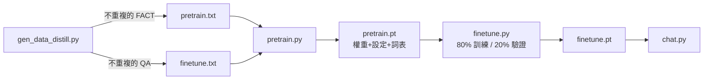

# mini-lm v4 -- run.sh

## 流程



| 檔案 | 說明 |
|---|---|
| `tokenizer.py` | 字元級 tokenizer，`<PAD> <UNK> <EOS> <Q> <A>` 各為單一 token |
| `data.py` | 讀檔去重、解析 `<Q>…<A>…`、固定種子切驗證集 |
| `model.py` | Transformer（RMSNorm、RoPE、SwiGLU），`generate` 支援 temperature / top-k / 遇 `<EOS>` 停止 |
| `pretrain.py` | 每句加 `<EOS>`，每個樣本重新打亂句子順序 |
| `finetune.py` | 只對「答案 + `<EOS>`」計算 loss，訓練後評估訓練集與驗證集 |
| `chat.py` | 單題、互動、`--eval` 三種模式 |

## 執行

```bash
./run.sh
```

```bash
python chat.py "火星的表面是什麼顏色？"
```

```bash
python chat.py --temperature 0.8 --top_k 5
```

```bash
python chat.py --eval
```

## 結果

```
Pretrain 資料: 50 句不重複的知識敘述
詞表大小: 210（含特殊 token），已儲存為 vocab.json
使用硬體: cpu | 參數量: 1.08M | 開始 Pre-training...
Pretrain Step    0 | Loss: 5.6330
Pretrain Step  499 | Loss: 0.2836
Finetune 資料: 50 組問答 → 訓練 40 / 驗證 10
Finetune Step    0 | Loss: 3.3794
Finetune Step  299 | Loss: 0.0035
📊 訓練集: 40/40 正確 (100%)
📊 驗證集（微調沒看過的問題）: 0/10 正確 (0%)
```

* 回答到 `<EOS>` 就停止，不會再自己編出下一題。
* 訓練集全對，但驗證集 0%：預訓練只看過 50 句敘述，模型學會的是「背答案的格式」，
  還不能把敘述句裡的知識轉成問答。要改善需要更多、更多樣的資料（例如同一事實用多種說法敘述）。
