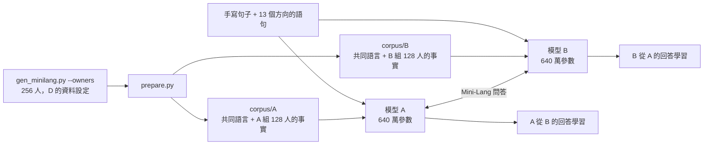

# mini-talk：兩個 Mini-Lang 模型的對話

讓兩個用 [Mini-Lang](../mini-lang/mini-lang.md) 訓練的小語言模型 A、B 互相問答，並從對方的回答中學到自己原本不知道的事。

## 設計

A、B 都用[最佳模型的設定 D](../doc/best-model.md#五推薦的設計)訓練：640 萬參數（d=256、6 層、8 頭），資料是加強的人物資料、手寫句子與 13 個方向的語句。



**知識不對稱。** 語料中有 256 個人，每個事實有 4 種說法，每人還有 2 段打亂順序的小傳。A 只在預訓練時看過其中 128 人的事實，B 只看過另外 128 人的。兩個模型學了相同的一般句子、手寫句子和方向語句，所以說的是同一種語言。

「小花是小明的朋友」這類句子同時提到兩個人，只比對人名分不出是誰的事實。所以 `gen_minilang.py --owners` 另外輸出每句話是關於誰，[prepare.py](prepare.py) 依此拆分。

**學會發問，也知道自己不知道。** 兩個模型都用全部 256 人的問題微調（每種問題 2 種問法）：自己知道的人回答事實，不知道的人回答「我不知道」。微調時加上 `--train_question`，讓問題部分也計算 loss，模型才能自己生成問題。

**交談規則（[talk.py](talk.py)）：**

1. 輪到發問的一方從 `<Q>` 開始抽樣，生成到 `<A>` 為止，得到一個問題。
2. 發問者先問自己：如果自己會回答（不是「我不知道」），或已經問過，就重新生成。也就是**只問自己不知道的事**。
3. 對方用 greedy 解碼回答。
4. 每句話都用 [check.py](../mini-lang/check.py) 檢查是否只用到字表內的字，答案也和 `corpus/truth.txt` 比對。
5. A、B 輪流發問，各問 `--rounds` 題。

**從對話中學習（`--learn`）。** 交談結束後，每個模型拿自己聽到的答案再微調 200 步。

* 為了避免忘記，訓練資料也混入原本的問答。
* 原本的問答（3,584 組）遠多於聽到的答案（約 50 個），所以聽到的答案會重複到約佔一半，否則每個答案只會被看到兩次左右，學不進去。
* 之後比較學習前後，對「對方那組人」能答對幾題，以及「自己那組人」有沒有忘記。

## 執行

完整流程（準備語料、同時訓練 A 與 B、交談並學習），8 核心 CPU 約 50 分鐘：

```bash
./run.sh --rounds 50
```

模型訓練好之後，只重新交談（約 5 分鐘）：

```bash
python talk.py --rounds 50 --temperature 0.7 --learn
```

| 參數 | 說明 |
|---|---|
| `--rounds` | 每人各問幾題（預設 20） |
| `--temperature` | 發問時的抽樣溫度（預設 0.7） |
| `--learn` | 交談後從聽到的答案學習，學習後的模型存在 `runs/A_learned/`、`runs/B_learned/` |
| `--out` | 對話紀錄，預設 `runs/talk.md` |
| 環境變數 `THREADS` | `run.sh` 中每個模型訓練用的執行緒數（預設 4） |

## 結果

> 下面的結果是用第 1 版字表（256 字、中文數字）訓練的模型得到的。目前的 `corpus/` 已經依第 2 版（247 字、阿拉伯數字）重新產生，重新執行 `./run.sh` 的數字可能會不同。

每人各問 50 題，發問溫度 0.7。

對話片段：

```
B：大花喜歡吃什麼？
A：肉　✅
A：天真的家裡有幾個孩子？
B：三個　✅
B：心真和誰是朋友？
A：花明　✅
A：白白今年幾歲？
B：我不知道
B：方心喜歡吃什麼？
A：菜　❌（正解: 飯）
```

### 交談

| 項目 | 結果 |
|---|---|
| 句子數 | 200 |
| 用了字表外的字 | 0 |
| 對方給出答案 | 95 次，正確 92 次（97%） |
| 問了不存在的人 | 5 次（「白白」「新新」「天天」「山山」），對方都回答「我不知道」 |

### 從對話中學習

| 模型 | 聽到的答案 | 對方那組人：學習前 | 學習後 | 自己那組人：學習前 → 後 |
|---|---:|---:|---:|---:|
| A | 46 | 0/1777 | 97/1777 | 1717 → 1744 / 1792 |
| B | 49 | 0/1792 | 71/1792 | 1792 → 1772 / 1792 |

學習後答對的題目，依和「聽過的問題」的關係分類：

| 題目 | A | B |
|---|---:|---:|
| 聽過的問題 | 46/46 (100%) | 45/49 (92%) |
| 同一個事實，換一種問法 | 18/42 (43%) | 24/45 (53%) |
| 聽過的人的其他事實 | 9/441 | 1/480 |
| 沒聽過的人 | 24/1248 | 1/1218 |

### 和先前版本（16 人、80 萬參數）比較

| 項目 | 先前版本 | 最佳模型 |
|---|---|---|
| 人物 | 16 人，每個事實 2 種說法 | 256 人，4 種說法 + 小傳 |
| 模型 | d=128、4 層，約 80 萬參數 | d=256、6 層，640 萬參數 |
| 回答正確 | 40/40 | 92/95 |
| 聽過的問題學會 | 20/20 | 91/95 |
| 換一種問法也答得出來 | 沒有測試（只有 1 種問法） | 約一半 |

### 觀察

* **只說 Mini-Lang。** 200 句話都只用 256 字表內的字。
* **知識多了 16 倍，回答仍然 97% 正確。** 3 個錯誤都是選錯同類的答案（茶／紅茶、菜／飯、紅南／紅天），句子本身是對的。
* **學到的不只是聽到的那句話。** 這是和先前版本最大的不同。聽到「小明幾歲？二十二歲」之後，約一半的情況下也答得出「小明今年幾歲？」。D 的預訓練讓模型把兩種問法連到同一個事實，所以從對話學到的是事實，而不只是一組「問題 → 答案」。
* **但不會推廣到同一個人的其他事實。** 聽過某人的年齡，不會因此知道他的家在哪裡，這是合理的，因為對話中沒有這個資訊。
* **自己的知識大致保留。** A 學習後自己那組人反而多答對 27 題，B 少了 20 題（1%）。混入原本的問答能防止大部分遺忘。
* **會問不存在的人。** 模型學到人名是「兩個名字用字」，就組出了「白白」「新新」這些不存在的人。對方回答「我不知道」是對的。不過它對一半的人都學過回答「我不知道」，所以這不代表它分得出「不存在」和「不知道」。

要更嚴格地檢驗「理解」，還需要問不存在的人、兩步推理等測試，詳見 [doc/understanding.md](../doc/understanding.md)。
