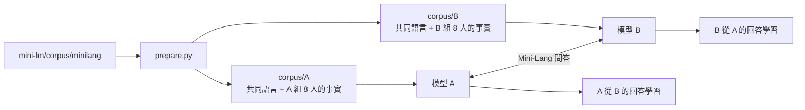

# mini-talk：兩個 Mini-Lang 模型的對話

讓兩個用 [Mini-Lang](../mini-lang/mini-lang.md) 訓練的小語言模型 A、B 互相問答，並從對方的回答中學到自己原本不知道的事。

## 設計



**知識不對稱。** Mini-Lang 語料中有 16 個人。A 只在預訓練時看過其中 8 人的事實，B 只看過另外 8 人的事實。兩個模型都學了相同的一般句子和文件例句，所以說的是同一種語言。

**學會發問，也知道自己不知道。** 兩個模型都用全部 16 人的問題微調：自己知道的人回答事實，不知道的人回答「我不知道」。微調時加上 `--train_question`，讓問題部分也計算 loss，模型才能自己生成問題。

**交談規則（[talk.py](talk.py)）：**

1. 輪到發問的一方從 `<Q>` 開始抽樣，生成到 `<A>` 為止，得到一個問題。
2. 發問者先問自己：如果自己會回答（不是「我不知道」），或已經問過，就重新生成。也就是**只問自己不知道的事**。
3. 對方用 greedy 解碼回答。
4. 每句話都用 [check.py](../mini-lang/check.py) 檢查是否只用到 256 字，答案也和 `corpus/truth.txt` 比對。
5. A、B 輪流發問，各問 `--rounds` 題。

**從對話中學習（`--learn`）。** 交談結束後，每個模型拿自己聽到的答案再微調。為了避免忘記原本會的東西，訓練資料也混入原本的問答。之後比較學習前後，對「對方那組人」的問題能答對幾題。

## 執行

完整流程（準備語料、訓練 A 與 B、交談並學習），CPU 約 8 分鐘：

```bash
./run.sh
```

模型訓練好之後，只重新交談：

```bash
python talk.py --rounds 30 --temperature 0.7 --learn
```

| 參數 | 說明 |
|---|---|
| `--rounds` | 每人各問幾題（預設 20） |
| `--temperature` | 發問時的抽樣溫度（預設 0.7） |
| `--learn` | 交談後從聽到的答案學習，學習後的模型存在 `runs/A_learned/`、`runs/B_learned/` |
| `--out` | 對話紀錄，預設 `runs/talk.md` |

## 結果

對話片段（溫度 0.7）：

```
A：小月幾歲？
B：六十二歲　✅
B：小天的家在哪裡？
A：東邊　✅
A：大文的朋友是誰？
B：小花　✅
B：小明的朋友是誰？
A：大心　✅
```

| 發問溫度 | 句子數 | 字表外 | 不通順的問題 | 回答正確 | A 學習後 | B 學習後 |
|---|---:|---:|---:|---:|---:|---:|
| 1.0 | 80 | 0 | 5 | 35/35 | 17/56 | 18/56 |
| 0.7 | 80 | 0 | 0 | 40/40 | 20/56 | 20/56 |
| 0.5 | 80 | 0 | 0 | 40/40 | 20/56 | 20/56 |

「學習後」是對方那組人 56 題中答對的題數，學習前兩邊都是 0/56。

### 觀察

* **只說 Mini-Lang。** 所有句子都只用到 256 字表內的字。
* **問答正確。** 問題通順時，對方的回答和 `truth.txt` 完全一致。
* **學到的就是聽到的。** A、B 聽過的題目學習後全部答對，但沒聽過的仍然答不出來。對話確實把資訊傳了過去，不過模型只記住「問題 → 答案」，沒有推廣到同一個人的其他事實。
* **溫度太高會產生不通順的問題，而且對方照樣回答。** 溫度 1.0 時出現過：

  ```
  B：小明的外在哪裡？
  A：南邊
  A：大天的家在覺幾個孩子？
  B：兩個
  ```

  模型對不通順的問題也照樣給出答案。這表示它是根據問題的局部特徵（人名、「哪裡」、「幾個孩子」）挑答案，而不是理解整句話。要更嚴格地檢驗「理解」，還需要換句話問、問不存在的人、兩步推理等測試。
