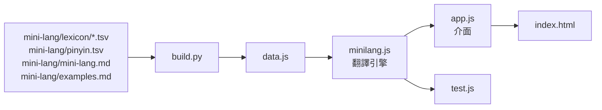

# Mini-Lang 翻譯器（網站）

純前端的網頁：把一般中文翻成 [Mini-Lang](../mini-lang/universal.md)（247 字），也能從 Mini-Lang 翻回一般中文；Mini-Lang 的文字可以在字的下面標注漢語拼音。

## 使用

直接用瀏覽器打開 `index.html` 就能用，不需要伺服器，也不會把文章送到任何地方。

要讓頁面上連到規格文件的連結也能用，可以在專案根目錄開一個靜態伺服器：

```bash
python3 -m http.server 8765
```

再打開 <http://localhost:8765/web/>。

## 功能

| 功能 | 說明 |
|---|---|
| 中文 → Mini-Lang | 數字換成阿拉伯數字、量詞換成「個」、查詞典換詞、英文外來語第一次出現時加說明 |
| Mini-Lang → 中文 | 把詞典登記的描述與外來語還原成一般中文的詞 |
| 標注拼音 | 用 HTML 的 `<ruby>` 把拼音放在字的下面；處理多音字（覺得、睡覺、長大）、輕聲（東西、朋友）與「一、不」的變調 |
| 標出要注意的地方 | 換掉的詞（滑鼠移上去看原文）、有幾種說法的詞、要依句子改寫的詞（雖然、已經…）、詞典沒有的字表外的字 |
| 範例 | 載入 [examples.md](../mini-lang/examples.md) 的 8 段範例 |
| 字表 | 依類別列出 247 字，附拼音 |

這是依規則的翻譯，不是語言模型：需要改寫句子結構的地方只會標出來並給建議，結果通常還要人讀一次、改通順。

## 檔案



| 檔案 | 內容 |
|---|---|
| `index.html`、`style.css`、`app.js` | 介面 |
| `minilang.js` | 翻譯引擎與拼音，網頁和測試共用 |
| `data.js` | 字表、詞典、讀音、範例，由 `build.py` 產生，不要手動修改 |
| `build.py` | 從 `mini-lang/` 產生 `data.js` |
| `test.js` | 引擎的測試 |

詞典、讀音或範例更新後：

```bash
python web/build.py
node web/test.js
```

讀音表在 [mini-lang/pinyin.tsv](../mini-lang/pinyin.tsv)：前面是 247 字的讀音，後面是多音字與輕聲的詞。拼音標錯時，在後面加上那個詞的讀音即可。
