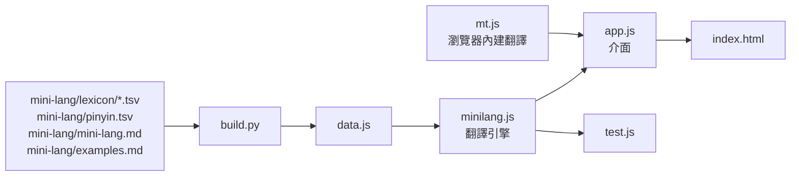

# Mini-Lang 翻譯器（網站）

這個資料夾有兩個網頁：

| 網頁 | 做什麼 | 需要 |
|---|---|---|
| [index.html](index.html) | 依規則的翻譯器：中文 ⇄ Mini-Lang（英文用瀏覽器內建翻譯），標注拼音 | 什麼都不用，直接打開 |
| [mini-lang-expert.html](mini-lang-expert.html) | Mini-Lang 專家：用 GLM 5.3 Flash 回答問題、翻譯、寫文章 | 本機伺服器與 `NVIDIA_API_KEY` |

## Mini-Lang 專家

```bash
export NVIDIA_API_KEY=...        # 已經設定過就不用
python web/expert_server.py
```

再打開 <http://localhost:8766/mini-lang-expert.html>。

* **為什麼要伺服器：** 網頁讀不到環境變數，金鑰也不能放進網頁（任何人打開都看得到）。[expert_server.py](expert_server.py) 從環境變數讀金鑰、代為呼叫 NVIDIA 的 API，金鑰只留在伺服器裡；伺服器只聽本機（127.0.0.1）。只用 Python 標準函式庫。
* **模型：** `z-ai/glm-5.3-flash`，reasoning effort 設為 low（回答一般在 5 到 15 秒）。
* **提示詞：** [system.md](../mini-lang/prompts/system.md) + [expert.md](../mini-lang/prompts/expert.md) + 整份詞典，每次對話都重新讀檔，改了提示詞或詞典不用重開伺服器。
* **Mini-Lang 的文字放在綠色框裡：** 網頁逐字檢查是否只用 297 字（字表外的字標紅）、可以標注拼音、外來語的說明滑鼠移上去才浮現。
* **模型自己用檢查工具：** 伺服器提供一個工具 `check_minilang`（和 check.py 相同）。模型寫好 Mini-Lang 後先呼叫它，工具回傳字表外的字、出現的位置，以及詞典的標準換法；模型只改那幾句、再檢查，直到通過才輸出（最多 5 次）。網頁會顯示每一次檢查的結果，檢查前的草稿收在「檢查前的草稿」裡。
* **網頁的第二道檢查：** 如果最後的綠色框裡還有字表外的字，網頁會再自動請模型只改那幾句（最多 2 次）。
* **對話紀錄** 存在瀏覽器裡（localStorage），按「新對話」清除。

實測（有檢查工具之後）：

| 原文 | 模型自己的檢查 | 結果 |
|---|---|---|
| 雖然她已經很累了，但還是把作業寫完才去睡覺。第二天早上，她發現窗外下雪了。 | ✗ 二、才、累、雪 → ✗ 才 → ✗ 然 → ✓ | 全部只用字表內的字，約 30 秒 |
| My grandmother lives in a small village near the mountains. Every morning she feeds her chickens and walks to the market. | ✗ 場、市、村、雞 → ✓ | 全部只用字表內的字，不需要網頁的第二道檢查 |

沒有檢查工具時，第一句第一次翻譯用了「累、把、業、二」4 個字表外的字，要靠網頁的自動修改。已知的小問題：模型有時說「外來語附上說明」，實際上卻沒有附（網頁上滑鼠移到外來語仍會顯示詞典的說明）。

---

以下是 index.html（規則翻譯器）的說明。

純前端的網頁：在一般中文、英文和 [Mini-Lang](../mini-lang/universal.md)（297 字）三種語言之間翻譯；Mini-Lang 的文字可以在字的下面標注漢語拼音。

## 使用

直接用瀏覽器打開 `index.html` 就能用，不需要伺服器，也不會把文章送到任何地方。

要讓頁面上連到規格文件的連結也能用，可以在專案根目錄開一個靜態伺服器：

```bash
python3 -m http.server 8765
```

再打開 <http://localhost:8765/web/>。

## 功能

| 功能 | 說明 |
|---|---|
| 三種語言互翻 | 選「從」和「翻成」的語言：中文、English、Mini-Lang，任兩種都能互翻 |
| 中文 → Mini-Lang | 依規則：數字換成阿拉伯數字、量詞換成「個」、查詞典換詞、英文外來語 |
| 外來語的說明 | 畫面上只顯示英文詞（例如 egg），滑鼠移上去或點一下才浮現說明與原文；按「複製」得到的文字，會依規則在第一次出現時附上說明 |
| Mini-Lang → 中文 | 依規則：把詞典登記的描述與外來語還原成一般中文的詞 |
| 英文 | 用瀏覽器內建的翻譯模型（Chrome 的 Translator API，桌面版 Chrome 138 以上）。英文和 Mini-Lang 之間經過中文：Mini-Lang → 中文 → English、English → 中文 → Mini-Lang |
| 標注拼音 | 用 HTML 的 `<ruby>` 把拼音放在字的下面；處理多音字（覺得、睡覺、長大）、輕聲（東西、朋友）與「一、不」的變調 |
| 標出要注意的地方 | 換掉的詞（滑鼠移上去看原文）、有幾種說法的詞、要依句子改寫的詞（雖然、已經…）、詞典沒有的字表外的字 |
| 範例 | 載入 [examples.md](../mini-lang/examples.md) 的 8 段範例 |
| 字表 | 依類別列出 297 字，附拼音 |

中文 ⇄ Mini-Lang 是依規則的翻譯，不是語言模型：需要改寫句子結構的地方只會標出來並給建議，結果通常還要人讀一次、改通順。

### 英文翻譯

* 第一次翻英文時，頁面會出現「下載翻譯模型」的按鈕；模型由瀏覽器下載、保存，之後在本機執行，文章不會送出去。
* 只有支援 Translator API 的瀏覽器能用（目前是桌面版 Chrome 138 以上）。其他瀏覽器會顯示「英文翻譯不能用」，中文 ⇄ Mini-Lang 不受影響。
* 經過中文中轉時，頁面下方會列出中間的中文，方便檢查是哪一段翻錯。

## 檔案



| 檔案 | 內容 |
|---|---|
| `index.html`、`style.css`、`app.js` | 介面 |
| `minilang.js` | 中文 ⇄ Mini-Lang 的翻譯引擎與拼音，網頁和測試共用 |
| `mt.js` | 英文翻譯：包裝瀏覽器內建的 Translator API |
| `data.js` | 字表、詞典、讀音、範例，由 `build.py` 產生，不要手動修改 |
| `build.py` | 從 `mini-lang/` 產生 `data.js` |
| `test.js` | 引擎的測試 |
| `mini-lang-expert.html` | Mini-Lang 專家的聊天頁面（共用 data.js、minilang.js 做字表檢查與拼音） |
| `expert_server.py` | 專家的本機伺服器：讀環境變數的金鑰、組提示詞、轉送 GLM 5.3 Flash 的串流 |

詞典、讀音或範例更新後：

```bash
python web/build.py
node web/test.js
```

讀音表在 [mini-lang/pinyin.tsv](../mini-lang/pinyin.tsv)：前面是 297 字的讀音，後面是多音字與輕聲的詞。拼音標錯時，在後面加上那個詞的讀音即可。
